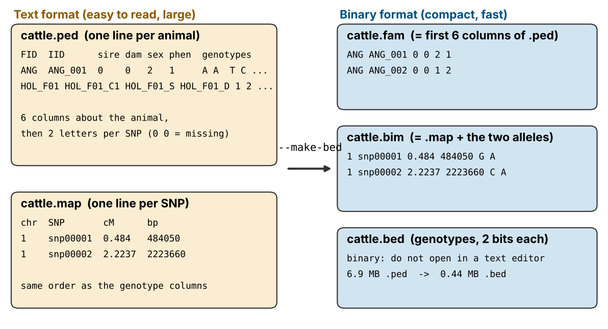

# Genotype files: what PLINK reads and writes {#sec-files}

::: {.lead}
Before running any analysis it pays to open the files and look at them. Most problems I have seen in student projects (wrong sex codes, swapped alleles, a phenotype of -9 read as a real value) are visible in the first few lines of a file.
:::

{#fig-formats}

## The text format: `.ped` and `.map`

The **`.ped`** file has one line per animal. The first six columns describe the animal, and then come two letters per SNP.

| Column | Name | Meaning | Codes |
|---|---|---|---|
| 1 | FID | Family ID | Any text; in livestock often the breed, herd or sire family |
| 2 | IID | Animal ID | Must be unique within its FID |
| 3 | PAT | Sire ID | `0` = unknown |
| 4 | MAT | Dam ID | `0` = unknown |
| 5 | SEX | Sex | `1` = male, `2` = female, `0` = unknown |
| 6 | PHENOTYPE | Trait value | `1` = control, `2` = case, `-9` or `0` = missing; any other number = quantitative |
| 7 onwards | genotypes | Two alleles per SNP | `A C G T` or `1 2`; `0 0` = missing |

Here are two lines from our practice file:

```text
ANG ANG_001 0 0 2 1 A A A A T T T C ...
HOL_F01 HOL_F01_C1 HOL_F01_S HOL_F01_D 1 2 A G ...
```

The first animal is an Angus cow (sex 2) with no recorded parents and phenotype 1 (healthy). The second is a Holstein bull calf whose sire and dam are both in the file, and phenotype 2 (sick).

The **`.map`** file has one line per SNP, in the same order as the genotype columns of the `.ped`:

| Column | Meaning |
|---|---|
| 1 | Chromosome |
| 2 | SNP name |
| 3 | Genetic distance (centimorgans; `0` if unknown, which is fine) |
| 4 | Base-pair position |

```text
1   snp00001   0.484    484050
1   snp00002   2.2237   2223660
```

## The binary format: `.bed`, `.bim` and `.fam`

Text files are huge (each genotype takes four characters: two letters and two spaces) and slow to read. PLINK's binary format stores each genotype in 2 bits, so our practice file shrank from 6.9 MB to 0.44 MB, and PLINK reads it many times faster. Convert first, and then always work with the binary files.

```bash
plink --file cattle --cow --make-bed --out cattle
```

- **`.fam`** is the first six columns of the `.ped`.
- **`.bim`** is the `.map` plus two extra columns: allele 1 (**A1**) and allele 2 (**A2**).
- **`.bed`** holds the genotypes. It is not text, so do not open it in an editor.

```text
cattle.bim:  1   snp00001   0.484    484050   G   A
             1   snp00002   2.2237   2223660  C   A
```

::: {.callout-warning}
## A1 is not "the reference allele"
PLINK 1.9 makes A1 the **minor** (rarer) allele by default. Every effect size PLINK reports (odds ratio, beta) is for A1. If you need A1 to be a fixed allele, for example the reference allele of the genome assembly, add `--keep-allele-order` or set it with `--a1-allele` (Chapter 5). PLINK 2.0 keeps the input order and calls the alleles REF and ALT.
:::

## Other formats you will meet

| Format | Files | Typical use |
|---|---|---|
| Transposed | `.tped` + `.tfam` | One SNP per line; some older programs |
| Long | `.lgen` + `.map` + `.fam` | One genotype per line; database exports |
| Additive | `.raw` from `--recode A` | 0/1/2 counts of A1 per animal; R, Python, genomic prediction |
| VCF | `.vcf` or `.vcf.gz` | Sequencing tools, imputation (BEAGLE), bcftools |
| PLINK 2.0 | `.pgen` + `.pvar` + `.psam` | Large data and dosages |

The additive `.raw` file is the one you will use most for your own models. Each genotype column counts copies of the allele named in the header:

```text
FID IID PAT MAT SEX PHENOTYPE snp00001_G snp00002_C snp00003_A snp00004_T
ANG ANG_001 0 0 2 1 0 0 0 1
```

So `snp00004_T = 1` means ANG_001 carries one T at that SNP. Missing genotypes appear as `NA`.

## Extra files: phenotypes, covariates and clusters

Real projects keep traits and covariates in separate files. All of them start with FID and IID:

```text
pheno.txt     FID IID WWT BW YWT BRD
              ANG ANG_001 265.0 38.8 523.1 1
covar.txt     FID IID SEX_M FEEDLOT AGE HERD_N
              ANG ANG_001 0 0 215 1
breed.clst    ANG ANG_001 ANG          (cluster file: no header, third column = group)
```

You point PLINK to them with `--pheno`, `--covar` and `--within`. Missing values are `-9` everywhere unless you change the code with `--missing-phenotype`.

::: {.callout-tip}
## Look before you analyse
`head cattle.fam` and `head cattle.bim` take two seconds. Check that sexes are 1 and 2 (not M and F), that phenotypes look sensible, and that chromosome codes are numbers your species flag accepts.
:::
