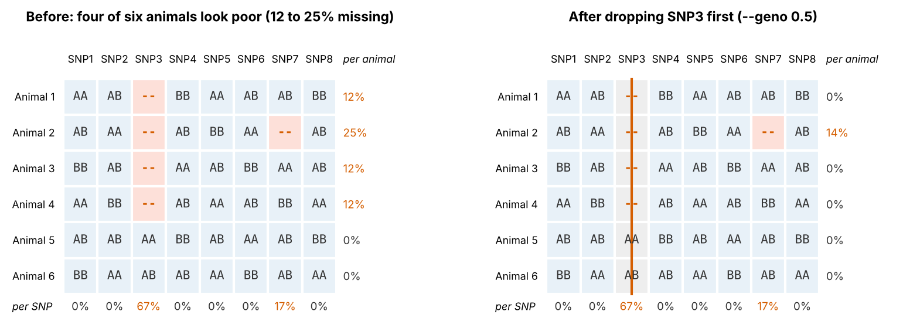
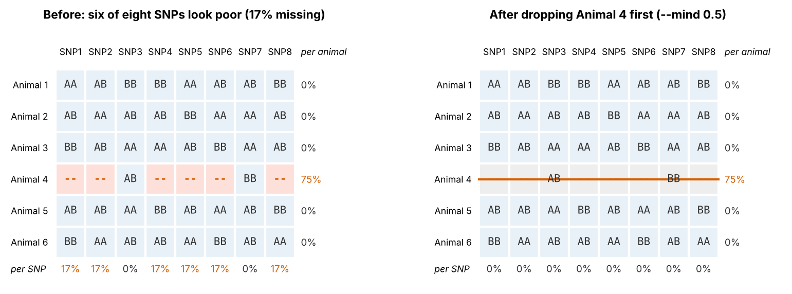
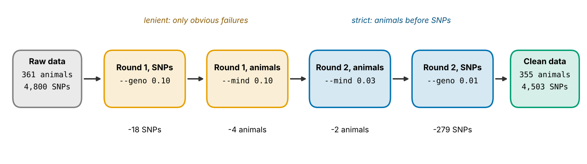
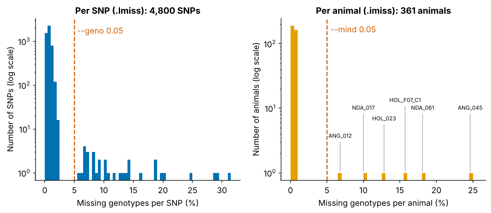
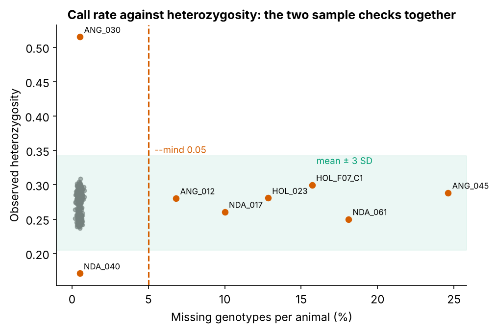

# Missing genotypes: per SNP and per animal {#sec-missing}

::: {.lead}
A missing genotype is a cell in the big animal-by-SNP table that the lab could not read. A few are normal. Many in one row means a bad DNA sample; many in one column means a bad SNP. Telling those two apart, and removing them in a sensible order, is the first real QC step.
:::

## Why genotypes go missing

A SNP chip measures two light signals per SNP. When the signals are clear, the calling software assigns AA, AB or BB. When they are weak or fall between the clusters, it gives up and writes `0 0`. This happens for two quite different reasons.

- **The animal's DNA is poor** (degraded, too little, contaminated). Then *many SNPs fail in that one animal*.
- **The SNP's probe works badly** (it sits near another variant, or in a repeated region). Then *that one SNP fails in many animals*.

So we measure missingness in two directions:

$$
\text{missing rate of an animal} = \frac{\text{SNPs with no genotype in that animal}}{\text{all SNPs}}
\qquad
\text{missing rate of a SNP} = \frac{\text{animals with no genotype at that SNP}}{\text{all animals}}
$$

The **call rate** is just one minus the missing rate: an animal with 2% missing has a 98% call rate.

## The logic, with a toy example

The two directions are tangled: every missing cell counts against one animal *and* one SNP. That is why the order of filtering matters. Here is a small table of six animals and eight SNPs. Genotypes are written the way Illumina reports them: AA, AB or BB, with `--` for a call that failed.

{#fig-toy-snp}

In case 1, the probe for SNP3 failed in four of the six animals (67% missing). That single SNP pushes Animals 1, 3 and 4 to 12% missing and Animal 2 to 25%. If we filtered animals first with, say, a 10% cut-off, we would discard four animals because of one bad probe. Drop SNP3 first and three of them are perfect; Animal 2 keeps one genuine gap (1 of 7 SNPs, 14%).

Now the opposite situation:

{#fig-toy-animal}

In case 2, Animal 4's sample failed at six of eight SNPs (75%). In a table of only six animals, that one sample makes six SNPs look 17% missing. Filter SNPs first and we lose six good SNPs; drop the animal first and every SNP is back to 0%.

The rule behind both cases: **a bad SNP inflates every animal's rate, and a bad animal inflates every SNP's rate.** How much depends on the size of the table. On a chip with 50,000 SNPs, one failed SNP adds only 0.002% to each animal. In a study of a few hundred animals, one failed sample adds a visible amount to every SNP. So in livestock studies, which usually have far more SNPs than animals, bad animals are the bigger threat to SNP call rates.

A practical plan follows from this. First remove only the disasters, with a lenient cut-off in both directions. Then apply the strict cut-offs, **animals before SNPs**, so that a few bad samples cannot drag good SNPs over the line.

{#fig-miss-flow}

Each box is one PLINK command, and each command reads the file the previous one wrote:

```bash
plink --bfile cattle --cow --geno 0.10 --make-bed --out qc1   # round 1, SNPs
plink --bfile qc1    --cow --mind 0.10 --make-bed --out qc2   # round 1, animals
plink --bfile qc2    --cow --mind 0.03 --make-bed --out qc3   # round 2, animals
plink --bfile qc3    --cow --geno 0.01 --make-bed --out qc4   # round 2, SNPs
```

Step 3 below shows what each command printed and why the order matters.

## Step 1: measure missingness

```bash
plink --bfile cattle --cow --missing --out miss
```

This writes two files.

`miss.imiss`, one line per animal:

| FID | IID | MISS_PHENO | N_MISS | N_GENO | F_MISS |
|---|---|---|---|---|---|
| ANG | ANG_001 | N | 34 | 4800 | 0.007083 |
| ANG | ANG_045 | N | 1182 | 4800 | 0.2462 |

`miss.lmiss`, one line per SNP:

| CHR | SNP | N_MISS | N_GENO | F_MISS |
|---|---|---|---|---|
| 1 | snp00001 | 0 | 361 | 0 |

`N_MISS` is the count of missing genotypes, `N_GENO` the number possible, and `F_MISS` their ratio. `MISS_PHENO` says whether the animal's phenotype is missing (Y or N).

## Step 2: look at the distribution before choosing a threshold

{#fig-miss-hist}

The animal plot shows exactly what you hope to see: a big group below 1%, then nothing, then six animals between 6.8% and 24.6%. Those six are the planted poor-DNA samples. Any threshold in the empty gap (1% to 6%) gives the same answer. **Choose your threshold by looking for the gap in your own data**, not only by copying a number from a paper.

| Missing rate above | SNPs flagged (out of 4,800) | of which truly bad (25 planted) | Animals flagged (out of 361) |
|---|---|---|---|
| 1% | 967 | 25 | 6 |
| 2% | 49 | 25 | 6 |
| 5% | 33 | 25 | 6 |
| 10% | 18 | 18 | 4 |
| 20% | 5 | 5 | 1 |

At 1%, `--geno` would remove 967 SNPs, 942 of them good. At 5%, it removes 33 and catches all 25 bad ones.

## Step 3: filter, and see how the order changes the result

We compared three strategies with the same strict cut-offs: 3% for animals and 1% for SNPs.

| Strategy | Animals removed | SNPs removed | SNPs left |
|---|---|---|---|
| SNPs first (`--geno 0.01`, then `--mind 0.03`) | 6 | 967 | 3,833 |
| Animals first (`--mind 0.03`, then `--geno 0.01`) | 6 | 297 | 4,503 |
| Two rounds (flowchart above) | 6 | 297 | 4,503 |

Our data look like case 2 (a few very poor samples), so removing the animals first saved 670 SNPs. Both orders removed the same six animals and caught all 25 truly bad SNPs; the difference is entirely good SNPs lost. We also tried the two-round plan with the strict round done SNPs first: it kept 4,399 SNPs, because two moderately poor animals (6.8% and 10.0% missing) slipped through the lenient 10% round and still dragged SNPs over 1%. That is why the strict round handles animals first. With a milder 3% cut-off for both, all orders gave the same result here (6 animals and 33 SNPs removed).

The commands for the two-round plan:

```bash
plink --bfile cattle --cow --geno 0.10 --make-bed --out qc1
plink --bfile qc1    --cow --mind 0.10 --make-bed --out qc2
plink --bfile qc2    --cow --mind 0.03 --make-bed --out qc3
plink --bfile qc3    --cow --geno 0.01 --make-bed --out qc4
```

```text
qc1: 18 variants removed due to missing genotype data (--geno).
qc2: 4 cattle removed due to missing genotype data (--mind).
qc3: 2 cattle removed due to missing genotype data (--mind).
qc4: 279 variants removed due to missing genotype data (--geno).
     4503 variants and 355 cattle pass filters and QC.
```

::: {.callout-warning}
## Order inside one command
If you put `--geno` and `--mind` in the same command, PLINK 1.9 always applies `--mind` first, whatever order you type them in. That suits data like ours (case 2) but not case 1. When the order matters, use separate commands, as above.
:::

## Step 4: check that missingness is random

Missing data are only harmless if they are missing at random. If a SNP fails more often in sick animals, for example because their samples were collected or stored differently, the missing genotypes alone can create a false association. `--test-missing` compares the missing rate in cases and controls for every SNP:

```bash
plink --bfile cattle --cow --allow-no-sex --test-missing --out tmiss
```

| SNP | Missing in cases | Missing in controls | P |
|---|---|---|---|
| snp02661 | 16.0% | 0.5% | 3.3 × 10⁻⁹ |
| snp03771 | 16.7% | 1.4% | 6.3 × 10⁻⁸ |
| snp01782 | 16.0% | 1.4% | 1.6 × 10⁻⁷ |
| ... (5 more) | | | down to 4.9 × 10⁻⁵ |
| next SNP | 39.6% | 25.4% | 5.2 × 10⁻³ |

The top eight are exactly the eight SNPs I planted with case-dependent failure. A common rule is to remove SNPs with p below 10⁻⁴ or 10⁻⁵. A related test, `--test-mishap`, asks whether missingness at a SNP depends on the haplotype of its neighbours, which can reveal a deletion or a probe that fails on one haplotype.

## Step 5: plot missingness against heterozygosity

The best single sample-QC picture puts each animal's missing rate on one axis and its heterozygosity (Chapter 8) on the other.

{#fig-miss-het}

Six animals are too far right (poor DNA), ANG_030 is far too heterozygous for its call rate (contaminated DNA), and NDA_040 is unusually homozygous (inbred). One picture, three different problems.

## Typical thresholds

| Data | `--geno` | `--mind` |
|---|---|---|
| Commercial 50K or HD SNP chip, good lab | 0.02 to 0.05 | 0.05 to 0.1 |
| Older chips, mixed labs, or field samples (hair, ear tissue) | 0.05 to 0.1 | 0.1 |
| After merging two chips | rerun `--geno` on the merged file; drop SNPs typed by only one chip | |

::: {.callout-note}
## PLINK 2.0
`plink2 --bfile cattle --cow --missing` writes `.smiss` (samples) and `.vmiss` (variants). `--geno` and `--mind` work as in 1.9.
:::

## Exercises

Try each question first, then open the answer. The challenge goes a step further than the chapter.

**1.** From `miss.lmiss` and `miss.imiss`, count the SNPs with more than 2% missing calls and the animals with more than 5% and more than 10%.

::: {.callout-note collapse="true" title="Answer"}
```bash
awk 'NR > 1 && $5 > 0.02' miss.lmiss | wc -l    # 49 SNPs
awk 'NR > 1 && $6 > 0.05' miss.imiss | wc -l    # 6 animals
awk 'NR > 1 && $6 > 0.10' miss.imiss | wc -l    # 4 animals
```
:::

**Challenge.** Run the two filters in two steps, first `--mind 0.05` then `--geno 0.05`, and then in the opposite order. Do you lose the same animals and SNPs? When could the order make a difference?

::: {.callout-note collapse="true" title="Answer"}
Both orders end with 4,767 SNPs and 355 animals: 6 animals and 33 SNPs are removed either way. Here the bad animals and the bad SNPs are clearly separate, so the order does not matter. It matters when a few very poor samples push many SNPs over the `--geno` limit: removing those samples first saves the SNPs. That is why the two-round approach removes the worst animals first.
:::
