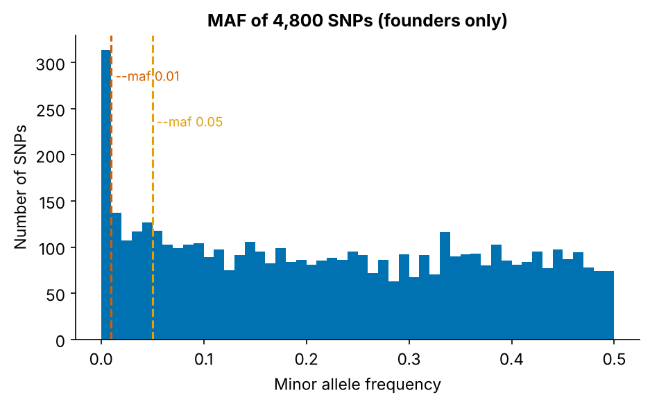
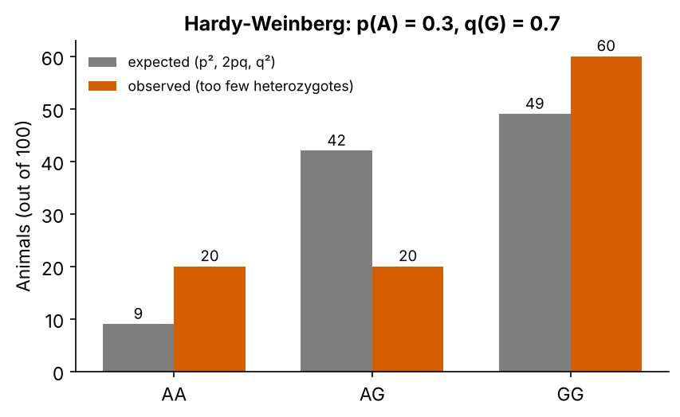
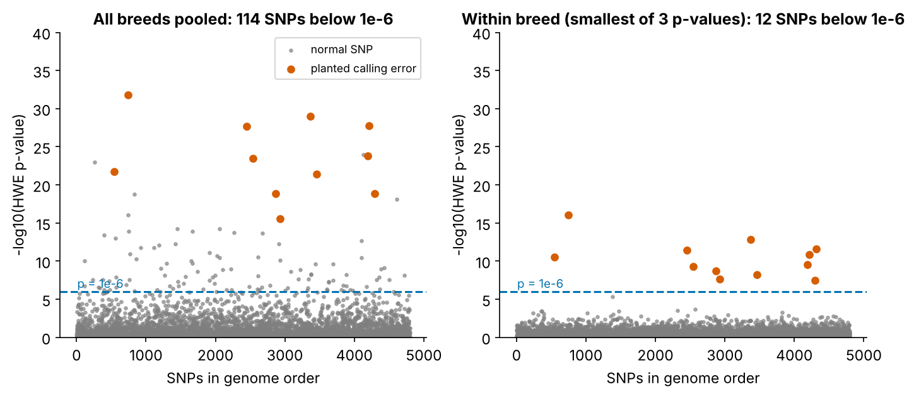

# Allele frequency and Hardy-Weinberg equilibrium {#sec-maf-hwe}

::: {.lead}
After missingness, the next two SNP checks ask simple questions. Is this SNP variable enough to be useful? And do its genotype counts look the way genetics says they should?
:::

## Allele frequency and MAF

At every SNP each animal carries two copies, so 100 animals carry 200 allele copies. The **allele frequency** is the share of those copies that carry a given allele. The rarer of the two alleles is the **minor allele**, and its frequency is the **minor allele frequency (MAF)**.

A worked example. Eight animals have these genotypes at one SNP: CT, TT, CC, TT, TT, CT, TT, TT.

| Genotype | Animals | C copies | T copies |
|---|---|---|---|
| CC | 1 | 2 | 0 |
| CT | 2 | 2 | 2 |
| TT | 5 | 0 | 10 |
| **Total (16 copies)** | **8** | **4** | **12** |

So p(C) = 4/16 = 0.25 and p(T) = 12/16 = 0.75. C is the minor allele, and MAF = 0.25. A SNP with MAF = 0 is **monomorphic**: every animal has the same genotype, so it tells us nothing about differences between animals.

### Step 1: compute frequencies

```bash
plink --bfile cattle --cow --freq --out freq
```

```text
 CHR        SNP   A1   A2          MAF  NCHROBS
   1   snp00001    G    A      0.02492      602
```

NCHROBS (chromosomes observed) is 602, not 2 × 361 = 722, because PLINK counts **founders only** by default. A calf's alleles are copies of its parents' alleles, so counting calves would count some alleles twice. Add `--nonfounders` to count everyone.

| Command | Output | Extra information |
|---|---|---|
| `--freq` | `.frq` | MAF and number of allele copies |
| `--freq counts` | `.frq.counts` | Allele counts instead of frequencies |
| `--freqx` | `.frqx` | Genotype counts (hom A1, het, hom A2, haploid, missing) |
| `--freq --within breed.clst` | `.frq.strat` | One line per SNP per breed |

The per-breed version is very informative in livestock:

```text
 CHR        SNP     CLST   A1   A2      MAF    MAC  NCHROBS
   1   snp00001      ANG    G    A   0.0125      2      160
   1   snp00001      HOL    G    A        0      0      222
   1   snp00001      NDA    G    A  0.05909     13      220
```

The G allele is absent in Holstein but present in 6% of N'Dama chromosomes. A SNP can be rare overall and common in one breed.

### Step 2: look at the distribution and choose a threshold

{#fig-maf}

Why remove rare SNPs at all? With MAF 0.01 and 300 animals there are only about 6 copies of the minor allele, so any test on that SNP rests on a handful of animals. Rare SNPs give unstable estimates (you will see an odds ratio of infinity in Chapter 12) and some analyses, such as PCA, break completely on monomorphic SNPs (Chapter 17).

| Analysis | Typical `--maf` |
|---|---|
| Association study | 0.01 to 0.05 |
| PCA, relatedness, admixture | 0.05 |
| Runs of homozygosity, selection signatures | Often no MAF filter, or filter within breed |

## Hardy-Weinberg equilibrium (HWE)

If animals mate at random and nothing else disturbs a SNP, genotype frequencies follow a fixed rule from the allele frequencies p and q = 1 - p:

$$
P(AA) = p^2, \qquad P(AG) = 2pq, \qquad P(GG) = q^2
$$

Take a SNP where p(A) = 0.3 and q(G) = 0.7. The expected shares are 0.3² = 0.09, 2 × 0.3 × 0.7 = 0.42 and 0.7² = 0.49, so in 100 animals we expect 9 AA, 42 AG and 49 GG.

{#fig-hwe-example}

The observed counts in the figure (20, 20, 60) give exactly the same allele frequency (A = (2 × 20 + 20) / 200 = 0.3), but only half the expected heterozygotes and more than twice the expected AA animals. A classic cause is a genotype-calling error in which the calling software misses heterozygotes. PLINK tests the departure with an **exact test**, which works well even for rare SNPs. A small p-value means the genotype counts are unlikely under HWE.

But genotyping errors are not the only cause of departure from HWE. Selection, inbreeding, a deletion on the SNP, and above all **mixing populations** also do it. That last one is the important trap in livestock.

### Step 3: run the test

```bash
plink --bfile cattle --cow --hardy --out hwe
```

```text
 CHR        SNP     TEST   A1   A2                 GENO   O(HET)   E(HET)            P
   1   snp00001      ALL    G    A             0/15/286  0.04983  0.04859            1
   1   snp00001      AFF    G    A              0/3/116  0.02521  0.02489            1
   1   snp00001    UNAFF    G    A             0/12/168  0.06667  0.06444            1
```

Each SNP gets three lines: all animals (ALL), cases (AFF) and controls (UNAFF). GENO is the count of hom A1 / het / hom A2; O(HET) and E(HET) are observed and expected heterozygosity. Why three lines? A SNP that really causes a disease can be out of HWE in cases for a genuine biological reason. That is why the `--hwe` filter in PLINK 1.9 uses **controls only** when a case/control phenotype is present.

### Step 4: watch out for the Wahlund effect

When you pool breeds that have different allele frequencies, you always see fewer heterozygotes than expected, even if each breed is perfectly in HWE. This is called the **Wahlund effect**. Picture one breed where nearly all animals are AA and another where nearly all are GG. Pool them and the "population" has an allele frequency near 0.5, so HWE expects about half the animals to be AG, but almost none are.

{#fig-hwe-wahlund}

| HWE threshold | SNPs failing, breeds pooled | of which planted errors | SNPs failing in any breed, tested separately | of which planted errors |
|---|---|---|---|---|
| 10⁻⁴ | 264 | 12 | 13 | 12 |
| 10⁻⁶ | 114 | 12 | 12 | 12 |
| 10⁻¹⁰ | 40 | 12 | 6 | 6 |

Pooled at 10⁻⁶, the filter would have thrown away 102 perfectly good SNPs. Within breed, it found exactly the 12 bad ones. So in multi-breed data, run the test in each breed and remove a SNP if it fails in any of them:

```bash
for b in ANG HOL NDA; do
  awk -v b=$b '$3==b {print $1, $2}' breed.clst > keep_$b.txt
  plink --bfile cattle --cow --keep keep_$b.txt --hardy --out hwe_$b
done
awk '$3=="ALL" && $9 < 1e-6 {print $2}' hwe_ANG.hwe hwe_HOL.hwe hwe_NDA.hwe | sort -u > hwe_fail.txt
plink --bfile cattle --cow --exclude hwe_fail.txt --make-bed --out cattle_hwe
```

### Step 5: choose a threshold

The p-value threshold works in the opposite direction from MAF: **a smaller number is gentler.** `--hwe 0.001` removes more SNPs than `--hwe 1e-10`. In livestock association studies, 10⁻⁶ applied within breed is a common choice. For selection-signature work be careful, because strong selection can itself push a SNP out of HWE, and that is exactly what you are looking for.

| Option | What it does |
|---|---|
| `--hwe 1e-6` | Remove SNPs with HWE p < 10⁻⁶ (controls only when case/control) |
| `--hwe 1e-6 include-nonctrl` | Use all animals |
| `--hwe 1e-6 midp` | Mid-p version of the exact test, slightly less conservative |
| `--hardy midp` | Report mid-p values |

::: {.callout-note}
## PLINK 2.0
`plink2 --freq` writes `.afreq`, `--geno-counts` replaces `--freqx`, and `--hardy` writes `.hardy` (autosomes) and `.hardy.x`. The filters `--maf` and `--hwe` work as in 1.9.
:::
