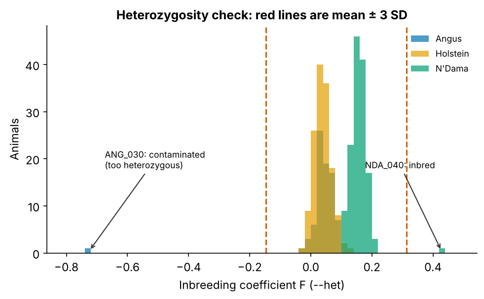
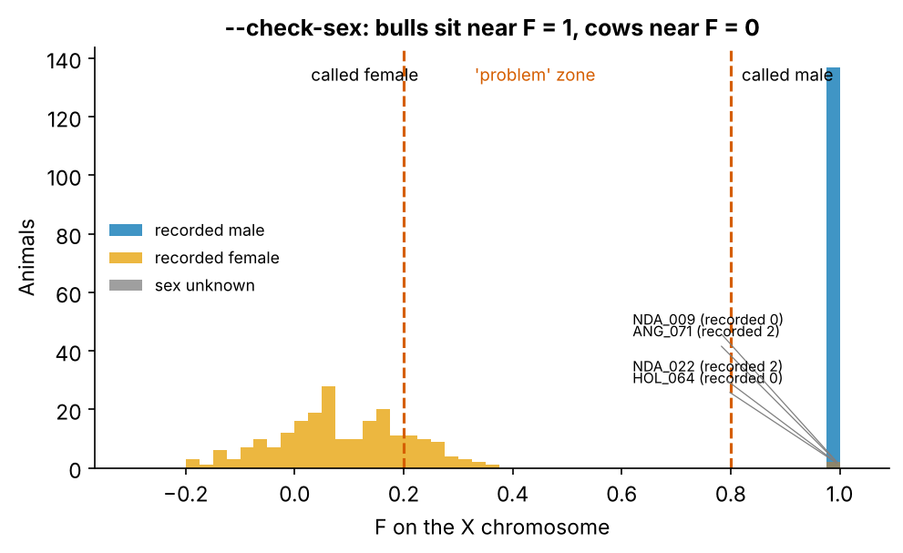

# Sample checks: sex, pedigree and heterozygosity {#sec-samples}

::: {.lead}
Missingness tells you whether a sample was genotyped well. These three checks tell you whether it is the animal you think it is: the right sex, the right parents, and one animal rather than a mixture of two.
:::

## Heterozygosity and inbreeding

Every animal has an expected number of homozygous genotypes, given the allele frequencies in the population. PLINK compares observed and expected homozygosity with the **inbreeding coefficient F**:

$$
F = \frac{O(\text{HOM}) - E(\text{HOM})}{N - E(\text{HOM})}
$$

where O(HOM) is the observed number of homozygous SNPs, E(HOM) the expected number and N the number of SNPs with a genotype.

| F | Meaning |
|---|---|
| Near 0 | Normal |
| Clearly positive | Too many homozygotes: the parents were related (inbreeding) |
| Clearly negative | Too many heterozygotes: almost always **contaminated DNA** (two animals mixed), occasionally a cross between very different breeds |

### Step 1: prune SNPs in LD, then run `--het`

Neighbouring SNPs in strong LD carry the same information, so one region would be counted many times. Prune first (Chapter 9 explains how):

```bash
plink --bfile cattle --cow --autosome --indep-pairwise 50 5 0.2 --out prune
plink --bfile cattle --cow --extract prune.prune.in --het --out het
```

```text
      FID          IID       O(HOM)       E(HOM)        N(NM)            F
      ANG      ANG_030         1727         2497         3561      -0.7243
      HOL      HOL_077         2459         2496         3559      -0.0346
      NDA      NDA_040         2953         2498         3562       0.4274
```

{#fig-het}

- **ANG_030, F = -0.72**: far too heterozygous. This is the planted contaminated sample: wherever the two mixed animals differ, the machine sees both alleles and calls a heterozygote.
- **NDA_040, F = 0.43**: highly inbred. This is the planted inbred animal.
- The N'Dama as a group sit to the right (mean F = 0.16 against 0.04 for the other breeds). F is measured against *pooled* frequencies here, so the most distinct breed looks inbred. Compute F within breed when you want to compare animals fairly.

The usual rule is to remove animals more than 3 standard deviations from the mean. `--ibc` gives three alternative estimators (Fhat1, Fhat2, Fhat3); Fhat3, the correlation between uniting gametes, is popular in livestock genomics. Chapter 10 adds a third measure, F_ROH, from runs of homozygosity.

## Sex check from the X chromosome

A bull has one X chromosome, so all his X SNPs look homozygous: F on the X is near 1. A cow has two X chromosomes and is often heterozygous: F near 0. PLINK compares this with the recorded sex.

```bash
plink --bfile cattle --cow --check-sex --out sexcheck
```

```text
--check-sex: 246 Xchr and 0 Ychr variant(s) scanned, 44 problems detected.
      FID          IID       PEDSEX       SNPSEX       STATUS            F
      ANG      ANG_071            2            1      PROBLEM            1
      NDA      NDA_022            2            1      PROBLEM            1
      HOL      HOL_064            0            1      PROBLEM            1
      NDA      NDA_009            0            1      PROBLEM            1
      ANG      ANG_001            2            0      PROBLEM       0.2541
```

{#fig-sex}

- **ANG_071 and NDA_022** are recorded as cows (2) but have F = 1. They are bulls: real sex errors.
- **HOL_064 and NDA_009** had no recorded sex (0). Genetically they are bulls.
- The other 40 "problems" are cows with F between 0.2 and 0.5. They are not errors. As with the Wahlund effect, mixing breeds inflates F. Run `--check-sex` within each breed and the 44 problems fall to 11, still including the four real ones.

Useful options: `--check-sex 0.3 0.7` changes the female and male thresholds, and `--impute-sex` writes the genotype-based sex into a new `.fam` (here it set 321 of 361 sexes and left 40 as unknown, so never apply it blindly). Livestock chips usually carry some Y-chromosome SNPs; when they are present, `--check-sex ycount` uses them too and separates the sexes much better.

## Mendel errors: checking the pedigree

A calf gets one allele from its sire and one from its dam. If both parents are AA, the calf must be AA. A calf that is AG breaks Mendel's law; this is a **Mendel error**. Many errors in one family point to a wrong parent. Many errors at one SNP point to a bad SNP.

```bash
plink --bfile cattle --cow --mendel --out mendel
```

```text
--me/--mendel: 877 Mendel errors detected.
```

| File | One line per | What we found |
|---|---|---|
| `mendel.mendel` | error | `HOL_F03 HOL_F03_C2 1 snp00028 1 G/G x G/G -> G/A` |
| `mendel.fmendel` | family | HOL_F03: 536 errors; next worst family: 20 |
| `mendel.imendel` | animal | HOL_F03_S 535, HOL_F03_C2 534, HOL_F03_D 268 |
| `mendel.lmendel` | SNP | worst SNP: 26 errors |

Read the family line like a detective. The calf HOL_F03_C2 and its recorded sire share 534 errors, while the dam has only half as many. Most errors involve the sire, so **the recorded sire is wrong**. Chapter 10 identifies the real sire.

After removing that calf, 343 errors remained, and the SNPs with the most errors (26, 23, 22 ...) were all SNPs with heterozygote-calling errors from Chapter 7. Two independent checks pointing at the same SNPs is reassuring.

The `CODE` column tells you the error type. Code 1 means both parents are homozygous for the same allele but the calf is heterozygous; codes 3 to 6 mean the calf is homozygous for an allele that one parent does not carry, which points at that parent.

To act on the errors:

```bash
# remove families with > 5% errors and SNPs with > 10% errors
plink --bfile cattle --cow --me 0.05 0.1 --make-bed --out me_filtered
# or keep everything but set the offending genotypes to missing
plink --bfile cattle --cow --set-me-missing --make-bed --out me_missing
```

`--me 0.05 0.1` removed the three animals of family HOL_F03 and exactly the 12 SNPs with calling errors. Note that it drops the whole nuclear family; if you only want to drop the wrong calf, use `--remove`. PLINK only checks the trios written in the `.fam`, so a pedigree you have not entered is never checked.

::: {.callout-note}
## PLINK 2.0
`--het`, `--check-sex` (with `max-female-xf=` and `min-male-xf=`), `--impute-sex` and `--mendel` all exist. `--mendel-duos` also checks sire-calf and dam-calf pairs when the other parent is missing, which is common in livestock.
:::
