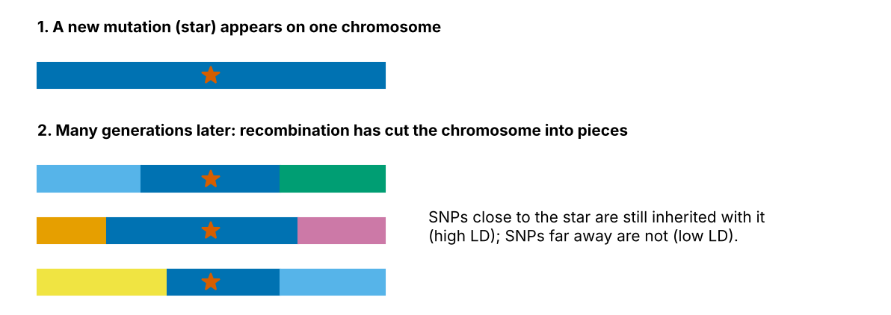
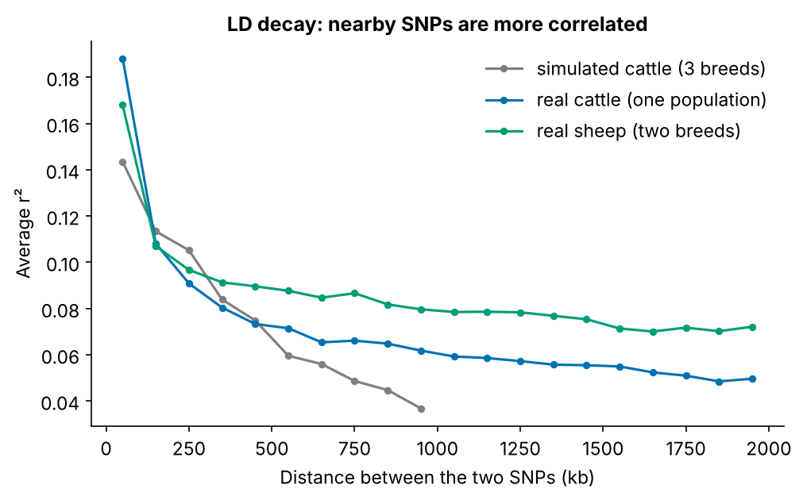
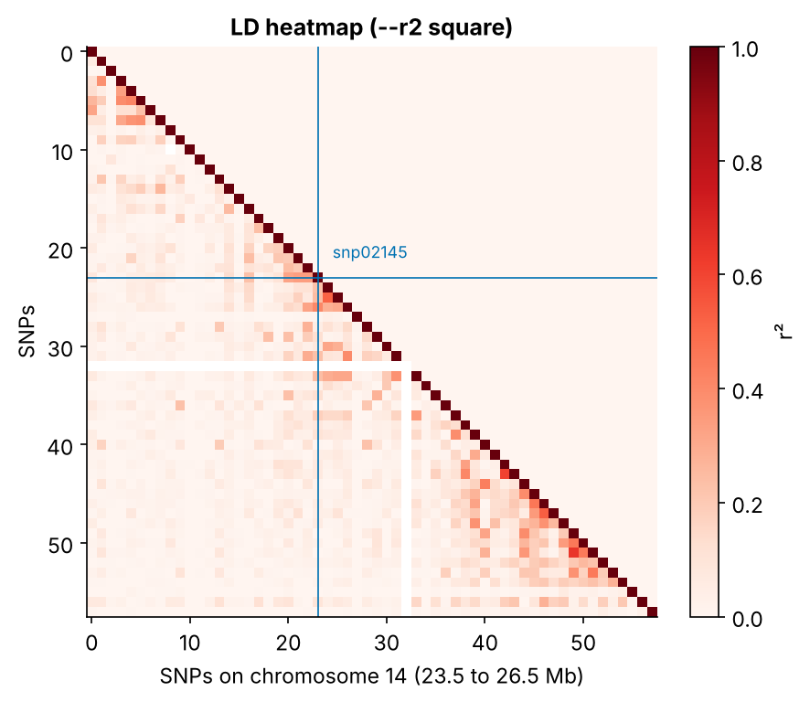

# Linkage disequilibrium {#sec-ld}

::: {.lead}
SNPs that sit close together on a chromosome tend to travel together from parent to offspring. Their alleles are therefore correlated. This correlation is called linkage disequilibrium (LD). It is the reason a 50K chip can find a gene it does not contain, and the reason the top SNP in a study is often not the causal one.
:::

## Where LD comes from

{#fig-ld-schematic}

When a mutation first appears, it sits on one particular chromosome with one particular set of alleles around it. Every copy of the mutation in later generations descends from that first copy, so at first it always comes with the same neighbours. Each generation, recombination swaps pieces between the two chromosomes of a parent. A SNP 10 Mb away is separated from the mutation quickly; a SNP 10 kb away almost never. So LD is strong between nearby SNPs and weak between distant ones.

In livestock, LD extends much further than in humans, because breeds were founded from few animals and a few popular sires have many offspring (a small *effective population size*). That is why 50,000 SNPs are enough for genomic selection in cattle.

## Haplotypes

A **haplotype** is the set of alleles on one chromosome copy. With two SNPs, one with alleles A/C and one with alleles G/T, there are four possible haplotypes: A-G, A-T, C-G and C-T. Each animal carries two haplotypes, one from each parent.

From genotypes alone we often cannot tell which haplotypes an animal has. An animal that is A/C at the first SNP and G/T at the second could carry A-G + C-T, or A-T + C-G. Finding the right pair is called **phasing**. For two SNPs at a time, PLINK can estimate the four haplotype *frequencies* in the whole group without knowing every animal's phase (below). Getting each animal's two haplotypes along a whole chromosome is a different and much harder job, done by programs such as BEAGLE, SHAPEIT and Eagle (Chapter 14).

## Measuring LD: D, D′ and r²

Write f<sub>A</sub> for the frequency of allele A at SNP 1, f<sub>T</sub> for the frequency of allele T at SNP 2, and f<sub>AT</sub> for the frequency of the A-T haplotype. If the two SNPs were independent, the A-T haplotype frequency would simply be f<sub>A</sub> × f<sub>T</sub>. **D** measures how far reality is from that:

$$
D = f_{AT} - f_A \, f_T
$$

D depends on the allele frequencies, so two scaled versions are used:

$$
r^2 = \frac{D^2}{f_A(1-f_A)\,f_T(1-f_T)}
\qquad\qquad
D' = \frac{D}{D_{\max}}
$$

where D<sub>max</sub> is the largest value D could reach with these allele frequencies. **r²** is the squared correlation between the alleles; it ranges from 0 (independent) to 1 (one SNP perfectly predicts the other). **D′** is 1 when at most three of the four haplotypes exist, even if one of them is rare. For association and genomic prediction, r² is the one to use: it tells you how well one SNP can stand in for another.

### A worked example with real output

`--ld` reports the haplotype frequencies of one pair of SNPs. Only animals that are heterozygous at **both** SNPs have an unknown phase; everyone else's haplotypes can be read straight from the genotypes. PLINK estimates the frequencies with the EM algorithm: it splits each double heterozygote between the two possible phases in proportion to the current frequency estimates, re-counts, and repeats until the numbers stop changing.

```bash
plink --bfile cattle --cow --ld snp02144 snp02145 --out ld_pair
```

```text
   R-sq = 0.382072       D' = 0.642212

   Haplotype     Frequency    Expectation under LE
   ---------     ---------    --------------------
          AT      0.323442                0.173290
          CT      0.102233                0.252385
          AG      0.083652                0.233804
          CG      0.490672                0.340520

   In phase alleles are AT/CG
```

Let us check PLINK's numbers by hand.

1. Allele frequencies: f<sub>A</sub> = AT + AG = 0.323 + 0.084 = 0.407, and f<sub>T</sub> = AT + CT = 0.323 + 0.102 = 0.426.
2. If independent, AT would be 0.407 × 0.426 = 0.173. That is PLINK's column **"Expectation under LE"**: the haplotype frequency expected under *linkage equilibrium*, the situation in which the alleles at the two SNPs are combined at random.
3. D = 0.323 − 0.173 = 0.150.
4. r² = 0.150² / (0.407 × 0.593 × 0.426 × 0.574) = 0.0225 / 0.0590 = 0.382, as PLINK reported.
5. D<sub>max</sub> = min(0.407 × 0.574, 0.593 × 0.426) = 0.234, so D′ = 0.150 / 0.234 = 0.642, as PLINK reported.

"In phase alleles are AT/CG" means A tends to travel with T, and C with G.

::: {.callout-warning}
## LE is not HWE
The two "equilibria" are easy to mix up. **Hardy-Weinberg equilibrium** (Chapter 7) is about *one* SNP: are the two alleles inside an animal combined at random, giving p², 2pq and q²? **Linkage equilibrium** is about *two* SNPs: are the alleles at SNP 1 combined at random with the alleles at SNP 2 on the same chromosome copy, giving f<sub>A</sub>f<sub>T</sub> for haplotype A-T? A SNP pair can be in perfect HWE at both SNPs and still be in strong linkage *dis*equilibrium. The expected values in the table come from multiplying allele frequencies, not from p², 2pq and q².
:::

::: {.callout-tip}
## Why r² can never reach 1 for some pairs
r² can only be 1 when the two SNPs have the same MAF. A SNP with MAF 0.05 and one with MAF 0.40 can never be perfectly correlated, however close they are. This is one reason rare variants are hard to tag with common chip SNPs.
:::

## LD across the genome

### Step 1: compute r² for many pairs

`--r2` writes one line for every pair of SNPs that passes three windows. Start with the defaults, on chromosome 14 only:

```bash
plink --bfile cattle --cow --chr 14 --r2 --out ld_default
head -3 ld_default.ld
```

```text
 CHR_A         BP_A      SNP_A  CHR_B         BP_B      SNP_B           R2
    14      3312654   snp02076     14      3399456   snp02077      0.32996
    14     21869511   snp02106     14     22049638   snp02107     0.257487
```

Each line is one pair: positions and names of SNP A and SNP B, and their r². Only 152 pairs were written, because three filters were on:

| Window flag | Default | Meaning |
|---|---|---|
| `--ld-window` | 10 | Pairs at most 9 SNPs apart in the file (counting SNPs, not distance) |
| `--ld-window-kb` | 1000 | Pairs at most 1,000 kb apart |
| `--ld-window-r2` | 0.2 | Only pairs with r² of at least 0.2 are **written** |

The last one is the trap: it hides every weak pair, so an average of the written r² values is biased upwards. Relaxing the filters one at a time on chromosome 14:

| Command | Pairs written |
|---|---|
| `--r2` (defaults) | 152 |
| `--r2 --ld-window-r2 0` | 962 |
| `--r2 --ld-window-r2 0 --ld-window 99999 --ld-window-kb 1000` | 1,721 |

For an LD decay curve you need every pair up to some distance, so set `--ld-window-r2 0`, make `--ld-window` large and let `--ld-window-kb` set the distance:

```bash
plink --bfile cattle --cow --autosome --r2 --ld-window-kb 1000 --ld-window 99999 --ld-window-r2 0 --out ld
```

On 50K or HD chips with thousands of animals this file becomes very large (every pair within 1 Mb), so use `--ld-window-kb` to limit the distance, or `--thin` to sample SNPs first.

**Other forms of the output**

```bash
plink --bfile cattle --cow --chr 14 --r --ld-snp snp02145 --ld-window 3 --ld-window-r2 0 --out ld_signed
plink --bfile cattle --cow --chr 14 --from-mb 24.9 --to-mb 25.0 --r2 square --out ld_matrix
```

```text
ld_signed.ld:
     SNP_A     SNP_B         R
  snp02145  snp02143  -0.580685
  snp02145  snp02144   0.58117
  snp02145  snp02146   0.472939
ld_matrix.ld (snp02143, snp02144, snp02145):
1         0.195501  0.337195
0.195501  1         0.337758
0.337195  0.337758  1
```

- **`--r`** reports r with its sign. A negative r means the A1 allele of one SNP tends to sit with the A2 allele of the other. Since A1 is simply the minor allele, the sign carries no biological meaning on its own; it matters when you compare LD phase between breeds or check strand (`--flip-scan` uses it).
- **`--ld-snp snp02145`** reports only pairs that include that SNP: the quickest way to see what a top hit is linked to.
- **`--r2 square`** writes a full matrix with no names, in the order of the `.bim` file, for heatmaps. The diagonal is 1. Use it only on small regions: for n SNPs it writes n² numbers.
- **`--r2 dprime`** adds a D′ column (see the box below).

::: {.callout-important}
## Two different r² values
PLINK can report two versions of r², and they are not the same number:

| Command | What it computes | snp02144 and snp02145 |
|---|---|---|
| `plink --r2` | Squared correlation of the two genotype counts (0, 1, 2), no phasing needed: the **unphased** r² | 0.338 |
| `plink --r2 dprime`, `plink --ld` | r² from the EM haplotype frequencies, the textbook definition above: the **phased** r² | 0.382 |
| `plink2 --r2-unphased` | Same as `plink --r2` | 0.338 |
| `plink2 --r2-phased` | Same as `plink --r2 dprime`; uses the real phase when the data are phased (Chapter 14) | 0.382 |

The unphased version is fast and fine for pruning and LD decay curves; the phased version is the one population-genetics formulas (for example, estimating effective population size from LD) assume. Always say which one you used. PLINK 2.0 makes you choose, which is a good habit.
:::

### Step 2: plot LD decay

Average r² for SNP pairs in distance bins tells you how far LD reaches:

{#fig-ld-decay}

In the simulated three-breed data, average r² falls from 0.14 below 100 kb to 0.04 at 1 Mb. The real cattle and sheep keep about 0.05 to 0.07 even at 2 Mb, which is typical of livestock populations with small effective size.

### Step 3: look at one region as a heatmap

{#fig-ld-heat}

```bash
plink --bfile cattle --cow --chr 14 --from-mb 23.5 --to-mb 26.5 --r2 square --out ld14
```

A square of dark red is a **haplotype block**: SNPs that are rarely separated by recombination. `--blocks` finds such blocks automatically, using the same rules as the Haploview program.

## Why LD matters in practice

**1. Tagging.** A chip SNP does not need to be the causal mutation. If it is in strong LD with the causal variant, it shows the association for it. This is how genome-wide association works.

**2. The top SNP is not necessarily causal.** In Chapter 13 the weaning-weight signal appears at five SNPs in the PLAG1 region, because they are all in LD with each other. Separating the real cause from its neighbours is called fine-mapping. Conditional analysis (`--condition`, Chapter 13) is the PLINK tool for a first look.

**3. Many analyses need independent SNPs.** PCA, relatedness, F and admixture assume each SNP is a separate piece of evidence. In a block of ten SNPs in perfect LD, the region would count ten times. So we **prune**:

```bash
plink --bfile cattle --cow --autosome --indep-pairwise 50 5 0.2 --out prune
```

```text
Pruned 82 variants from chromosome 14, leaving 148.
Pruning complete.  969 of 4550 variants removed.
```

`--indep-pairwise 50 5 0.2` looks at a window of 50 SNPs, removes one SNP from every pair with r² above 0.2, then slides the window 5 SNPs along and repeats. It writes `prune.prune.in` (SNPs to keep) and `prune.prune.out`; use them with `--extract prune.prune.in`. The heaviest pruning happened in the dense regions on chromosomes 14, 6 and 5, as expected. Chapter 17 shows how the three numbers change the result.

**4. Summarising association results.** `--clump` groups significant SNPs that are in LD with each other into one "clump" per signal, so that a list of 50 significant SNPs becomes, for example, 3 independent loci.

::: {.callout-note}
## PLINK 2.0
`plink2 --r2-unphased` replaces `plink --r2`, and `plink2 --r2-phased` replaces `plink --r2 dprime` (see the box above). `--ld`, `--indep-pairwise`, `--blocks` and `--clump` work as in 1.9.
:::

## Exercises

Try each question first, then open the answer. The challenge goes a step further than the chapter.

**1.** On `cattle_qc`, prune with `--indep-pairwise 50 5 0.5` instead of 0.2. How many SNPs are kept?

::: {.callout-note collapse="true" title="Answer"}
4,376 of 4,443 SNPs are kept with r² < 0.5, against 3,533 with r² < 0.2. A looser threshold keeps more SNPs but leaves more LD for analyses that assume independent SNPs (PCA, relatedness).
:::

**Challenge.** Using `--r2 --ld-window 99999 --ld-window-kb 1000 --ld-window-r2 0`, compare the mean r² of SNP pairs less than 50 kb apart with that of pairs 500 to 1,000 kb apart.

::: {.callout-note collapse="true" title="Answer"}
```bash
plink --bfile cattle_qc --cow --r2 --ld-window 99999 --ld-window-kb 1000 --ld-window-r2 0 --out ldd
awk 'NR > 1 {d = ($5 - $2) / 1000
             if (d < 50) {a += $7; n++} else if (d >= 500) {b += $7; m++}}
     END {print a/n, n, b/m, m}' ldd.ld
```
Mean r² was 0.163 over 607 close pairs and 0.054 over 5,254 distant pairs: LD falls quickly with distance. The distant value is not zero, partly because of real long-range LD in small populations and partly because three breeds are pooled.
:::
