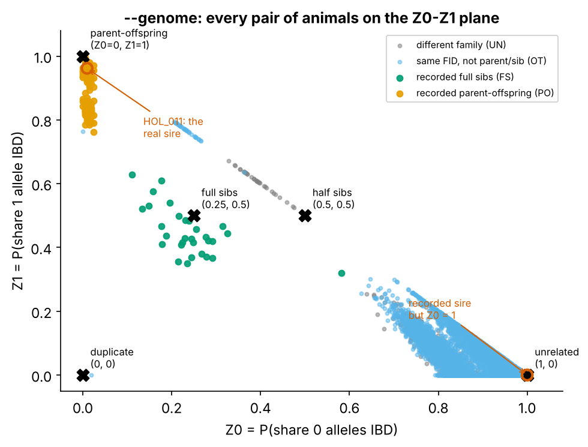
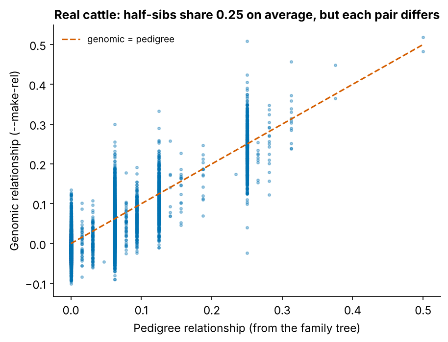
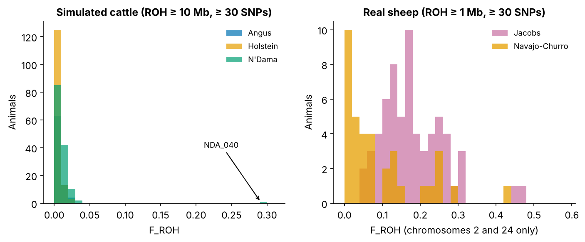

# Relatedness, inbreeding and runs of homozygosity {#sec-related}

::: {.lead}
Pedigrees in livestock are useful but imperfect: a few percent of recorded sires are wrong in many herds. Genotypes let us measure relationships directly. This chapter explains what "related" means genetically, how PLINK measures it, and how to use it to catch duplicates, wrong parents and contaminated samples.
:::

## IBS and IBD: two kinds of sharing

At any SNP, two animals can share 0, 1 or 2 alleles. There are two reasons they might share one.

- **Identical by state (IBS)**: the alleles are the same letter. That can happen by chance, especially for a common allele.
- **Identical by descent (IBD)**: the alleles are the same physical copy, inherited from a recent common ancestor.

IBD implies IBS, but not the other way round. Two unrelated Holsteins share many alleles by state simply because the alleles are common in Holsteins. Relatedness is about IBD.

## Kinship, relationship and inbreeding

Three coefficients describe IBD sharing. They differ by a factor of 2, which is a common source of confusion, so always say which one you report.

| Coefficient | Definition | Parent-offspring | Full sibs | Half sibs | Unrelated |
|---|---|---|---|---|---|
| Kinship φ | Probability that one allele taken at random from each animal is IBD | 0.25 | 0.25 | 0.125 | 0 |
| Relationship r = 2φ (PLINK's PI_HAT, the GRM, the pedigree A matrix) | Proportion of the genome shared IBD | 0.5 | 0.5 | 0.25 | 0 |
| Inbreeding F of an animal | Kinship between its sire and dam | | | | |

Parent-offspring and full sibs have the same r = 0.5, but they share it differently. A calf always gets exactly one allele from each parent, so parent and calf share exactly **one** allele IBD at every position. Full sibs share 0, 1 or 2 alleles IBD with probabilities 1/4, 1/2 and 1/4. PLINK estimates these three probabilities for each pair:

| Relationship | Z0 = P(IBD = 0) | Z1 = P(IBD = 1) | Z2 = P(IBD = 2) | PI_HAT = Z1/2 + Z2 |
|---|---|---|---|---|
| Duplicate sample or identical twins | 0 | 0 | 1 | 1 |
| Parent-offspring | 0 | 1 | 0 | 0.5 |
| Full sibs | 0.25 | 0.5 | 0.25 | 0.5 |
| Half sibs, grandparent-grandchild, uncle-nephew | 0.5 | 0.5 | 0 | 0.25 |
| First cousins | 0.75 | 0.25 | 0 | 0.125 |
| Unrelated | 1 | 0 | 0 | 0 |

## Step 1: estimate IBD with `--genome`

PLINK counts how many alleles each pair shares by state at every SNP, then uses the population allele frequencies to work out how much of that sharing is more than chance (a "method of moments"). Prune first, because SNPs in LD would count the same region many times.

```bash
plink --bfile cattle --cow --extract prune.prune.in --genome --out ibd
```

```text
 FID1   IID1      FID2     IID2        RT EZ   Z0     Z1     Z2     PI_HAT PHE DST      PPC    RATIO
 HOL    HOL_050   HOL      HOL_050_rep OT 0    0.0188 0.0000 0.9812 0.9812 1   0.998168 1.0000 284.67
 HOL_F03 HOL_F03_S HOL_F03 HOL_F03_C2  PO 0.5  1.0000 0.0000 0.0000 0.0000 1   0.761972 0.0560 1.74
 HOL    HOL_011   HOL_F03  HOL_F03_C2  UN NA   0.0096 0.9619 0.0285 0.5095 1   0.853903 1.0000 230.00
```

| Column | Meaning |
|---|---|
| RT | Relationship recorded in the `.fam`: PO parent-offspring, FS full sibs, HS half sibs, OT other pair with the same FID, UN unrelated |
| EZ | PI_HAT expected from that recorded relationship |
| Z0, Z1, Z2, PI_HAT | Estimated IBD sharing (see the table above) |
| DST | IBS distance: share of alleles identical by state |
| PPC | Pairwise population concordance test; small values mean the two animals look like they come from different populations |

The most useful way to look at the whole file is to plot Z0 against Z1 for every pair. Each relationship type has its own place on that plane.

{#fig-z0z1}

What the plot and the table reveal:

- **HOL_050 and HOL_050_rep**: PI_HAT 0.98 and Z2 0.98. The same animal was genotyped twice. Keep the copy with the better call rate.
- **HOL_F03_S and HOL_F03_C2**: the pedigree says parent-offspring (EZ = 0.5), but Z0 = 1 and PI_HAT = 0. This bull is not the calf's sire.
- **HOL_011 and HOL_F03_C2**: Z1 = 0.96, exactly the pattern of a parent. HOL_011 is the real sire, which agrees with the Mendel errors in Chapter 8.
- **ANG_030** had PI_HAT above 0.2 with 359 of the 360 other animals, including other breeds. Nobody is related to everyone. Contaminated DNA creates extra heterozygous calls, and these look like extra sharing with everyone. Together with its F of -0.72, this confirms contamination.

All other 119 recorded parent-offspring pairs fell between PI_HAT 0.4 and 0.9, as they should.

### Population structure inflates IBD estimates

`--genome` uses allele frequencies from the whole file. When the file mixes breeds, animals of the same breed share more than the pooled frequencies predict, so they look a little related. In our data, 545 unrelated pairs (mostly N'Dama, the most distinct breed) had PI_HAT between 0.2 and 0.4. Run `--genome` within breed, or use KING (below), when you need accurate relationships across breeds.

| Useful option | Effect |
|---|---|
| `--min 0.2` | Only write pairs with PI_HAT above 0.2 (the full file has n(n-1)/2 pairs: 64,980 for 361 animals) |
| `--genome full` | Add the IBS counts behind each estimate |
| `--genome rel-check` | Only pairs with the same FID (pedigree checking) |

## Step 2: the genomic relationship matrix (GRM)

A second way to measure relatedness treats each SNP as a small piece of evidence and averages over all SNPs. Write g<sub>il</sub> for the number of copies (0, 1 or 2) of allele 1 that animal i carries at SNP l, and f<sub>l</sub> for the frequency of that allele. The genomic relationship between animals i and j is

$$
\hat r_{ij} = \frac{1}{p}\sum_{l=1}^{p}\frac{(g_{il}-2f_l)(g_{jl}-2f_l)}{2f_l(1-f_l)}
$$

In words: standardise each genotype by subtracting its expected value and dividing by its standard deviation, then average the products over all p SNPs. Two animals that carry the same unusual alleles get a positive value; unrelated animals average about zero (and can be slightly negative). This is the GRM of Yang and colleagues (2011), used by GCTA and in GBLUP genomic prediction; VanRaden's (2008) G matrix is a close relative.

```bash
plink --bfile cattle_real_qc --cow --make-rel square --out grm
# grm.rel     500 x 500 matrix of relationships
# grm.rel.id  the animal IDs, in the same order
```

The real cattle data come with a pedigree of 1,929 animals, so we can compare the GRM with the relationships calculated from the family tree:

{#fig-grm-ped}

| Pedigree relationship | Pairs | Average GRM | SD of GRM |
|---|---|---|---|
| 0 (no known common ancestor) | 110,834 | -0.008 | 0.035 |
| 0.01 to 0.1 | 12,450 | 0.032 | 0.043 |
| 0.1 to 0.2 | 616 | 0.111 | 0.049 |
| 0.2 to 0.3 (mostly paternal half sibs) | 833 | 0.237 | 0.053 |
| 0.3 to 0.6 | 17 | 0.347 | 0.082 |

On average the genomic values match the pedigree very well: half sibs share 0.237 against the expected 0.25. But individual half-sib pairs (806 pairs with pedigree relationship 0.25) vary: 90% of them fall between 0.16 and 0.32. That spread is real: by chance, two sons of the same bull inherit more or less of the same half of his genome. The pedigree can only give the average; genotypes give the actual value. This is exactly why genomic selection is more accurate than pedigree-based selection.

## Step 3: KING, a method robust to structure

KING (Manichaikul and colleagues, 2010) estimates kinship without using population allele frequencies. It only looks at SNPs where both animals are heterozygous (N<sub>Aa,Aa</sub>) and where they are opposite homozygotes (N<sub>AA,aa</sub>):

$$
\hat\phi_{ij} = \frac{N_{Aa,Aa} - 2\,N_{AA,aa}}{N_{Aa}^{(i)} + N_{Aa}^{(j)}}
$$

Because it needs no allele frequencies, KING is much less fooled by breed mixing. It is available in PLINK 2.0:

```bash
plink2 --bfile cattle --cow --make-king-table --out king
plink2 --bfile cattle --cow --king-cutoff 0.177 --out unrelated   # keep a set with no 1st-degree pairs
```

KING reports kinship φ (not r), so its cut-offs are half of PI_HAT's. The categories below are the ones proposed by Manichaikul and colleagues (2010):

| Category | Kinship φ | Relationship r |
|---|---|---|
| Duplicates or identical twins | > 0.354 | > 0.707 |
| First degree (parent-offspring, full sibs) | 0.177 to 0.354 | 0.354 to 0.707 |
| Second degree (half sibs, grandparents) | 0.088 to 0.177 | 0.177 to 0.354 |
| Third degree | 0.044 to 0.088 | 0.088 to 0.177 |
| Unrelated | < 0.044 | < 0.088 |

## Step 4: runs of homozygosity (ROH)

An inbred animal inherited the same long stretch of chromosome from both parents, because both got it from a common ancestor. That stretch shows up as a long run of homozygous SNPs, a **run of homozygosity** (ROH). The share of the genome covered by ROH is **F_ROH**, a genomic inbreeding coefficient widely used in livestock:

$$
F_{ROH} = \frac{\text{total length of ROH in the animal}}{\text{length of the genome covered by SNPs}}
$$

Long ROH come from recent inbreeding (the common ancestor was a few generations back); short ROH from old inbreeding. A common rule of thumb is that an ROH of length L cM traces back to a common ancestor about 50/L generations ago.

```bash
plink --bfile cattle --cow --autosome --homozyg --homozyg-density 1000 --homozyg-gap 3000 \
      --homozyg-snp 30 --homozyg-kb 10000 --homozyg-window-snp 30 --out roh
```

The default settings were written for dense human data and require at least one SNP every 50 kb. Our practice panel has about one SNP per 700 kb, so the defaults found **no runs at all**. The settings must match your SNP density:

| Settings | ROH found | ROH length in the inbred NDA_040 |
|---|---|---|
| defaults (`--homozyg` alone) | 0 | 0 |
| density 1000, gap 3000, 15 SNPs, 3 Mb | 16,889 | 1,259 Mb |
| density 1000, gap 3000, 30 SNPs, 10 Mb | 352 | 729 Mb |
| density 1000, gap 3000, 50 SNPs, 20 Mb | 13 | 665 Mb |

With only 15 SNPs required, chance homozygosity at sparse SNPs creates thousands of false runs. With 30 SNPs and 10 Mb, NDA_040 (truly homozygous on chromosomes 1 to 8) stands out with F_ROH = 729 / 2,507 = 0.29.

{#fig-froh}

| `--homozyg` option | Meaning |
|---|---|
| `--homozyg-snp` | Minimum number of SNPs in a run |
| `--homozyg-kb` | Minimum length of a run (kb) |
| `--homozyg-density` | Maximum average distance between SNPs in a run (kb per SNP) |
| `--homozyg-gap` | Maximum gap between two SNPs inside a run (kb) |
| `--homozyg-window-snp` | Size of the scanning window (SNPs) |
| `--homozyg-window-het` | Heterozygous calls allowed per window (default 1) |
| `--homozyg-window-missing` | Missing calls allowed per window (default 5) |
| `--homozyg-window-threshold` | Share of windows that must be homozygous to call a SNP part of a run (default 0.05) |

Output files: `.hom` (one line per run), `.hom.indiv` (per animal: number of runs NSEG, total length KB, average length KBAVG) and `.hom.summary` (per SNP: how many animals have a run there; peaks hint at selection). Always report your exact settings, because F_ROH depends on them.

::: {.callout-note}
## PLINK 2.0
Use `--make-king-table` and `--king-cutoff` for relatedness, `--make-rel` for the GRM, and `--homozyg` (in recent builds). `--genome` does not exist in PLINK 2.0.
:::
