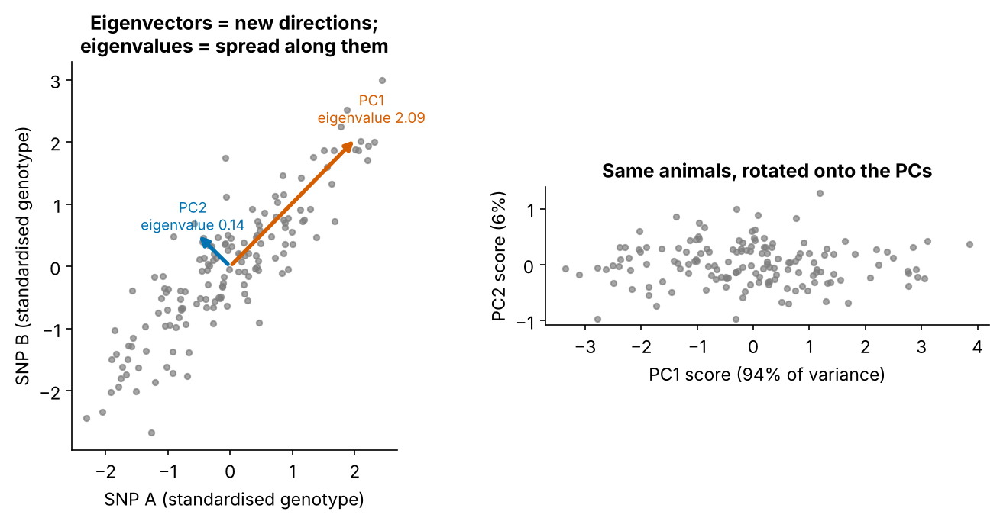
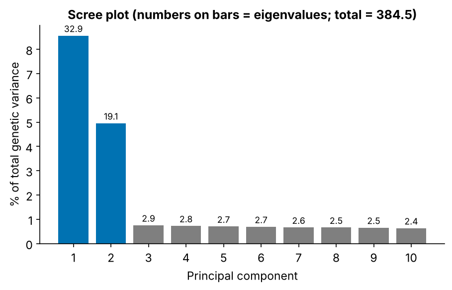
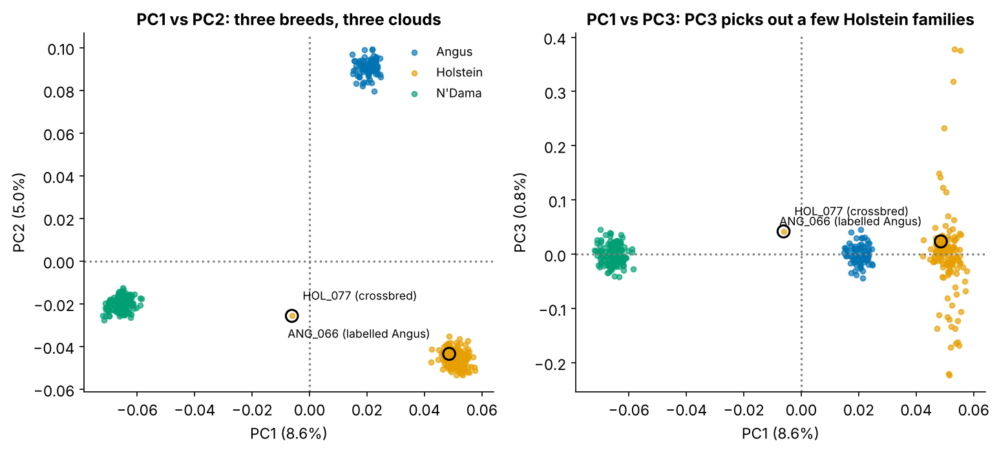
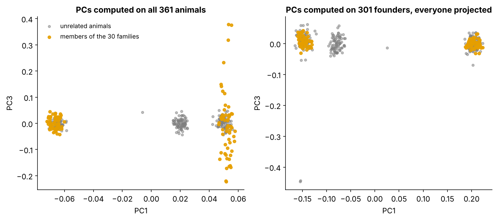
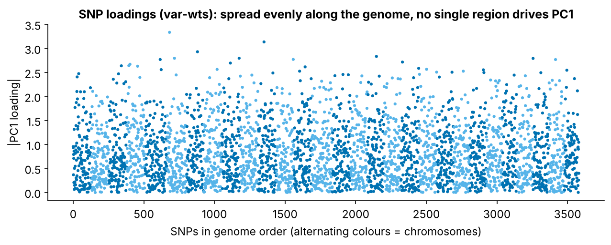

# Population structure and principal component analysis {#sec-pca}

::: {.lead}
Principal component analysis (PCA) turns thousands of SNPs into a few numbers per animal that you can plot. Breeds, crossbreds, mislabelled animals and family clusters all become visible. The same numbers, used as covariates, protect association studies from false results. This chapter explains what eigenvectors and eigenvalues are, how to run and plot a PCA, and the traps to avoid.
:::

## The idea in two SNPs

Imagine only two SNPs, and plot every animal by its (standardised) genotype at SNP A and SNP B. If the two SNPs are correlated, the cloud of points is stretched along a diagonal.

{#fig-pca-toy}

PCA finds new axes for the same cloud:

- The **first principal component (PC1)** is the direction along which the animals differ the most.
- **PC2** is the direction of most remaining variation, at right angles to PC1, and so on.

Each PC is described by two things:

- An **eigenvector**: the direction itself, a list of weights, one per SNP (PLINK calls these the SNP *loadings* or *variant weights*). Projecting an animal onto that direction gives its **PC score**: the number you plot.
- An **eigenvalue**: how much of the variation lies along that direction. A big eigenvalue means a PC that separates animals strongly.

In the toy example, PC1 has eigenvalue 2.09 and PC2 only 0.14: PC1 carries 94% of the variation, so one number per animal describes almost everything the two SNPs say. With real data we do the same thing with thousands of SNPs at once.

## How PLINK computes it

PLINK first builds the genomic relationship matrix (GRM) from Chapter 10: one row and one column per animal, filled with the standardised genotype products averaged over SNPs. Then it finds the eigenvectors and eigenvalues of that matrix. Each eigenvector of the GRM has one value per animal: those values are the PC scores. In matrix language, if **G** is the GRM,

$$
\mathbf{G}\,\mathbf{v}_k = \lambda_k\,\mathbf{v}_k
$$

where **v**<sub>k</sub> is the k-th eigenvector (the scores of all animals on PC k) and λ<sub>k</sub> its eigenvalue. The eigenvalues add up to the total variation, which equals the sum of the diagonal of G (its *trace*, roughly the number of animals). So the share of variation explained by PC k is

$$
\text{\% variance of PC}_k = \frac{\lambda_k}{\text{trace}(\mathbf{G})} \times 100
$$

::: {.callout-warning}
## The most common PCA mistake
PLINK only writes the top 20 eigenvalues (or as many as you ask for). Many tutorials divide each eigenvalue by the sum of *those* values. That gives the share among the first few PCs, not of the total, and it exaggerates badly. In our data PC1 is 45% of the first ten eigenvalues but only **8.6% of the total variation**. To get the true total, run `--make-rel` on the same SNPs and add up the diagonal (in R: `sum(diag(G))`), or use the number of animals as an approximation.
:::

## Step 1: prepare the data

PCA is sensitive to things that are not population structure. Before running it:

1. **Filter rare SNPs** (`--maf 0.05`). PLINK 1.9 returned all-zero PCs with monomorphic SNPs present, and PLINK 2.0 refuses to run.
2. **Prune for LD** (`--indep-pairwise 50 5 0.2`), so that a block of correlated SNPs does not dominate a PC.
3. **Use autosomes only** (PLINK does this for you).
4. **Remove duplicates, and ideally close relatives.** A family or a duplicate pair can take over a whole PC (Step 6).

```bash
plink --bfile cattle --cow --maf 0.05 --autosome --indep-pairwise 50 5 0.2 --out prune
plink --bfile cattle --cow --extract prune.prune.in --pca 10 header tabs var-wts --out pca
```

| Option | Meaning |
|---|---|
| `--pca 10` | Compute the first 10 PCs (default 20) |
| `header` | Write column names in `.eigenvec` |
| `tabs` | Separate columns with tabs |
| `var-wts` | Also write the SNP loadings (`.eigenvec.var`) |

## Step 2: understand the output files

`pca.eigenvec`: one line per animal, its scores on each PC.

```text
FID     IID       PC1        PC2        PC3
ANG     ANG_001   0.0118239  0.0913939  -0.00673676
```

`pca.eigenval`: one number per PC, the eigenvalues.

```text
32.9286
19.061
2.89977
2.7953
...
```

`pca.eigenvec.var`: one line per SNP, its loading (weight) on each PC.

The sign of a PC is arbitrary: two programs, or two runs on slightly different data, can flip PC1 from positive to negative. Only the relative positions of animals matter.

## Step 3: how many PCs matter? The scree plot

{#fig-scree}

The first two eigenvalues (32.9 and 19.1) stand far above the rest, which flatten out near 2.5 to 2.9. That "elbow" after PC2 tells us there are two strong axes of structure: with three breeds, you need two axes to separate them (in general, k groups need k - 1 PCs). After the elbow, PCs mostly describe noise or small family groups. For association studies, people usually include the PCs up to the elbow, and often a few more for safety (Chapter 12 uses PC1 and PC2).

## Step 4: plot the animals

{#fig-pca-breeds}

- **PC1** (8.6%) separates N'Dama from the two European breeds. **PC2** (5.0%) separates Angus from Holstein. That matches what we know about cattle history: the African taurine N'Dama is the most distinct.
- **ANG_066**, recorded as Angus, sits inside the Holstein cloud. It is a mislabelled Holstein.
- **HOL_077**, recorded as Holstein, sits halfway between Holstein and N'Dama. It is a crossbred: a 50:50 cross falls in the middle of the line between its two parent breeds.
- **PC3** (0.8%) spreads out some Holsteins. Step 6 shows why.

## Step 5: make the plot in R, and what each setting does

```r
library(tidyverse)

pca    <- read.table("pca.eigenvec", header = TRUE)
eigval <- scan("pca.eigenval")
G      <- as.matrix(read.table("rel.rel"))   # from: plink ... --make-rel square --out rel
pct    <- round(eigval / sum(diag(G)) * 100, 1)

breeds <- read.table("breed.clst", col.names = c("FID", "IID", "breed"))
pca    <- left_join(pca, breeds, by = c("FID", "IID"))

ggplot(pca, aes(x = PC1, y = PC2, colour = breed)) +          # 1
  geom_point(size = 1.8, alpha = 0.7) +                          # 2
  geom_hline(yintercept = 0, linetype = "dotted") +              # 3
  geom_vline(xintercept = 0, linetype = "dotted") +
  scale_colour_manual(values = c(ANG = "#0072B2",                # 4
                                 HOL = "#E69F00",
                                 NDA = "#009E73")) +
  ggrepel::geom_text_repel(                                      # 5
      data = filter(pca, IID %in% c("ANG_066", "HOL_077")),
      aes(label = IID), colour = "black", size = 3) +
  labs(x = paste0("PC1 (", pct[1], "%)"),                        # 6
       y = paste0("PC2 (", pct[2], "%)"),
       colour = "Breed",
       title = "PCA of three cattle breeds") +
  coord_equal() +                                                # 7
  theme_minimal(base_size = 12)                                  # 8

ggsave("pca_pc1_pc2.png", width = 7, height = 5, dpi = 300)     # 9
```

| Line | Setting | Why |
|---|---|---|
| 1 | `colour = breed` | Colour by a known label, so you can see whether the genetics agree with the records |
| 2 | `size`, `alpha` | Small, semi-transparent points so overlapping animals stay visible |
| 3 | zero lines | Help you see which animals are on which side of each PC |
| 4 | `scale_colour_manual` | Choose colours yourself; these are colour-blind safe (Okabe-Ito palette) |
| 5 | `geom_text_repel` | Label only the animals you want to discuss, without labels overlapping |
| 6 | axis labels with % | Tell the reader how much variation each axis carries |
| 7 | `coord_equal()` | Same scale on both axes, so distances are not distorted; drop it if the plot becomes too thin |
| 8 | `theme_minimal()` | A clean background |
| 9 | `ggsave(..., dpi = 300)` | Journal-quality image file |

Other useful variations: `shape = sex` to use a second variable, `facet_wrap(~ herd)` for one panel per herd, and plotting PC1 against PC3 and PC2 against PC3 as well, because structure can hide in higher PCs.

## Step 6: watch out for families and duplicates

A group of close relatives can take over a PC of its own, a problem described in many GWAS teaching notes (see Appendix C). It happened to our PC3: the animals with extreme PC3 scores were all members of a few Holstein families (F01, F14, F07, F11), because a sire, a dam and two calves share a lot of genome. PC3 described families, not breeds.

The fix is to compute the PCs on unrelated animals only and then **project** everyone else onto those PCs, using the SNP loadings. PLINK 2.0 does both steps:

```bash
# 1. PCs from the 301 founders only, saving the SNP loadings
plink2 --bfile cattle --cow --extract prune.prune.in --keep founders.txt \
       --maf 0.05 --freq --pca 10 allele-wts --out pcaF
# 2. project all 361 animals onto those PCs
plink2 --bfile cattle --cow --extract prune.prune.in --read-freq pcaF.afreq \
       --score pcaF.eigenvec.allele 2 6 header-read no-mean-imputation variance-standardize \
       --score-col-nums 7-16 --out proj
```

{#fig-pca-proj}

In the right panel the families sit neatly inside their breed. But two animals now stand far out on PC3: HOL_050 and HOL_050_rep, the duplicate sample from Chapter 10. Two identical "founders" are the most extreme family possible. So the rule is: **remove duplicates and relatives first, then compute PCs, then project.**

## Step 7: check the SNP loadings

The loadings tell you which SNPs build each PC. For population structure they should be spread along the whole genome. A single tall peak means one region (often a large inversion or a region under strong selection) is driving the PC, and your LD pruning was not enough.

{#fig-loadings}

## PCA and MDS: two roads to the same map

An older alternative to PCA is multidimensional scaling (MDS) of the pairwise distances between animals. PLINK can do it directly:

```bash
plink --bfile cattle --cow --extract prune.prune.in --cluster --mds-plot 4 --out mds
```

```r
# or: MDS in R from a PLINK distance matrix
d   <- as.matrix(read.table("dist.mdist"))          # plink ... --distance-matrix --out dist
ids <- read.table("dist.mdist.id")
mds <- cmdscale(d, k = 5, eig = TRUE)
pct <- round(mds$eig / sum(mds$eig) * 100, 2)      # here all eigenvalues are available
```

MDS works on IBS distances and PCA on the GRM. In our data both gave the same picture: three tight clouds, ANG_066 with the Holsteins and HOL_077 in the middle. PCA is faster for big data and is the standard choice for covariates, and the PLINK 2.0 `--pca approx` option handles tens of thousands of animals.

## Using clustering to name the groups

PCA shows structure; clustering assigns animals to groups. `--cluster --K 3` split our animals into 79 Angus; 141 Holsteins plus ANG_066; and 140 N'Dama, with HOL_077 in the Holstein cluster. Chapter 17 shows how `--ppc` and `--mc` change the clusters. For admixture proportions (for example, what share of HOL_077 is N'Dama), use ADMIXTURE on the pruned PLINK files.

::: {.callout-note}
## PLINK 2.0
`plink2 --pca 10` writes `.eigenvec` and `.eigenval`; add `allele-wts` for loadings and `approx` for very large samples. Projection uses `--score` as shown in Step 6. `--cluster` and `--mds-plot` are only in PLINK 1.9.
:::
