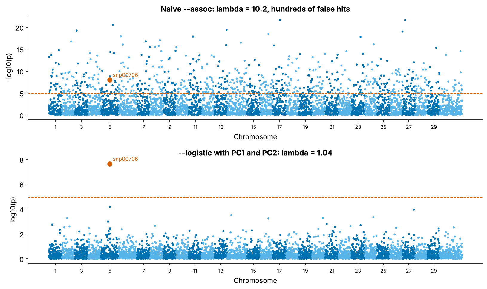
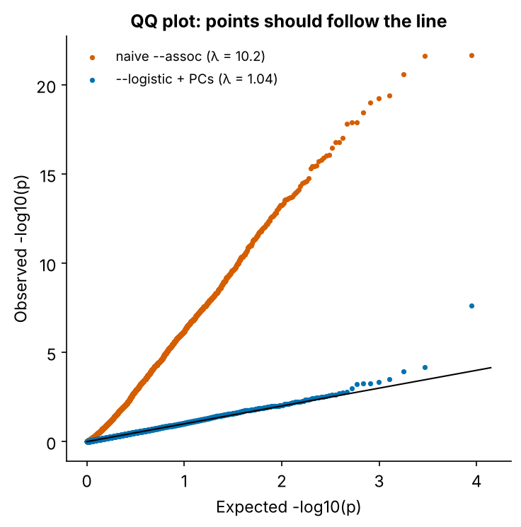
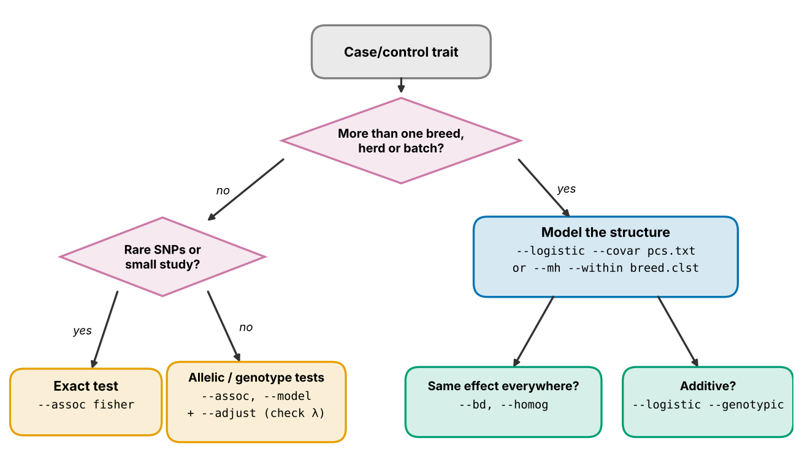

# Case/control association {#sec-assoc}

::: {.lead}
An association test asks a simple question at every SNP: is one allele more common in sick animals than in healthy ones? This chapter runs the basic tests, shows how breed differences can produce hundreds of false hits, and fixes them.
:::

From here on we use the cleaned file `cattle_qc` (351 animals, 4,443 SNPs; Chapter 19 lists the QC steps). The disease is BRD: 138 cases and 213 controls. Every command starts with `plink --bfile cattle_qc --cow --allow-no-sex`.

## Step 1: the allelic test

Count alleles in cases and controls and put them in a 2 × 2 table. For our true BRD SNP:

| | A allele | C allele | Total |
|---|---|---|---|
| Cases | 171 | 105 | 276 |
| Controls | 168 | 254 | 422 |

The A allele makes up 62% of case chromosomes but only 40% of control chromosomes. The chi-square test (1 degree of freedom) asks whether a difference that large could easily happen by chance. The **odds ratio** summarises the size of the effect:

$$
OR = \frac{171/105}{168/254} = 2.46
$$

The odds of carrying A are 2.46 times higher on a case chromosome than on a control chromosome.

```bash
plink --bfile cattle_qc --cow --allow-no-sex --assoc --adjust --out a_basic
```

```text
 CHR        SNP         BP   A1      F_A      F_U   A2        CHISQ            P           OR
  17   snp02679   40026542    G    0.573   0.2123    T        94.72    2.189e-22         4.98
  27   snp04131    8978640    A   0.1204   0.4765    G        94.61    2.317e-22       0.1504
   5   snp00741   67004928    A   0.5221   0.1808    G        89.81    2.616e-21        4.951
 ...
   5   snp00706   62019439    A   0.6196   0.3981    C        32.76    1.041e-08        2.462   (rank 238)
--adjust: Genomic inflation est. lambda (based on median chisq) = 10.1883.
```

| Column | Meaning |
|---|---|
| A1, A2 | The tested allele and the other allele |
| F_A, F_U | Frequency of A1 in cases (affected) and controls (unaffected) |
| CHISQ, P | Test statistic and p-value |
| OR | Odds ratio for A1 (above 1: A1 more common in cases) |

Something is very wrong: hundreds of SNPs have p-values below 10⁻¹⁰, and the true BRD SNP is only 238th.

## Step 2: spot stratification with λ, the Manhattan plot and the QQ plot

BRD is far more common in Holsteins (84 of 141) than in N'Dama (6 of 80). Any SNP whose frequency differs between those breeds therefore looks associated with BRD. This is **population stratification**, the most common cause of false positives in livestock studies.

The **genomic inflation factor λ** measures it. If almost no SNP is truly associated, the median chi-square across the genome should be 0.455 (the median of a chi-square with 1 degree of freedom):

$$
\lambda = \frac{\text{median}(\chi^2_{\text{observed}})}{0.455}
$$

λ near 1.0 is healthy, above 1.05 to 1.1 deserves attention, and **10.2 is a disaster**.

{#fig-manh-brd}

{#fig-qq-brd}

## Step 3: correct for structure

The best fix is to include the population structure in the model. Logistic regression with the first two PCs from Chapter 11 as covariates:

```bash
plink --bfile cattle_qc --cow --allow-no-sex --logistic --covar pcs.txt --hide-covar --adjust --out lg_pc
```

```text
--adjust: Genomic inflation est. lambda (based on median chisq) = 1.03609.
 CHR        SNP         BP   A1       TEST    NMISS         OR         STAT            P
   5   snp00706   62019439    A        ADD      349      3.319        5.588    2.294e-08
   5   snp00708   62070027    T        ADD      351     0.4467       -3.984    6.768e-05
  27   snp04234   39892997    T        ADD      347      0.351       -3.862    0.0001126
```

λ dropped from 10.19 to 1.04, the number of SNPs with p < 10⁻⁵ dropped from 679 to 1, and that one is the planted BRD SNP. Its neighbour snp00708 comes second only because it is in LD with it. The covariate file `pcs.txt` has a header line (FID IID PC1 PC2). `--hide-covar` hides the covariate lines so you see one line per SNP.

`--adjust` also writes corrected p-values (`.adjusted`):

| Column | Correction |
|---|---|
| GC | Genomic control: each chi-square divided by λ |
| BONF | Bonferroni: p × number of tests (strictest) |
| HOLM, SIDAK_SS, SIDAK_SD | Step-down and Šidák versions of Bonferroni |
| FDR_BH, FDR_BY | False discovery rate (Benjamini-Hochberg, Benjamini-Yekutieli) |

The file is sorted from the smallest p-value down; here are its first two lines:

```text
 CHR        SNP      UNADJ         GC       BONF       HOLM   SIDAK_SS   SIDAK_SD     FDR_BH     FDR_BY
   5   snp00706  2.294e-08  4.018e-08  0.0001018  0.0001018  0.0001018  0.0001018  0.0001018  0.0009139
   5   snp00708  6.768e-05  9.067e-05     0.3004     0.3003     0.2595     0.2594     0.1502          1
```

Read each column as "the p-value after this correction": compare it with 0.05. snp00706 stays significant under every correction (Bonferroni: 2.29 × 10⁻⁸ × 4,439 tests = 1.0 × 10⁻⁴). Its neighbour snp00708 is significant before correction (6.8 × 10⁻⁵) but not after any (Bonferroni 0.30, FDR_BH 0.15). Bonferroni, Holm and Šidák control the chance of even one false positive and are strict; FDR_BH controls the expected *share* of false positives among the hits and is gentler, which suits screening many SNPs. GC divides each chi-square by λ, so it only makes sense when λ is close to 1 and the inflation is spread evenly. Note that these corrections treat the SNPs as independent; with SNPs in LD they are conservative, which is why permutation (Chapter 13) gives a sharper genome-wide threshold.

## Step 4: other tests for the same question

### Fisher's exact test

The chi-square test is an approximation that becomes unreliable when a table cell has fewer than about 5 counts (rare SNPs, small studies). Fisher's exact test computes the exact probability:

```bash
plink --bfile cattle_qc --cow --allow-no-sex --assoc fisher --out a_fisher
```

For snp00706 it gave p = 1.36 × 10⁻⁸, close to the chi-square's 1.04 × 10⁻⁸, because the counts are large.

### Genotype models: trend, dominant, recessive and general

The allelic test counts alleles. `--model` counts animals by genotype and asks several questions at once:

| Test | Question | df |
|---|---|---|
| ALLELIC | Do allele frequencies differ? | 1 |
| TREND (Cochran-Armitage) | Does risk rise steadily from aa to Aa to AA? (does not assume HWE) | 1 |
| DOM | Does carrying at least one A matter (AA + Aa vs aa)? | 1 |
| REC | Does carrying two copies matter (AA vs Aa + aa)? | 1 |
| GENO (general) | Do the three genotype groups differ in any way? | 2 |

```bash
plink --bfile cattle_qc --cow --allow-no-sex --model --out m_all
```

```text
 CHR        SNP   A1   A2     TEST            AFF          UNAFF        CHISQ   DF            P
   5   snp00706    A    C     GENO       50/71/17      32/104/75        32.91    2     7.14e-08
   5   snp00706    A    C    TREND        171/105        168/254        32.88    1    9.783e-09
   5   snp00706    A    C  ALLELIC        171/105        168/254        32.76    1    1.041e-08
   5   snp00706    A    C      DOM         121/17         136/75        23.19    1    1.471e-06
   5   snp00706    A    C      REC          50/88         32/179         20.6    1    5.665e-06
```

Read `AFF 50/71/17` as: among cases, 50 AA, 71 AC and 17 CC. TREND and ALLELIC are strongest, which fits an **additive** effect (each copy of A adds the same amount of risk), and that is how the SNP was simulated. GENO, DOM and REC are only computed when every cell has at least 5 animals; `--cell 0` removes that rule.

### Model comparison: is the effect additive?

`--logistic --genotypic` fits two terms per SNP: **ADD** (0, 1 or 2 copies of A1) and **DOMDEV** (1 for heterozygotes, 0 otherwise). DOMDEV measures how far the heterozygote is from halfway between the two homozygotes.

```bash
plink --bfile cattle_qc --cow --allow-no-sex --logistic --covar pcs.txt --genotypic --out lg_geno
```

```text
   5   snp00706   62019439    A        ADD      349      3.325        5.573    2.505e-08
   5   snp00706   62019439    A     DOMDEV      349      1.026      0.09652       0.9231
   5   snp00706   62019439    A   GENO_2DF      349         NA        31.19    1.688e-07
```

DOMDEV p = 0.92: no sign of dominance, so the simpler additive model is right. The fitted dominant and recessive models were weaker (p = 7.5 × 10⁻⁶ and 3.3 × 10⁻⁶).

::: {.callout-warning}
## OR = inf
One SNP in this run reported `OR = inf` with p = 3.6 × 10⁻¹⁰³. An infinite odds ratio means one genotype appears only in cases or only in controls ("complete separation"), and the regression breaks. Always look at the genotype counts (`--model`) before believing such a result.
:::

### Stratified tests: Cochran-Mantel-Haenszel and Breslow-Day

Instead of a regression, you can split animals into strata (breeds) and combine the 2 × 2 tables:

```bash
plink --bfile cattle_qc --cow --allow-no-sex --mh --within breed.clst --out mh
plink --bfile cattle_qc --cow --allow-no-sex --bd --within breed.clst --out bd
plink --bfile cattle_qc --cow --allow-no-sex --homog --within breed.clst --out homog
```

The **CMH test** asks whether there is an association within strata and gives one common OR: for snp00706, OR = 2.92 (95% CI 2.01 to 4.25), p = 9.9 × 10⁻⁹, with λ = 1.03. The **Breslow-Day test** asks whether the OR is the same in every stratum (p = 0.59, so yes). `--homog` shows each breed:

| Breed | Case freq of A | Control freq of A | OR | p |
|---|---|---|---|---|
| Angus | 0.75 | 0.55 | 2.44 | 0.012 |
| Holstein | 0.56 | 0.32 | 2.69 | 0.00023 |
| N'Dama | 0.71 | 0.38 | 4.08 | 0.00054 |
| Heterogeneity test | | | | 0.60 |

The same allele raises the risk in all three breeds.

## Which test should I use?

{#fig-assoc-choice}

Each box of the figure as a command on the cleaned data, with the result for the BRD SNP snp00706 from the sections above:

```bash
# one breed, rare SNPs or a small study: exact test
plink --bfile cattle_qc --cow --allow-no-sex --assoc fisher --out a_fisher          # p = 1.4e-08
# one breed, common SNPs: allelic and genotype tests, and check lambda
plink --bfile cattle_qc --cow --allow-no-sex --model --out m_all                    # TREND p = 9.8e-09
plink --bfile cattle_qc --cow --allow-no-sex --assoc --adjust --out a_basic         # lambda = 10.19 here!
# several breeds: model the structure
plink --bfile cattle_qc --cow --allow-no-sex --logistic --covar pcs.txt --hide-covar --adjust --out lg_pc   # p = 2.3e-08, lambda 1.04
plink --bfile cattle_qc --cow --allow-no-sex --mh --within breed.clst --out mh                              # p = 9.9e-09
# then: same effect in every breed? additive?
plink --bfile cattle_qc --cow --allow-no-sex --bd --within breed.clst --out bd                              # Breslow-Day p = 0.59
plink --bfile cattle_qc --cow --allow-no-sex --logistic --covar pcs.txt --genotypic --out lg_geno          # DOMDEV p = 0.92
```

Our data have three breeds, so the right-hand branch applies; the λ of 10.19 from the plain `--assoc` is the warning sign that sends you there.

::: {.callout-note}
## PLINK 2.0
One command, `--glm`, replaces `--assoc`, `--model`, `--logistic` and `--linear`; it picks logistic or linear regression from the phenotype. `firth-fallback` uses Firth regression for rare SNPs, which handles complete separation. `--mh`, `--bd`, `--homog` and `--model` are not in PLINK 2.0.

```bash
plink2 --bfile cattle_qc --cow --glm hide-covar firth-fallback --covar pcs.txt --adjust --out glm_brd
```

It gave the same answer: snp00706, OR 3.319, p = 2.29 × 10⁻⁸, λ = 1.04.
:::

## Exercises

Try each question first, then open the answer. The challenge goes a step further than the chapter.

**1.** With `--assoc` and no covariates, how many SNPs have p < 10⁻⁵? With `--logistic` and `pcs.txt`?

::: {.callout-note collapse="true" title="Answer"}
679 without correction (λ = 10.19) against 1 with two PCs (λ = 1.04): the planted BRD SNP, snp00706.
:::

**Challenge.** Use 10 PCs instead of 2 as covariates. What happens to λ and to the p-value of snp00706? Are more PCs always better?

::: {.callout-note collapse="true" title="Answer"}
```bash
plink --bfile cattle_qc --cow --extract qc_prune.prune.in --pca 10 --out p10
awk '{printf "%s %s", $1, $2; for (i = 3; i <= 12; i++) printf " %s", $i; print ""}' p10.eigenvec > pc10.txt
plink --bfile cattle_qc --cow --allow-no-sex --logistic --covar pc10.txt --hide-covar --adjust --out a10
```
λ fell to 1.00, and snp00706 is still first, but its p-value weakened from 2.3 × 10⁻⁸ to 2.0 × 10⁻⁷. Extra PCs cost degrees of freedom, and they can absorb part of a true signal if it is correlated with breed. Use the scree plot and λ to choose: enough PCs to remove the stratification, but no more.
:::
