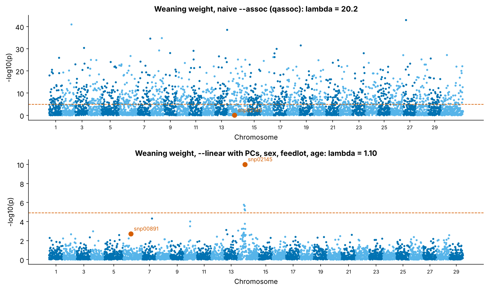
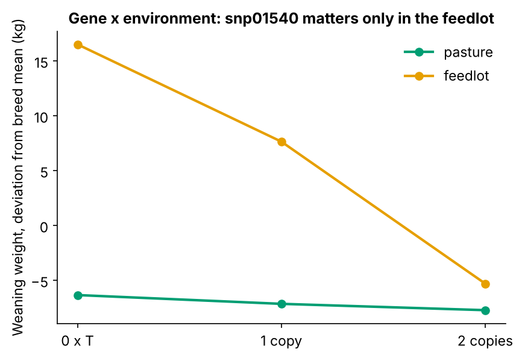

# Families, quantitative traits, interaction and permutation {#sec-qt}

::: {.lead}
Most livestock traits are measured on a scale (kilograms, litres, days) rather than as sick or healthy. This chapter covers quantitative traits and covariates, SNP-by-environment interaction, conditional analysis, mixed models for related animals, family-based tests that cannot be fooled by breed, permutation and imputed dosages.
:::

## Quantitative traits

For a trait like weaning weight (WWT), PLINK fits a straight line: weight against the number of copies of allele A1 (0, 1 or 2). The slope, **BETA**, is the average change in kilograms per copy.

$$
\text{WWT} = \mu + \beta \times (\text{copies of A1}) + \text{covariates} + \text{error}
$$

You do not pick "case/control" or "quantitative" yourself: PLINK looks at the phenotype. If it only contains 1, 2 and missing, it is case/control; otherwise it is quantitative. The same `--assoc` flag then writes `.assoc` or `.qassoc`.

### Phenotype files

`pheno.txt` holds four traits for every animal, with a header line:

```text
FID IID WWT BW YWT BRD
ANG ANG_001 265.6 37.3 475.0 1
```

There are four ways to tell PLINK which column to use. Each was run with `--assoc` on the cleaned file:

| Command | Log line | Result |
|---|---|---|
| `--pheno pheno.txt --pheno-name WWT` | `348 phenotype values present after --pheno.` | Weaning weight; 3 animals are -9 (missing) |
| `--pheno pheno.txt --mpheno 2` | `351 phenotype values present after --pheno.` | The 2nd trait column, BW; counting starts after FID and IID |
| `--pheno pheno.txt --all-pheno` | | One output per trait: `.BRD.assoc`, `.BW.qassoc`, `.WWT.qassoc`, `.YWT.qassoc` |
| no `--pheno` | | Column 6 of the `.fam` (BRD here) |

Prefer `--pheno-name`: `--mpheno 2` silently picks the wrong trait if someone adds a column to the file. With `--all-pheno`, PLINK chose the test for each trait by itself: BRD contains only 1 and 2, so it was treated as case/control (`.assoc`), and the three weights as quantitative (`.qassoc`).

Two coding traps, both silent:

**Case/control coded 0/1.** PLINK 1.9 expects 1 = control and 2 = case, with 0 and -9 meaning missing. We recoded BRD as 0 (healthy) and 1 (sick) and ran the same test:

```text
without --1:  138 phenotype values present after --pheno.
              Among remaining phenotypes, 0 are cases and 138 are controls.
with --1:     351 phenotype values present after --pheno.
              Among remaining phenotypes, 138 are cases and 213 are controls.
```

Without `--1`, the 213 healthy animals (coded 0) became missing and the 138 sick ones became "controls", leaving no cases at all. PLINK did not stop; it simply had nothing to test. Read the cases/controls line in every log.

**A different missing code.** We wrote the three missing weights as -99 instead of -9:

```text
without --missing-phenotype -99:  351 values present; snp02145 BETA -1.172, P 0.72
with    --missing-phenotype -99:  348 values present; snp02145 BETA -0.202, P 0.93
```

Without the flag, three calves were analysed as weighing -99 kg, which changed the estimate five-fold. Check the "phenotype values present" number against what you expect, and summarise each trait (minimum, maximum) in R before analysis.

### Step 1: the naive test

```bash
plink --bfile cattle_qc --cow --allow-no-sex --pheno pheno.txt --pheno-name WWT --assoc --adjust --out q_adj
```

```text
--adjust: Genomic inflation est. lambda (based on median chisq) = 20.186.
  27   snp04131    8978640      347     -23.15      1.444     0.4271   -16.04    1.201e-43
  ...
  14   snp02145   24936133      347     -0.202      2.391  2.069e-05  -0.0845       0.9327   (rank 4,391)
```

The real QTL (snp02145) looks completely dead, and λ = 20. Why? N'Dama calves are 50 to 60 kg lighter than Angus and Holstein calves in this simulation, so breed overwhelms everything.

{#fig-wwt-geno}

The figure shows the problem and the solution. Within every breed, each T allele lowers weight by about 9 kg. But the T allele is more common in the heavy breeds, so across breeds the slopes cancel out. Comparing animals within breed (that is, adjusting for structure) brings the real effect back.

### Step 2: linear regression with covariates

```bash
plink --bfile cattle_qc --cow --allow-no-sex --pheno pheno.txt --pheno-name WWT \
      --linear --covar cov_all.txt --hide-covar --adjust --out lin
```

```text
--adjust: Genomic inflation est. lambda (based on median chisq) = 1.10172.
 CHR        SNP         BP   A1       TEST    NMISS       BETA         STAT            P
  14   snp02145   24936133    T        ADD      347     -9.642       -6.681     9.73e-11
  14   snp02136   24278467    A        ADD      347     -6.777       -4.869    1.722e-06
  14   snp02144   24925785    A        ADD      345     -6.958       -4.806    2.321e-06
```

{#fig-manh-wwt}

The covariate file `cov_all.txt` holds PC1, PC2, SEX_M, FEEDLOT and AGE. BETA = -9.64 means each T allele lowers WWT by 9.6 kg; equivalently each G allele adds 9.6 kg (the simulation planted +9 kg). The second weaning-weight QTL, snp00891 in the LCORL region, ranked 18th (5.1 kg, p = 0.0019): real, but too small to detect with 350 animals.

Without `--hide-covar`, you also see the covariate effects:

```text
  14   snp02145   24936133    T        PC1      347      412.3        22.65    6.788e-70
  14   snp02145   24936133    T      SEX_M      347      11.18        5.913    8.202e-09
  14   snp02145   24936133    T    FEEDLOT      347      14.25         7.77    9.369e-14
  14   snp02145   24936133    T        AGE      347     0.2143        2.848     0.004666
```

Bull calves were 11.2 kg heavier, feedlot calves 14.3 kg heavier, and each extra day of age added 0.21 kg. Useful options: `--covar-name PC1,PC2` (choose covariates by name), `--covar-number 1-2`, `--sex` (add sex from the `.fam` as a covariate), `--standard-beta` and `--ci 0.95` (confidence intervals).

`--all-pheno` wrote four files, one per trait: three `.assoc.linear` files and `lin_all.BRD.assoc.logistic`. PLINK saw that BRD is coded 1/2 and switched to logistic regression by itself.

## SNP-by-environment interaction

Does a SNP's effect depend on the environment? In the simulation, snp01540 adds weight **only in the feedlot**.

{#fig-gxe}

`--interaction` adds a SNP × covariate term for every covariate, and `--parameters` keeps only the terms you want. The numbering is: 1 = ADD, then the covariates in file order (2 to 6), then ADD × each covariate in the same order (7 to 11). So ADD × FEEDLOT is 10.

```bash
plink --bfile cattle_qc --cow --allow-no-sex --pheno pheno.txt --pheno-name WWT \
      --linear --covar cov_all.txt --interaction --parameters 1-6,10 --out lin_int
```

```text
  10   snp01540   52104483    T         ADD      347    -0.3653      -0.2039       0.8385
  10   snp01540   52104483    T     FEEDLOT      347      23.19        7.813    7.086e-14
  10   snp01540   52104483    T ADDxFEEDLOT      347     -10.51       -4.051    6.322e-05
```

On pasture (FEEDLOT = 0), the T allele does nothing (BETA -0.37, p = 0.84). In the feedlot, each T allele costs an extra 10.5 kg (p = 6.3 × 10⁻⁵; 12 kg was planted).

PLINK 1.9 also has `--gxe`, which fits the SNP separately in two groups and compares the slopes:

```bash
plink --bfile cattle_qc --cow --allow-no-sex --pheno pheno.txt --pheno-name WWT --gxe --covar env.txt --out gxe
```

`env.txt` gives each animal a group (1 or 2). Across all breeds, `--gxe` gave p = 0.13, because it cannot include other covariates and breed differences blur the slopes. Within Holsteins only, the slopes were 0.34 kg (pasture) and -11.5 kg (feedlot), p = 0.0096. So prefer `--linear --interaction` with covariates; for case/control traits use `--logistic --interaction`. Chapter 16 adds continuous environments.

## Conditional analysis: one signal or several?

Several SNPs in the PLAG1 region were significant. Is that one QTL seen through LD, or several? Add the top SNP as a covariate and test again:

```bash
plink ... --linear --covar cov_all.txt --hide-covar --chr 14 --from-mb 23 --to-mb 27 \
          --condition snp02145 --out lin_chr14_cond
```

| SNP | p before | p after conditioning on snp02145 |
|---|---|---|
| snp02136 | 1.7 × 10⁻⁶ | 0.0073 |
| snp02144 | 2.3 × 10⁻⁶ | not in the top 3 |

The region's signal collapses: one QTL. `--condition-list file.txt` conditions on several SNPs. Conditioning genome-wide on snp02145 and snp00891 made the feedlot SNP the top SNP (p = 5.0 × 10⁻⁶).

## Relatives and breeds together: mixed models

Principal components remove the broad structure (breeds), but livestock data also contain many close relatives: half sibs by the same bull, full-sib families, cousins. Relatives share chromosome segments, so their phenotypes are correlated in ways a few PCs cannot capture, and test statistics stay slightly inflated (λ = 1.10 above). The standard answer in livestock genetics, and in most GWAS of related animals, is a **linear mixed model**:

$$
\mathbf{y} = \mathbf{X}\mathbf{b} + \mathbf{g}\,\beta + \mathbf{u} + \mathbf{e},
\qquad \mathbf{u} \sim N(\mathbf{0},\, \sigma^2_g\,\mathbf{G}),
\qquad \mathbf{e} \sim N(\mathbf{0},\, \sigma^2_e\,\mathbf{I})
$$

**X b** holds the fixed covariates (sex, feedlot, age, and PCs if you wish), **g β** is the SNP being tested, **u** is each animal's polygenic (breeding) value, and **G** is the genomic relationship matrix from Chapter 10. Animals that are closely related according to G are expected to have similar u, so the model accounts for every degree of relatedness at once, from breed to full sib. It is the same model as GBLUP, with one SNP added as a fixed effect.

PLINK does not fit mixed models. It prepares the data, and a dedicated program fits the model. The common choices are GCTA (`--mlma`, `--mlma-loco`; Yang and colleagues, 2014), GEMMA (`-lmm`; Zhou and Stephens, 2012) and, for very large data, BOLT-LMM or REGENIE. These programs read PLINK `.bed/.bim/.fam` files directly; PLINK 2.0 can also write the GRM in GCTA's binary format:

```bash
plink2 --bfile cattle_qc --cow --autosome --maf 0.05 --make-grm-bin --out grm   # grm.grm.bin, .grm.N.bin, .grm.id
```

(With `--maf 0.01` PLINK 2.0 refused, because it considers a GRM unreliable when the rarest SNP has a frequency below a quarter of 1/√n, here 0.013 for 351 animals.)

The commands for GCTA and GEMMA look like this. They are shown for reference and **were not run for this book**, because those programs could not be installed in the environment it was built in:

```bash
gcta64 --mlma-loco --bfile cattle_qc --autosome-num 29 --pheno wwt.phen \
       --qcovar qcovar.txt --covar covar.txt --out wwt_mlma          # GCTA
gemma -bfile cattle_qc -gk 1 -o grm                                  # GEMMA: 1. relationship matrix
gemma -bfile cattle_qc -k output/grm.cXX.txt -lmm 4 -c covar_gemma.txt -o wwt   # 2. association
```

To show what a mixed model does to the results, we fitted one with a short Python program written for this book, `scripts/lmm_gwas.py`. It follows the approach of EMMAX and GCTA's `--mlma-loco`: the variance components are estimated once per chromosome by REML, and each SNP is then tested with them held fixed. "LOCO" (leave one chromosome out) means the GRM used when testing a SNP on chromosome 14 is built from the other 28 chromosomes, so the SNP is not fitted twice, once as a fixed effect and once inside G.

```bash
plink --bfile cattle_qc --cow --autosome --recode A --out geno
python3 scripts/lmm_gwas.py geno.raw cattle_qc.bim pheno.txt WWT cov_all.txt SEX_M,FEEDLOT,AGE lmm_noPC.txt
python3 scripts/lmm_gwas.py geno.raw cattle_qc.bim pheno.txt WWT cov_all.txt PC1,PC2,SEX_M,FEEDLOT,AGE lmm_PC.txt
```

| Model for weaning weight (4,208 autosomal SNPs) | λ | snp02145 p (rank) | snp01540 rank | snp00891 rank |
|---|---|---|---|---|
| Linear regression, sex + feedlot + age | 21.86 | 0.63 (3,898) | 3,970 | 693 |
| Linear regression, + PC1 and PC2 (above) | 1.10 | 9.7 × 10⁻¹¹ (1) | 7 | 17 |
| Mixed model with the GRM, sex + feedlot + age | 1.06 | 7.2 × 10⁻⁹ (1) | 29 | 23 |
| Mixed model with the GRM, + PC1 and PC2 | 1.03 | 1.2 × 10⁻¹⁰ (1) | 7 | 25 |

The GRM alone took λ from 21.9 to 1.06: the model learned the breed structure and the families from the genotypes, without being told about either. Its REML estimate of the SNP heritability was 0.58, because it counted the large breed differences as "genetic". Adding the two PCs as fixed effects took the breed means out of the polygenic part (heritability 0.29) and gave the cleanest test statistics of all (λ = 1.03), with the PLAG1 SNP as strong as before. That combination, **PCs or breed as fixed effects plus the GRM as a random effect**, is the usual recommendation for multi-breed livestock data. In our small dataset the mixed model did not move the weaker QTL up the list; its benefit is that the p-values you report can be trusted.

::: {.callout-note}
## Notes on the teaching program
`lmm_gwas.py` fills missing genotypes with the SNP's average (so it uses 348 animals at every SNP, where PLINK's `--linear` dropped animals with a missing genotype), and it fixes the variance ratio per chromosome instead of re-estimating it for each SNP. GCTA and GEMMA handle both more carefully. Use them for real analyses; use the script to see how the model works.
:::

## Family-based tests

### The transmission disequilibrium test (TDT)

A heterozygous parent (Aa) passes A or a to a calf with a 50:50 chance, whatever its breed. If sick calves received A much more than half the time, A is linked to the disease. Because the comparison is inside the family, breed differences cannot fool it.

$$
\chi^2_{TDT} = \frac{(T - U)^2}{T + U}
$$

where T is the number of times A was transmitted from a heterozygous parent to an affected calf, and U the number of times it was not.

```bash
plink --bfile cattle_qc --cow --allow-no-sex --tdt --out tdt
```

```text
 CHR      SNP   A1 A2   T   U   OR   CHISQ      P   A:U_PAR  CHISQ_PAR   P_PAR  CHISQ_COM   P_COM
   5 snp00706    A  C  16   8    2   2.667 0.1025       9:2      3.769  0.0522      6.081 0.01366
```

The direction is right (OR = 2) but p = 0.10: our 30 families give only 24 informative transmissions. A TDT needs hundreds of trios. Options: `--tdt poo` splits transmissions by parent of origin (11:5 from sires, 5:3 from dams here), `--tdt exact` gives exact p-values, `--tdt perm` empirical ones.

### Sibship tests: `--dfam`

`--dfam` extends the TDT to sibships and can include unrelated animals for more power. The unrelated part needs clusters, or stratification comes back:

| Command | λ | snp00706 p |
|---|---|---|
| `--dfam no-unrelateds` | | 0.10 |
| `--dfam` | 5.32 | 5.9 × 10⁻⁷, behind many breed SNPs |
| `--dfam --within breed.clst` | 1.00 | 1.4 × 10⁻⁶, top SNP |

For quantitative traits in families, `--qfam` (within-family test) and `--qfam-total` (total association) exist, but with only 58 animals in sibships, `--qfam` gave the PLAG1 SNP an empirical p of 0.26.

## Asymptotic and empirical p-values

A normal (asymptotic) p-value comes from a formula that assumes a large sample and a well-behaved test. A **permutation test** makes no such assumption: it shuffles the phenotypes among the animals many times, recomputes the test each time, and asks how often a shuffled result beats the real one.

| Option | What it does | Output |
|---|---|---|
| `--perm` | Adaptive: stops early for SNPs that are clearly not significant | EMP1, NP (permutations used) |
| `--mperm 1000` | Exactly 1,000 permutations, with genome-wide correction | EMP1, EMP2 |
| `--seed 1` | Makes the shuffling repeatable | |

- **EMP1** is the empirical p-value for that SNP alone.
- **EMP2** is corrected for testing all SNPs. In each permutation PLINK keeps the largest statistic across the genome ("max(T)"), and EMP2 is how often that maximum beats this SNP's real statistic. It is like Bonferroni but accounts for LD.
- With N permutations, the smallest possible EMP1 is 1/(N + 1): 0.000999 with 1,000 permutations.

```bash
plink ... --logistic --covar pcs.txt --hide-covar --mperm 1000 --seed 1 --out lg_mperm
```

snp00706 got EMP1 = 0.000999 and **EMP2 = 0.000999**: significant genome-wide. Its LD neighbour snp00708 got EMP2 = 0.13. With adaptive `--perm`, snp00706 reached EMP1 = 10⁻⁶ after a million permutations while most SNPs stopped early (an average of 191,673 per SNP).

### Clustered permutation: `--within`

Permutation alone does not fix stratification: shuffling all animals breaks the breed-disease link that the real data have, so breed SNPs still look extreme. Shuffling **within breed** keeps that link in every shuffle:

```bash
plink --bfile cattle_qc --cow --allow-no-sex --assoc --mperm 1000 --seed 1 --within breed.clst --out mperm_within
```

| SNP | EMP1, shuffling all animals | EMP1, shuffling within breed |
|---|---|---|
| snp02679 (breed SNP, naive rank 1) | 0.000999 | 0.039 |
| snp04131 (breed SNP, naive rank 2) | 0.000999 | 0.455 |
| snp00706 (true BRD SNP) | 0.000999 | 0.000999 |
| SNPs with EMP1 < 0.01 | 1,778 | 59 |

## Imputed data: `--dosage`

After imputation (Chapter 14) you do not know a genotype for sure; you have an expected count of A1 between 0 and 2, the **dosage**. Analysing dosages keeps that uncertainty in the model.

```bash
plink --fam cattle.fam --cow --allow-no-sex --dosage chr14.dosage format=1 --map chr14.dosage.map \
      --pheno pheno.txt --pheno-name WWT --covar cov_all.txt --out dos
```

```text
 CHR         SNP          BP  A1  A2     FRQ    INFO    BETA      SE        P
  14    snp02145    24936133   G   T  0.5777  0.8674  9.7368  1.5105  3.92e-10
```

The same QTL with almost the same effect (+9.7 kg per G allele). **INFO** measures imputation quality from 0 to 1; 23 of the 86 imputed SNPs were below 0.8, a common cut-off. `format=1` means one dosage per animal, `format=2` two genotype probabilities, `format=3` three.

::: {.callout-note}
## PLINK 2.0
`--glm` replaces `--linear`, `--logistic` and `--qassoc`, with `interaction`, `--parameters`, `--condition` and `--covar-name` working as in 1.9. Permutation is a modifier (`--glm mperm=1000`), and clustered permutation uses `--permute-within`. `--glm` uses dosages stored in a `.pgen` file, which you create from an imputed VCF (`--vcf file dosage=DS`) or a BGEN file (`--bgen`), so `--dosage` is not needed. Chapter 14 shows the whole route from imputation to `--glm`. `--tdt`, `--dfam`, `--qfam` and `--gxe` are only in PLINK 1.9.
:::

## Exercises

Try each question first, then open the answer. The challenge goes a step further than the chapter.

**1.** Run `--linear` on yearling weight (YWT) with the PCs as covariates. Which two SNPs come first?

::: {.callout-note collapse="true" title="Answer"}
```bash
plink --bfile cattle_qc --cow --allow-no-sex --pheno pheno.txt --pheno-name YWT \
      --linear --covar pcs.txt --hide-covar --adjust --out ly
```
λ = 1.05. First is snp00217 on chromosome 2 (p = 6.8 × 10⁻⁵), then snp02145 on chromosome 14 (p = 9.8 × 10⁻⁵), the planted PLAG1-like weaning weight SNP. Neither reaches genome-wide significance.
:::

**Challenge.** Run `--assoc` on YWT without covariates. Compare λ and the top SNP with the run above. What does this tell you about the traits in this dataset?

::: {.callout-note collapse="true" title="Answer"}
Without covariates, λ = 16.3 and the top SNP is snp04131 on chromosome 27, with p = 4.5 × 10⁻³⁵, a breed-difference SNP rather than a QTL. Yearling weight differs strongly between breeds, so any SNP whose frequency differs between breeds looks "associated". In the simulation, yearling weight was built as 1.8 × weaning weight plus extra noise, so it inherits both the breed differences and, diluted by the noise, the PLAG1-like effect. Without the breed correction that trace is buried; with it, snp02145 comes second.
:::
