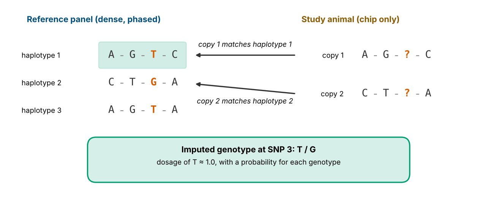
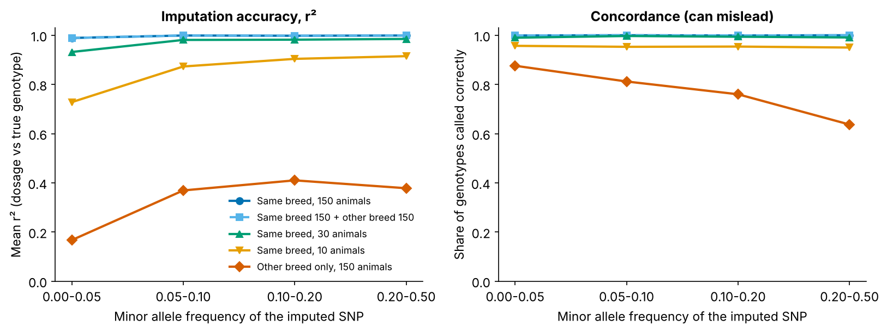
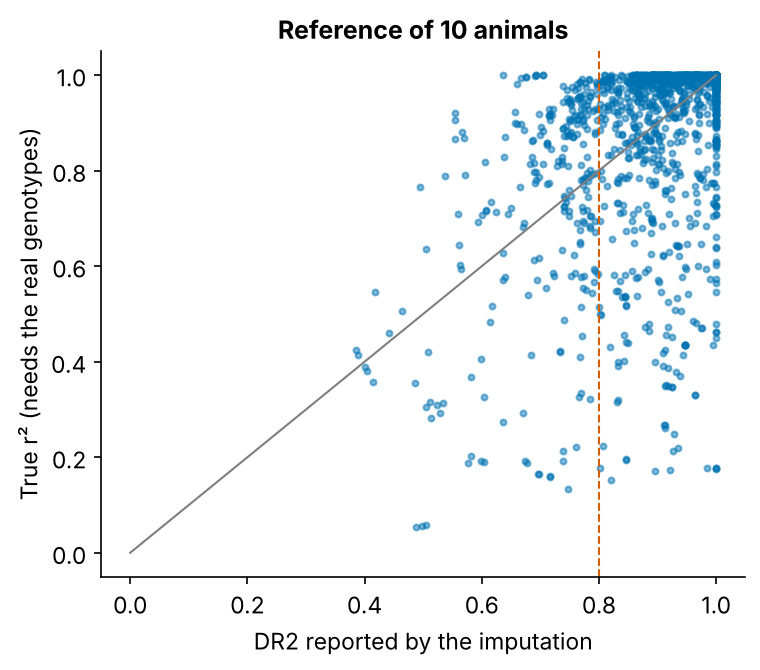
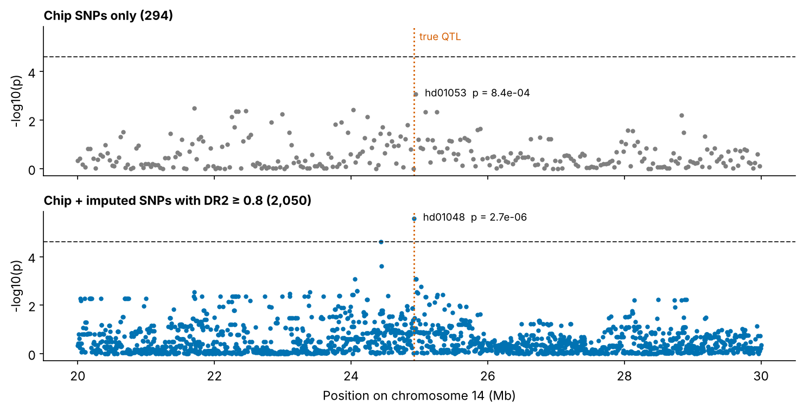

# Haplotypes, phasing and imputation {#sec-hap}

::: {.lead}
A single SNP is one letter. A haplotype is a short word: the alleles that travel together on one chromosome copy. The first half of this chapter uses haplotypes of a few SNPs to test a region and to check a hit. The second half works on whole chromosomes: how phase is stored in PLINK 2.0, why PLINK is not the tool for phasing, how BEAGLE, SHAPEIT and Eagle do it, and how imputation turns a cheap chip into a dense one.
:::

::: {.callout-important}
## Which PLINK?
PLINK 1.9 and 2.0 dropped the haplotype tests, so the first half of this chapter uses the old PLINK 1.07 (`plink107`). Every 1.07 command needs `--noweb`, which stops it trying to check for updates online. The second half uses PLINK 2.0 to store and analyse phased and imputed data, while the phasing and imputation themselves are done by other programs.
:::

We work on one small region around the BRD SNP, cut out with PLINK 1.9:

```bash
plink --bfile cattle_qc --cow --chr 5 --from-mb 60 --to-mb 64 --make-bed --out brd_region   # 59 SNPs
```

## What PLINK has to guess: phase

Genotypes do not tell you which alleles sit together on the same chromosome copy.

An animal that is A/C at one SNP and G/T at the next could carry its alleles in two ways:

| | Chromosome from sire | Chromosome from dam |
|---|---|---|
| Possibility 1 | A - G | C - T |
| Possibility 2 | A - T | C - G |

Both give exactly the same genotypes (A/C and G/T), so the chip cannot tell them apart. PLINK uses the **EM algorithm**: it starts from a guess of the haplotype frequencies in the population, works out how likely each phase is for each animal, updates the frequencies, and repeats until nothing changes. Every phase with probability at least 0.01 is kept as a weighted possibility, and haplotypes rarer than 1% are dropped (`--mhf 0.01`). Calves are phased with the help of their parents.

You tell PLINK which SNPs make up each haplotype:

| Option | Defines the haplotypes as |
|---|---|
| `--hap-window 3` | Every run of 3 neighbouring SNPs (a sliding window; 57 windows here) |
| `--hap-window 1,2,3` | Windows of 1, 2 and 3 SNPs together (174 windows) |
| `--hap-snps snp00705-snp00707` | One block of SNPs that you name |
| `--hap myfile.hlist` | A file of haplotypes or blocks you define |

## Haplotype frequencies and a case/control test

```bash
plink107 --noweb --bfile brd_region --cow --hap-window 3 --hap-freq --out hfreq
plink107 --noweb --bfile brd_region --cow --hap-snps snp00705-snp00707 --hap-assoc --out hsnps
```

```text
     LOCUS    HAPLOTYPE        F_A        F_U      CHISQ   DF          P SNPS
      WIN1      OMNIBUS         NA         NA      53.28    4  7.464e-11 snp00705|snp00706|snp00707
      WIN1          GCC     0.1302     0.2676      18.81    1  1.444e-05
      WIN1          TAT     0.2503     0.2413    0.07338    1     0.7865
      WIN1          GAT     0.3695     0.1585      40.61    1  1.854e-10
      WIN1          TCT   0.003574    0.02894      5.789    1    0.01612
      WIN1          GCT     0.2465     0.3037      2.704    1     0.1001
```

Five haplotypes exist for these three SNPs. Each line tests one haplotype against all the others (1 df); the **OMNIBUS** line tests all of them at once (df = 5 − 1 = 4). GAT, whose middle letter is the A allele of snp00706, makes up 37% of case chromosomes but only 16% of control chromosomes.

These are plain chi-square tests, so breed differences fool them just as they fooled `--assoc` in Chapter 12: some windows reached p = 7 × 10⁻¹², stronger than the true SNP. Use `--hap-logistic` (or `--hap-linear` for a measured trait), which accepts covariates:

```bash
plink107 --noweb --bfile brd_region --cow --hap-window 3 --hap-logistic --covar pcs.txt --out hlogpc
```

```text
NSNP NHAP CHR      BP1      BP2     SNP1     SNP2 HAPLOTYPE      F     OR   STAT        P
   3    6   5 62019439 62070027 snp00706 snp00708       ATG   0.45   3.32   30.6 3.15e-08
   3    6   5 61793011 62019439 snp00704 snp00706       TGC  0.454  0.335   25.1  5.5e-07
   3    5   5 61838266 62040131 snp00705 snp00707       GAT  0.244   3.06   23.4 1.31e-06
```

With PCs as covariates, the three best windows all contain snp00706. For family data, `--hap-tdt` runs the TDT on haplotypes.

## Is it one SNP or the whole haplotype? `--chap`

A haplotype signal raises two questions:

1. Does one SNP explain all of it?
2. Does that SNP matter on its own, or only through its neighbours?

`--chap` answers both by comparing two models. In the *alternative* model every haplotype has its own effect. In the *null* model some haplotypes are forced to share one effect. If forcing them together costs little, the simpler explanation is enough.

```bash
# 1. is there any haplotype effect at all?
plink107 --noweb --bfile brd_region --cow --chap --hap-snps snp00705-snp00707 --covar pcs.txt --out chap1
# 2. is anything left once we allow for snp00706?
plink107 --noweb --bfile brd_region --cow --chap --hap-snps snp00705-snp00707 --control snp00706 --covar pcs.txt --out chap2
# 3. does snp00706 have an effect beyond its neighbours?
plink107 --noweb --bfile brd_region --cow --chap --hap-snps snp00705-snp00707 --independent-effect snp00706 --covar pcs.txt --out chap3
```

| Test | Haplotypes grouped together in the null model | χ² | df | p | Conclusion |
|---|---|---|---|---|---|
| 1. Overall | all five together | 42.7 | 4 | 1.2 × 10⁻⁸ | The region matters |
| 2. `--control snp00706` | {GCC, TCT, GCT} and {TAT, GAT}, grouped by the snp00706 allele | 6.27 | 3 | 0.099 | Nothing beyond snp00706 |
| 3. `--independent-effect snp00706` | {GCC}, {TAT, TCT}, {GAT, GCT}, grouped by the other two SNPs | 34.8 | 2 | 2.8 × 10⁻⁸ | snp00706 has its own effect |

In test 2, the two haplotypes carrying A at snp00706 (TAT and GAT) had odds ratios of 2.50 and 3.85 when free, and 3.33 when forced to share. Tests 2 and 3 together say that snp00706 is the causal SNP, or a perfect tag for it, which is exactly how the data were simulated.

## Proxy association: do the neighbours agree?

For one SNP, PLINK searches nearby SNPs for haplotypes that tag it well ("proxies"), and tests those. This is a good sanity check for a hit: if a strong single-SNP result has no support from any proxy, suspect a genotyping problem at that SNP.

```bash
plink107 --noweb --bfile brd_region --cow --proxy-assoc snp00706 --proxy-verbose --out proxy1
```

```text
       SNP      MAF     GENO       KB      RSQ       OR    CHISQ        P
  snp00706    0.479    0.994        0        *     2.46     33.1 8.65e-09
  snp00708    0.445        1     50.6    0.556    0.379     33.6 6.81e-09
 ...
Of 60 subhaplotypes considered, 5 met proxy criteria
           HAP       FREQ        RSQ         OR      CHISQ          P
         .. TG      0.543      0.588       2.73       36.4   1.57e-09
```

Read `.. TG` as: skip the two proxy SNPs on the left and use the next two. That two-SNP haplotype has r² = 0.59 with snp00706 and gives the same signal, so the hit is backed by its neighbours. Settings to know: `--proxy-r2`, `--proxy-window 15`, `--proxy-kb 250`; `--proxy-tdt` for families and `--proxy-glm` for measured traits.

## Phasing whole chromosomes

So far PLINK has dealt with phase a few SNPs at a time, and only as haplotype *frequencies* in the group, or as several weighted guesses per animal. Many modern analyses need more: for every animal, the actual sequence of alleles on each of its two chromosome copies, from one end of the chromosome to the other.

### Why you would want phased data

| Use | Why phase is needed |
|---|---|
| **Imputation** (next section) | The program matches each of the animal's two haplotypes to haplotypes in a reference panel; nearly every imputation program phases the targets first or while it imputes |
| **Haplotype-based selection signatures** (EHH, iHS, XP-EHH) | These statistics follow how far a haplotype stays intact around a core SNP |
| **Parent-of-origin effects and imprinting** | You need to know which allele came from the sire and which from the dam |
| **Haplotype models in genomic prediction**, local ancestry in crossbreds | The units of the model are haplotypes or haplotype blocks, not single SNPs |
| **Phased r², LD-based estimates of effective population size** | The formulas assume haplotype frequencies (Chapter 9) |

Single-SNP QC, PCA, relatedness and ordinary association tests do **not** need phase: they work on genotype counts.

### The practice data for this part

The cattle file from Chapter 4 has only a few hundred SNPs per chromosome, which is too sparse for imputation. So this part uses a second simulation, made with the coalescent simulator msprime by `scripts/simulate_phasing.py` (files in `data/phasing/`). It models 10 Mb of chromosome 14 (20 to 30 Mb) in two breeds, A and B, that separated 60 generations ago and have each had an effective population size of 150 since then. The two breeds end up with an F<sub>ST</sub> of about 0.08, roughly the distance between two European beef breeds.

| File | Animals | SNPs | Phased? |
|---|---|---|---|
| `ref_A_hd.vcf.gz` | 150 of breed A, typed on a dense "HD" panel | 2,080 | Yes (the reference panel) |
| `ref_B_hd.vcf.gz` | 150 of breed B, same panel | 2,080 | Yes |
| `target_chip.vcf.gz` | 100 other animals of breed A, typed on a sparser "chip" (148 calls missing, 30 genotyping errors) | 294 | No |
| `truth_target_hd.vcf.gz` | The same 100 animals, all 2,080 SNPs, true haplotypes | 2,080 | Yes: the answer key, which never exists in real life |
| `target_pheno.txt` | Weaning weight of the 100 targets, with a QTL at a SNP that is **not** on the chip | | |
| `chr14.map` | Genetic map in PLINK format (1 cM per Mb) | 2,080 | |

### How a VCF and PLINK 2.0 store phase

In a VCF, a genotype written with a slash, `0/1`, is unphased: the animal carries one REF and one ALT allele, in unknown order. A genotype written with a bar, `0|1`, is phased: REF is on the first chromosome copy and ALT on the second, and `1|0` is the opposite. Read along a chromosome, the left-hand alleles form one haplotype and the right-hand alleles the other.

PLINK 2.0's `.pgen` format keeps this information. PLINK 1.9's `.bed` format cannot: it stores only the number of copies of an allele, so phase is lost the moment data pass through a `.bed` file.

```bash
plink2 --vcf ref_A_hd.vcf.gz --chr-set 29 --make-pgen --out refA
plink2 --pfile refA --pgen-info
```

These files hold only chromosome 14 and no sexes, so `--chr-set 29` (29 autosomes) is all PLINK needs; `--cow` gives the same results.

```text
--pgen-info on refA.pgen:
  Variants: 2080
  Samples: 150
  REF alleles are all known
  Maximum allele count for a single variant: 2
  Explicitly phased hardcalls present
  No dosages present
```

We then sent the same data along three routes and looked at the first SNP of the first six animals in the VCF that came out:

| Route | Commands | REF, ALT | Genotypes |
|---|---|---|---|
| Original file | | A, G | `1\|1 1\|1 0\|0 0\|1 1\|1 1\|1` |
| `.pgen` and back | `--make-pgen`, then `--export vcf` | A, G | `1\|1 1\|1 0\|0 0\|1 1\|1 1\|1` |
| Through a `.bed` | `--make-bed`, then `plink2 --bfile ... --export vcf` | A, G (INFO: `PR`) | `1/1 1/1 0/0 0/1 1/1 1/1` |
| Through PLINK 1.9 | `plink --vcf ... --make-bed`, then `plink --recode vcf-iid` | **G, A** (INFO: `PR`) | `0/0 0/0 1/1 0/1 0/0 0/0` |

The `.bed` route lost the phase: `--pgen-info` on a file made from it says "No hardcalls are explicitly phased" and "REF alleles are all provisional" (the `PR` flag in the VCF). The PLINK 1.9 route did worse: PLINK 1.9 made the minor allele A1 (Chapter 3) and wrote A1 as ALT, so REF and ALT swapped places and every genotype was recoded. The genotypes are still correct, but this file no longer matches the reference panel, and imputation programs will refuse those SNPs or, worse, treat them as different SNPs. We come back to this below.

::: {.callout-warning}
## Keep phased data out of `.bed` files
Once data are phased, store them as `.pgen` or as VCF/BCF, never as `.bed`. If you must use PLINK 1.9 on them, keep the phased VCF as the master copy. `--make-pgen erase-phase` removes phase deliberately when you need to.
:::

PLINK 2.0 can write phased data in the formats phasing and haplotype programs read:

```bash
plink2 --pfile refA --chr-set 29 --export haps ref-first --out refA_haps    # .haps + .sample (SHAPEIT, IMPUTE, selscan)
plink2 --pfile refA --chr-set 29 --export vcf bgz --out refA_phased         # phased VCF, block-gzipped
plink2 --pfile refA --chr-set 29 --export beagle-phased --out refA_bgl      # old BEAGLE 3 format
```

`--export haps` stops with `Error: '--export haps' must be used with a fully phased dataset.` when you give it the unphased `.bed` version, a useful safety check. Without `ref-first`, PLINK lists the ALT allele first in each `.haps` line, so a 0 means ALT; with `ref-first`, 0 means REF, as in a VCF. Check which convention the next program expects.

`--r2-phased` (Chapter 9) uses the real phase when it is there. With unphased data it falls back on EM, and for single pairs of SNPs EM works well: over 85,189 pairs of SNPs less than 200 kb apart, the r² from EM differed from the r² computed with the true phase by 0.003 on average (only 376 pairs by more than 0.05). The unphased r² differed from both by 0.017 on average. So **pairwise LD does not need phased data. Whole haplotypes do.**

### Why we do not phase with PLINK

Three reasons, from the simplest to the most important.

1. **PLINK 1.9 and 2.0 have no phasing algorithm.** They store, convert, filter and export phased data, but every phased genotype in a `.pgen` file was phased by another program.
2. **PLINK 1.07 phases only short windows, each on its own.** Its EM algorithm must consider every possible haplotype in a window, and the number of possible haplotypes doubles with each extra SNP (2<sup>k</sup> for k SNPs). So it works in windows of a few SNPs, and it phases each window separately. We ran it on the 100 target animals:

    ```bash
    plink --vcf target_fixed.vcf.gz --chr-set 29 --double-id --keep-allele-order --recode --out target
    plink107 --noweb --file target --cow --hap-window 6 --hap-phase --out p107
    ```

    It wrote 289 separate files (`p107.phase-WIN1` to `p107.phase-WIN289`), one per window of 6 SNPs. Within a window it did well: compared with the true haplotypes, it got the phase right in 96.0% of the 17,397 animal-windows that had at least two heterozygous SNPs. But nothing links window 1 to window 2. To build a chromosome-long haplotype you would have to decide 288 times which haplotype of one window continues which haplotype of the next, and PLINK gives no help with that.
3. **It cannot use the information that makes phasing accurate.** Good phasing borrows from many other animals at once, models recombination along the chromosome, allows for genotyping errors, can use a phased reference panel and, in livestock, the pedigree. PLINK 1.07 uses only haplotype frequencies inside each window.

### How BEAGLE, SHAPEIT and Eagle phase

Nearly all modern programs build on one idea, the *copying model* of Li and Stephens (2003). An animal's chromosome is not unique: over short distances it looks like the chromosomes of other animals in the population, because they share ancestors. So the program describes each chromosome copy of the animal as a **mosaic of pieces copied from other haplotypes** (the reference panel, or the other animals in the study). Moving along the chromosome, the copy usually continues from the same haplotype, and switches to another one only where a recombination happened in their shared history. Switches are more likely over long genetic distances, and a few mismatches are allowed for mutations and genotyping errors. This is a *hidden Markov model*: the hidden state is "which pair of haplotypes is being copied here", and the genotypes are the observations.

{#fig-ls-mosaic}

The figure comes from `scripts/ls_impute.py`, a short program written for this book. It fits the Li and Stephens model directly: it tries every pair of reference haplotypes at every chip SNP, so you can read every step. The Viterbi path of the model (the single most likely mosaic) gives the phased genotypes, and the forward-backward probabilities give the imputed dosages. Real programs do the same job thousands of times faster with clever shortcuts:

| Program | How it speeds up the copying model | Notes |
|---|---|---|
| **BEAGLE 5** (Browning and colleagues, 2018, 2021) | Imputes from a small set of "composite" reference haplotypes built for each target animal; phases in two stages (common variants first, then rare ones); works in overlapping windows | Phases and imputes in one run; reads VCF or its fast `bref3` reference format |
| **SHAPEIT5** (Hofmeister and colleagues, 2023; earlier SHAPEIT4, Delaneau and colleagues, 2019) | Uses the positional Burrows-Wheeler transform (PBWT) to pick the most similar haplotypes as copying states | Phasing only (`phase_common` for common variants, `phase_rare` for rare ones); can use parent-offspring information (`--pedigree`) |
| **Eagle2** (Loh and colleagues, 2016) | Finds long shared segments quickly, then runs a copying model on the best candidates | Phasing only, with or without a reference; human genetic maps built in, a constant 1 cM per Mb map supplied for other species |

For imputation after phasing with SHAPEIT or Eagle, the usual partners are Minimac4 and IMPUTE5.

::: {.callout-tip}
## Livestock have one big advantage: relatives
In a breed with a small effective population size, an animal's chromosome is often shared almost entirely with a sire, a half sib or a cousin in the reference. That is why the 150-animal panel in @fig-ls-mosaic needed a single piece per chromosome. Programs written for livestock exploit this directly. **FImpute** (Sargolzaei and colleagues, 2014) first uses the pedigree (family imputation) and then searches the population for long shared haplotypes with overlapping sliding windows; it is widely used in cattle breeding programs. SHAPEIT5 can also use parent-offspring information.
:::

## Imputation: filling in the SNPs you did not genotype

Suppose your animals were typed on a cheap chip and a group of reference animals on a dense panel or by whole-genome sequencing. The reference animals show which haplotypes go with which alleles at the missing SNPs, so the missing genotypes can be predicted from the chip SNPs around them.

{#fig-imp-idea}

In commands, the route from a chip file to imputed data in PLINK 2.0 is the one this section follows step by step:

```bash
# Step 1: make REF/ALT match the reference panel, and QC
plink2 --vcf lab_vcf.vcf --chr-set 29 --ref-allele force ref_allele_list.txt 2 1 --export vcf bgz --out target_fixed
# Step 2: phase and impute (BEAGLE in practice; the teaching program here)
python3 scripts/ls_impute.py ref_A_hd.vcf.gz target_fixed.vcf.gz chr14.map target_imputed
# Step 3: measure accuracy (here against the truth; in practice by masking)
python3 scripts/eval_imputation.py target_imputed.vcf.gz truth_target_hd.vcf.gz target_chip.vcf.gz
# Step 4: dosages into PLINK 2.0, quality filter, association
plink2 --vcf target_imputed.vcf.gz dosage=DS --chr-set 29 --make-pgen --out imp
plink2 --pfile imp --chr-set 29 --extract-if-info "DR2 >= 0.8" --make-pgen --out imp_dr2
plink2 --pfile imp_dr2 --chr-set 29 --pheno target_pheno.txt --pheno-name WWT --glm allow-no-covars --out imp
```

Imputation gives a probability for each genotype, not a certainty. The most useful summary is the **dosage**: the expected number of ALT alleles, a number between 0 and 2 (Chapter 13). A dosage of 1.97 means "almost surely two copies"; a dosage of 1.1 means "probably heterozygous, but not sure".

### Step 1: prepare the two files so they match

Most failed imputations fail here, not in the imputation program. The target and the reference must agree on:

1. **The genome assembly.** All positions must come from the same assembly (for cattle today, ARS-UCD1.2 or ARS-UCD2.0). Never mix files from different assemblies; convert positions first.
2. **The SNP names, positions and alleles.** BEAGLE requires reference and target markers to match on CHROM, POS, REF and ALT.
3. **The strand and the REF allele.** This is where PLINK 1.9 bites. Our chip data had travelled through PLINK 1.9 once (`--make-bed`, then `--recode vcf-iid`), as often happens when a lab sends PLINK files:

```bash
# what happened to the chip file before it reached us
plink --vcf target_chip.vcf.gz --chr-set 29 --double-id --make-bed --out lab
plink --bfile lab --chr-set 29 --recode vcf-iid --out lab_vcf
# compare REF/ALT of the target with the reference, SNP by SNP
zcat ref_A_hd.vcf.gz | grep -v "^#" | cut -f3,4,5 | sort > ref_alleles.txt
grep -v "^#" lab_vcf.vcf | cut -f3,4,5 | sort > tgt_alleles.txt
join ref_alleles.txt tgt_alleles.txt | \
  awk '{n++; if($2==$4 && $3==$5) same++; else if($2==$5 && $3==$4) swap++; else other++}
       END {print n, "shared:", same, "same,", swap, "swapped,", other+0, "other"}'
```

```text
294 shared: 224 same, 70 swapped, 0 other
```

70 of 294 SNPs had REF and ALT swapped, because PLINK 1.9 had made the minor allele A1. Set the REF allele from the reference panel with PLINK 2.0:

```bash
zcat ref_A_hd.vcf.gz | grep -v "^#" | awk '{print $3"\t"$4}' > ref_allele_list.txt   # SNP name, REF allele
plink2 --vcf lab_vcf.vcf --chr-set 29 --ref-allele force ref_allele_list.txt 2 1 \
       --export vcf bgz --out target_fixed
```

```text
--ref-allele: 70 sets of allele codes permuted.
Warning: 1786 variant IDs in --ref-allele file missing from main dataset.
```

After this, all 294 SNPs matched. (The warning is expected: those are the SNPs that are only in the reference.) With real data, also look for SNPs whose two alleles are different letters in the two files, which means a strand difference, and remove A/T and C/G SNPs if the strand is uncertain (Chapter 5). BEAGLE's companion tool `conform-gt` and `bcftools +fixref` do these checks for VCF files; with `--ref-from-fa`, PLINK 2.0 can set REF alleles from the genome's FASTA file instead of from a panel.

4. **Quality control on both files**, as in Chapters 6 to 8, using the same thresholds. Our target passed easily (no SNP above 5% missing, worst animal 1.7% missing, no SNP failing HWE at 10⁻⁶).
5. **One chromosome per run, sorted by position**, and the genetic map for that chromosome.

### Step 2: run the imputation

The commands for the standard programs look like this. They are shown for reference only: these programs could not be installed in the environment where this book was built, so **these four commands were not run here**. Check each program's manual for your version.

```bash
# BEAGLE 5: phases the target and imputes in one run
java -Xmx8g -jar beagle.jar gt=target_fixed.vcf.gz ref=ref_A_hd.vcf.gz map=chr14.map \
     out=target_imputed gp=true nthreads=4

# SHAPEIT5 to phase (target as indexed BCF), then Minimac4 to impute
phase_common --input target_fixed.bcf --reference ref_A_hd.bcf --map chr14.gmap.gz \
             --region 14 --output target_phased.bcf --thread 4
minimac4 --compress-reference ref_A_hd.bcf > ref_A_hd.msav
minimac4 ref_A_hd.msav target_phased.bcf -o target_imputed.vcf.gz
```

A few settings matter for livestock. BEAGLE's default effective population size, `ne=100000`, suits large human panels; with unphased targets BEAGLE estimates `ne` and the error rate from the data before phasing, but for a single breed you can also set a small value yourself. SHAPEIT and Eagle need a genetic map in their own formats; without a map for your species, a constant 1 cM per Mb is the usual stand-in (BEAGLE assumes this when `map=` is left out). PLINK's `.map` file, with its centimorgan column, is exactly the format BEAGLE's `map=` expects.

What we actually ran is the teaching program, on the same files:

```bash
python3 scripts/ls_impute.py ref_A_hd.vcf.gz target_fixed.vcf.gz chr14.map target_imputed
```

```text
reference: 150 animals (300 haplotypes), 2080 SNPs; target: 100 animals, 294 typed SNPs shared with the reference
wrote target_imputed.vcf.gz: 2080 SNPs (1786 imputed), 100 animals, 147 s
```

Its output VCF has the same layout as BEAGLE's: phased genotypes (`GT`), dosages (`DS`) and genotype probabilities (`GP`) for every animal, and in the INFO column the estimated ALT frequency (`AF`), the quality score `DR2` and the flag `IMP` for SNPs that were imputed rather than typed:

```text
#CHROM POS      ID      REF ALT ... INFO                     FORMAT   T_001
14     20001016 hd00001 A   G   ... AF=0.6200;DR2=1.000      GT:DS:GP 1|0:1.000:0.000,1.000,0.000
14     20005399 hd00002 T   C   ... AF=0.3550;DR2=1.000;IMP  GT:DS:GP 0|1:1.000:0.000,1.000,0.000
```

T_001 is heterozygous at both SNPs; the first was on the chip, the second was imputed (`IMP`). The phase says G (ALT) at the first SNP sits on the same chromosome copy as T (REF) at the second.

### Step 3: how good is it?

In a real study you never see the true genotypes of the imputed SNPs. The standard way to measure accuracy is **masking**: hide some genotypes you do know (for example, a few reference animals treated as targets, or a few chip SNPs), impute them, and compare. Our simulation gives us the answer key directly, so we imputed the 100 targets five times, with different reference panels, and compared every imputed genotype with the truth (`scripts/eval_imputation.py`):

{#fig-imp-acc}

| Reference panel | Mean r² | r², SNPs with MAF < 0.05 | Concordance | Imputed SNPs with DR2 ≥ 0.8 | Switch error rate |
|---|---|---|---|---|---|
| Same breed, 150 animals | 0.997 | 0.989 | 1.000 | 99% | 0.0002 |
| Same breed 150 + other breed 150 | 0.997 | 0.989 | 1.000 | 99% | 0.0002 |
| Same breed, 30 animals | 0.974 | 0.932 | 0.992 | 92% | 0.002 |
| Same breed, 10 animals | 0.878 | 0.728 | 0.953 | 72% | 0.016 |
| Other breed only, 150 animals | 0.353 | 0.167 | 0.743 | 29% | 0.279 |

What the table teaches:

- **The reference must contain the breed.** 150 animals of the other breed did far worse than 10 animals of the right breed. The target's haplotypes, shaped by 60 generations of drift in its own breed, were mostly missing from the other breed's panel. Studies in real cattle agree that the target breed must be well represented in the reference, and that adding other breeds to it can raise accuracy further (Bouwman and Veerkamp, 2014; Pausch and colleagues, 2017). Here adding breed B to a 150-animal breed-A panel changed nothing, because breed A alone was already almost perfect.
- **More reference animals, better accuracy**, above all for rare SNPs. Rare alleles sit on few haplotypes, so a small panel often has no copy of the right one.
- **Concordance flatters.** With the 10-animal panel, 95.3% of genotypes were right, but r² was only 0.73 for rare SNPs. For a SNP with MAF 0.02, calling every animal "homozygous common" is already 96% correct and completely useless. Report r² (or the correlation), not concordance.
- **Switch errors** count how often the phase flips between two neighbouring heterozygous SNPs. Phasing accuracy follows imputation accuracy, because both depend on finding the right haplotypes to copy. Across the same 6-SNP windows used for PLINK 1.07 above, the chromosome-wide phase from the 150-animal reference was right in 99.9% of animal-windows, against PLINK 1.07's 96.0%. (PLINK 1.07 had no reference panel to help it, which is part of the point.)

**DR2 and INFO.** Every imputation program reports a quality score per SNP, computed from the dosages alone, without the true genotypes: DR2 in BEAGLE, R2 in Minimac, INFO in IMPUTE. They estimate the r² between dosage and true genotype. A cut-off of 0.8 (sometimes 0.3 to 0.5 for association studies that keep more SNPs) is common.

{#fig-dr2}

A quality score is the model's opinion of itself, and a model that is wrong can be confidently wrong. With the 10-animal reference our DR2 called 72% of imputed SNPs "good", yet many of them had a true r² well below 0.8, and across SNPs DR2 and true r² correlated only about 0.5. The scores of BEAGLE and Minimac are better calibrated than this simple program's, but the lesson holds: use DR2 or INFO to remove bad SNPs, and use masking to measure accuracy.

### Step 4: bring the imputed data into PLINK 2.0

PLINK 2.0 imports dosages from a VCF when you name the FORMAT field that holds them:

```bash
plink2 --vcf target_imputed.vcf.gz dosage=DS --chr-set 29 --make-pgen --out imp
plink2 --pfile imp --pgen-info
```

```text
  Explicitly phased hardcalls present
  Explicitly phased dosages present
```

Both the phase and the dosages are kept. Filter on imputation quality with the INFO field, and run the association test on the dosages:

```bash
plink2 --pfile imp --chr-set 29 --extract-if-info "DR2 >= 0.8" --make-pgen --out imp_dr2
# 2080 variants in imp.pvar; 30 excluded by --extract-if-info, 2050 remaining.
plink2 --pfile imp_dr2 --chr-set 29 --pheno target_pheno.txt --pheno-name WWT \
       --glm allow-no-covars --out imp
```

{#fig-imp-gwas}

| Analysis | Top SNP | p | Effect of the ALT allele |
|---|---|---|---|
| Chip SNPs only | hd01053, 27 kb from the QTL (r² = 0.57 with it) | 8.4 × 10⁻⁴ | +5.8 kg |
| Chip + imputed SNPs | hd01048, **the QTL itself** | 2.7 × 10⁻⁶ | +8.6 kg (simulated: +10 kg) |

On the chip, the best SNP was only a partial tag of the QTL and did not reach genome-wide significance. After imputation the causal SNP itself was tested and passed the Bonferroni threshold (0.05 / 2,050 = 2.4 × 10⁻⁵). This is the main reason livestock studies impute from 50K to high density or to sequence before an association study.

Useful options for imputed data in PLINK 2.0:

| Option | What it does |
|---|---|
| `--vcf file dosage=DS` | Import dosages (use `dosage=HDS` for haplotype dosages, or `--bgen` for BGEN files) |
| `--extract-if-info "DR2 >= 0.8"` | Keep SNPs by an INFO field; use the field name your program writes (DR2 for BEAGLE, R2 for Minimac4) |
| `--mach-r2-filter 0.3` | Compute the MaCH r² quality score from the dosages and remove SNPs below 0.3 |
| `--hard-call-threshold 0.1` | How sure a dosage must be to also store a best-guess genotype; less sure calls are set to missing for commands that need hard calls (292 genotypes here) |
| `--glm` | Uses the dosages, not the hard calls |

PLINK 1.9 reads only the `GT` field of a VCF, so it would turn these dosages into hard calls. To analyse dosages in PLINK 1.9, use `--dosage` (Chapter 13).

The target animals' phenotype file starts with an `IID` column only: animals imported from a VCF have no FID in PLINK 2.0, and a file with an FID column would not match them.

### PLINK 1.07's own imputation heuristic

PLINK 1.07 has a simple imputation tool built on proxy haplotypes, which treats animals with a missing phenotype as the reference panel. On the BRD region of the cattle file, we made 90 animals the reference (phenotype -9), hid 8 SNPs (including snp00706) in the other 261, and asked PLINK to fill them in:

```bash
plink107 --noweb --file masked --cow --proxy-impute all --proxy-replace --make-bed --out imputed
```

| Hidden SNP | INFO (quality, 0 to 1) | Study animals given a genotype | Correct calls |
|---|---|---|---|
| snp00706 | 0.90 | 101 of 259 | 90.1% |
| snp00725 | 0.86 | 173 of 258 | 90.8% |
| snp00720 | 0.71 | 140 of 261 | 95.0% |
| snp00690 | 0.48 | 98 of 261 | 91.8% |
| snp00710 | 0.67 | 0 of 260 | |
| snp00685 | 0.59 | 0 of 261 | |

PLINK fills a genotype only when the best guess has a probability of at least 0.9 (`--proxy-impute-threshold`), so it leaves most genotypes empty, and when it calls, it is right only about 90% of the time. It is a historical tool; use the programs above.

### Imputation in livestock: practical advice

- **Use the target breed in the reference**, and include the sires of your target animals if you can: close relatives in the reference give the longest, most accurate matches.
- **Go up in steps.** From a low-density chip, impute first to 50K, then to HD, then to sequence. In Holstein cattle, imputing straight from 50K to sequence gave an accuracy of 0.37 to 0.46 per SNP, and going through the HD panel first raised it to 0.65 (van Binsbergen and colleagues, 2014).
- **Check accuracy by masking**, per SNP and per animal. Animals with few relatives in the reference impute worst.
- **Treat the X chromosome separately**: males are haploid outside the pseudoautosomal region. SHAPEIT5 takes a list of haploid samples (`--haploids`), and FImpute needs a pedigree for the X.
- **Keep the dosages.** In Fleckvieh and Holstein cattle, dosages of imputed sequence variants agreed better with the true genotypes than best-guess calls did, and were better at detecting causal mutations (Pausch and colleagues, 2017). Analyse dosages with `plink2 --glm` (or a mixed model, Chapter 13) and filter on DR2 or INFO; round to hard calls only when a later program demands it.
- **Record everything**: assembly, reference panel (breeds, size), program and version, settings, and the quality filter.

::: {.callout-note}
## PLINK 2.0
Neither PLINK 1.9 nor 2.0 has the haplotype tests, `--chap`, proxy association or the 1.07 imputation heuristic. PLINK 1.9 keeps the LD tools that support this work: `--ld`, `--r2`, `--blocks` (haplotype blocks, as in Haploview), `--clump` and `--show-tags`. PLINK 2.0 adds what modern pipelines need around phasing and imputation: it stores phased genotypes and dosages in `.pgen` files, imports them from VCF and BGEN, exports phased data (`--export haps`, `vcf`, `bgen-1.2`), filters on imputation quality (`--extract-if-info`, `--mach-r2-filter`) and tests dosages with `--glm`. The phasing and imputation themselves are done by BEAGLE, SHAPEIT, Eagle, Minimac, IMPUTE or FImpute.
:::

## Exercises

Try each question first, then open the answer. The challenge goes a step further than the chapter.

**1.** What are the frequencies of the QTL allele T at hd01048 in the two reference breeds?

::: {.callout-note collapse="true" title="Answer"}
```bash
plink2 --vcf ref_A_hd.vcf.gz --chr-set 29 --freq --out exA     # 0.340
plink2 --vcf ref_B_hd.vcf.gz --chr-set 29 --freq --out exB     # 0.243
```
:::

**2.** In the imputed file `imp`, how many of the 2,080 SNPs pass DR2 ≥ 0.3, ≥ 0.8 and ≥ 0.95?

::: {.callout-note collapse="true" title="Answer"}
2,075, 2,050 and 1,364. The very strict 0.95 throws away a third of the SNPs, while 0.3 and 0.8 differ by only 25. Choose the filter from the DR2–accuracy figure above, not by habit.
:::

**Challenge.** Measure the LD between the QTL hd01048 and the chip SNP hd01053, which was the top chip SNP in the GWAS, in reference A. Use it to explain why the chip GWAS found only a weak signal.

::: {.callout-note collapse="true" title="Answer"}
`plink2 --vcf ref_A_hd.vcf.gz --chr-set 29 --ld hd01048 hd01053` gives r² = 0.57 and |D′| = 1. D′ = 1 means the two SNPs are never seen on all four possible haplotypes, but r² = 0.57 means the chip SNP is only a partial tag: the test statistic at a tag shrinks roughly in proportion to r². Imputation recovers the QTL itself, which is why the imputed GWAS gave p = 2.7 × 10⁻⁶ against 8.4 × 10⁻⁴ on the chip.
:::
