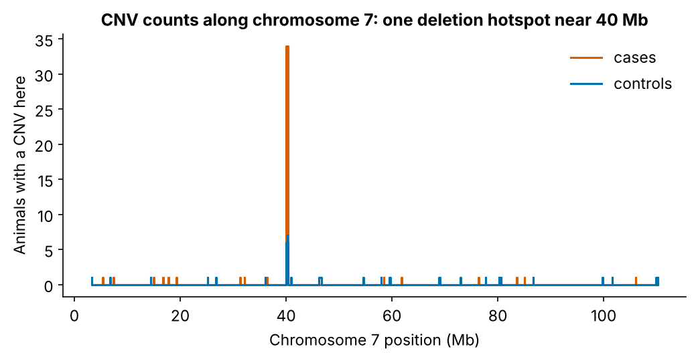

# Copy number variants {#sec-cnv}

::: {.lead}
A copy number variant (CNV) is a stretch of DNA that some animals have lost (a deletion) or carry extra copies of (a duplication). In our data, BRD cases carried 46% more CNVs than controls, and one deletion on chromosome 7 was carried by 34 cases but only 6 controls.
:::

::: {.callout-important}
## Which PLINK?
PLINK does not call CNVs. A caller such as PennCNV or QuantiSNP reads the raw SNP-chip intensities (Log R Ratio and B Allele Frequency) and writes a list of segments. PLINK 1.07 then filters, summarises and tests those segments. PLINK 1.9 and 2.0 have no CNV tools, so this chapter uses `plink107 --noweb --cow`.
:::

## What a CNV looks like in the data

Normally an animal has two copies of every autosomal segment, one from each parent. A deletion leaves 1 (or 0) copies; a duplication gives 3 or more.

| Copy number | Name | Code in the `.cnv` file |
|---|---|---|
| 0 | Homozygous deletion | 0 |
| 1 | Heterozygous deletion | 1 |
| 2 | Normal | (not listed) |
| 3 or 4 | Duplication | 3, 4 |

## Step 1: the CNV file and its map

A `.cnv` file has one line per segment:

```text
FID IID     CHR BP1      BP2      TYPE SCORE SITES
ANG ANG_001 13  67427184 67528256 3    25.19 12
ANG ANG_001 12  77659358 77822565 3    6.98  20
```

| Column | Meaning |
|---|---|
| BP1, BP2 | Start and end of the segment |
| TYPE | Copy number |
| SCORE | Confidence score from the caller |
| SITES | Number of SNP probes inside the segment |

Our file has 1,260 segments for 361 animals. PLINK first needs a map of all segment boundaries:

```bash
plink107 --noweb --cow --cnv-list cattle.cnv --fam cattle.fam --cnv-make-map --out cnv
# Wrote 3780 unique positions to file
plink107 --noweb --cow --cnv-list cattle.cnv --fam cattle.fam --map cnv.cnv.map --out cnv_sum
```

```text
1250 mapped to a person, of which 1250 passed filters
 CopyN Case/Control
     1    383 / 382
     3    228 / 257
```

Ten segments belonged to the two animals with unknown sex, whose phenotypes PLINK 1.07 treats as missing. `cnv_sum.cnv.indiv` lists each animal's number of segments (NSEG), total length (KB) and average length (KBAVG); `cnv_sum.cnv.summary` lists, for each map position, how many cases and controls have a CNV there.

## Step 2: filter the segments

Many short CNVs with few probes and low scores are calling errors. Filtering is where CNV studies succeed or fail, and every filter changes the counts:

| Filter | Keeps | Segments (of 1,250) | Deletions case/control | Duplications case/control |
|---|---|---|---|---|
| none | everything | 1,250 | 383 / 382 | 228 / 257 |
| `--cnv-del` | deletions only | 765 | 383 / 382 | |
| `--cnv-dup` | duplications only | 485 | | 228 / 257 |
| `--cnv-kb 100` | at least 100 kb | 517 | 185 / 145 | 93 / 94 |
| `--cnv-max-kb 50` | at most 50 kb | 360 | 109 / 102 | 72 / 77 |
| `--cnv-score 20` | score at least 20 | 691 | 216 / 208 | 119 / 148 |
| `--cnv-sites 10` | at least 10 probes | 645 | 212 / 191 | 117 / 125 |
| `--cnv-freq-exclude-below 10` | only common CNV regions | | 20 / 4 | |
| `--cnv-intersect genes.txt` | segments overlapping listed regions | | 38 / 9 | 5 / 0 |
| `--cnv-exclude genes.txt` | segments not overlapping them | | 345 / 373 | 223 / 257 |

A common recipe is `--cnv-kb 100 --cnv-sites 10 --cnv-score 10`, plus removing animals with far too many CNVs (they usually have noisy intensities; check `.cnv.indiv`). `--cnv-write` saves the filtered segments as a new file.

## Step 3: do cases carry more CNVs overall? (burden tests)

`--cnv-indiv-perm` compares the groups on several summary measures and gets p-values by shuffling the case/control labels among animals.

```bash
plink107 --noweb --cow --cnv-list cattle.cnv --fam cattle.fam --map cnv.cnv.map \
         --cnv-indiv-perm --mperm 10000 --seed 3 --out burden
```

| Measure | Meaning | Cases | Controls | Empirical p |
|---|---|---|---|---|
| RATE | CNVs per animal | 4.30 | 2.95 | 0.0001 |
| PROP | Share of animals with at least one CNV | 0.97 | 0.96 | 0.44 |
| TOTKB | Total CNV length per animal (kb) | 557.6 | 334.1 | 0.0001 |
| AVGKB | Average length of one CNV (kb) | 125.7 | 110.6 | 0.037 |

Cases carry more and longer CNVs. PROP does not differ because almost every animal has at least one CNV. Split by type, the deletion rate was 2.70 against 1.76 (p = 0.0001) and the duplication rate 1.61 against 1.18 (p = 0.0007). With `--cnv-count genes.txt`, PLINK adds gene-based measures: 28% of cases but 4% of controls had a CNV in a listed region (GPROP, p = 0.001).

## Step 4: which position? (CNV association by location)

Without `--cnv-indiv-perm`, `--mperm` tests every map position:

```bash
plink107 --noweb --cow --cnv-list cattle.cnv --fam cattle.fam --map cnv.cnv.map --mperm 10000 --seed 3 --out loci
```

```text
 CHR             SNP         EMP1         EMP2
   7     p7-39998413    9.999e-05    9.999e-05
   7     p7-40002671    9.999e-05    9.999e-05
```

{#fig-cnv}

Positions are named `p<chr>-<bp>`. At these positions 34 cases and 6 controls carry a CNV. EMP1 is the point-wise empirical p-value; EMP2 is corrected for all 3,780 positions. All 100 positions with EMP2 < 0.05 lay on chromosome 7 between 39.99 and 40.41 Mb: one deletion region, exactly where the simulation put it. Options: `--cnv-test-1sided` (only test for more CNVs in cases), `--cnv-test-window 100` (count CNVs within 100 kb) and `--cnv-test-region` (test whole regions).

## Step 5: common CNVs together with SNPs

A common CNV (a copy number polymorphism, CNP) can sit on top of a SNP. An animal can then carry, say, one A allele on one chromosome and a deletion on the other, which normal genotype calling reports as "AA". PLINK 1.07 stores such data as **generic variants** in a `.gvar` file with copy numbers for each allele:

```text
ANG ANG_001 ccnv1 A 1 G 0      # one A copy, the other chromosome deleted
ANG ANG_002 ccnv1 A 1 G 1      # normal heterozygote
```

We simulated a deletion that raises BRD risk sitting on a SNP that does not:

```bash
plink107 --noweb --cow --gfile ccnv --out g1
```

| Test | Question | Result |
|---|---|---|
| P(SNP) | Does the allele (A or G) matter, ignoring copy number? | 0.053 |
| P(CNP) | Does total copy number matter? | 1.1 × 10⁻⁷ |
| P(CNP\|SNP) | Does copy number matter after allowing for the allele? | 3.2 × 10⁻⁷ |
| P(SNP\|CNP) | Does the allele matter after allowing for copy number? | 0.26 |

The deletion carries the risk and the SNP allele does not. In a SNP-only study you would only see the weak SNP signal (p = 0.053), which is just a shadow of the deletion.

::: {.callout-note}
## PLINK 2.0
PLINK 1.9 and 2.0 have no CNV commands. For livestock CNV work today: call CNVs with PennCNV (chips) or a sequencing caller, merge them into CNV regions with tools such as CNVRanger (R/Bioconductor), and test common regions by coding each animal's copy number as a dosage or covariate in `plink2 --glm`.
:::
