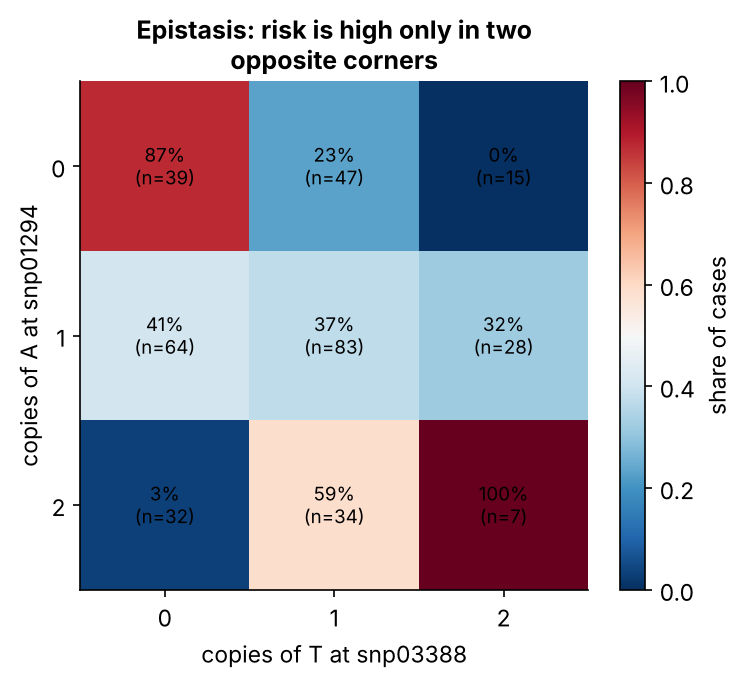
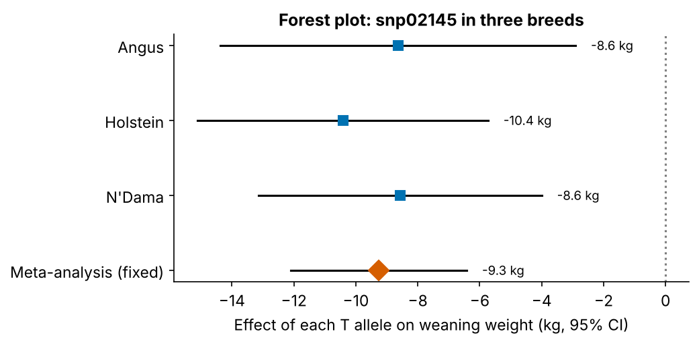

# Beyond single SNPs: gene sets, epistasis, environments and meta-analysis {#sec-beyond}

::: {.lead}
So far we tested one SNP at a time. This chapter looks at whole regions, at pairs of SNPs that only matter together, at SNP effects that change with a continuous environment, and at combining several studies. In our data the region test ranked the PLAG1 region first, a pure SNP × SNP interaction reached p = 6 × 10⁻²⁰ although neither SNP had any effect alone, and a meta-analysis of the three breeds found the weaning-weight QTL at p = 1.7 × 10⁻¹⁰.
:::

All commands use the cleaned file and PLINK 1.9: `plink --bfile cattle_qc --cow --allow-no-sex`.

## Gene-based (set-based) tests

A gene may hold several weak signals, none strong enough alone. A set-based test pools the evidence from all SNPs in a gene or region and judges the total by permutation.

**Step 1: define the sets.** `genes.txt` lists regions, one per line: CHR START END NAME.

```bash
plink --bfile cattle_qc --cow --make-set genes.txt --write-set --out sets
# --make-set: 8 sets defined.
```

**Step 2: test with permutation.**

```bash
plink --bfile cattle_qc --cow --allow-no-sex --pheno pheno.txt --pheno-name WWT \
      --make-set genes.txt --linear mperm=10000 set-test --covar cov_all.txt --hide-covar --seed 2 --out settest
```

```text
         SET   NSNP   NSIG   ISIG         EMP1 SNPS
  PLAG1_region     30     17      5    9.999e-05 snp02145|snp02136|snp02144|snp02143|snp02148
  GXE_region       26      3      3       0.0028 snp01540|snp01539|snp01541
  NULL_A            1      1      1     0.005499 snp00007
  LCORL_region     50      3      3      0.07399 snp00891|snp00870|snp00874
  BRD_region       29      2      2       0.2528 snp00718|snp00692
```

How it works, in four steps:

1. Within each set, keep the SNPs with p below `--set-p` (default 0.05). Their number is **NSIG**.
2. From those, pick up to `--set-max` SNPs (default 5) that are not in strong LD with each other (r² below `--set-r2`, default 0.5). Their number is **ISIG**.
3. The set statistic is the average test statistic of those SNPs.
4. Repeat steps 1 to 3 in each permuted dataset. **EMP1** is the share of permutations that beat the real value.

| Settings | PLAG1_region | GXE_region | LCORL_region |
|---|---|---|---|
| Defaults (`--set-p 0.05 --set-max 5`) | 5 SNPs, EMP1 0.0001 | 3 SNPs, 0.0028 | 3 SNPs, 0.074 |
| `--set-p 0.01` | 5 SNPs, 0.0001 | 3 SNPs, 0.011 | 2 SNPs, 0.093 |
| `--set-max 1` (best SNP only) | 1 SNP, 0.0001 | 1 SNP, 0.0022 | 1 SNP, 0.071 |

Two cautions. The "null" region NULL_A got EMP1 = 0.0055 from a single SNP with p = 0.005: set p-values are not corrected for the number of sets, so correct for that yourself (8 sets here). And the BRD region did nothing for weaning weight, as expected, but for BRD itself (`--logistic mperm=10000 set-test` with PCs) it gave EMP1 = 0.0008, led by snp00706.

## Epistasis: SNP × SNP interaction

Sometimes two SNPs only matter **together**. An epistasis test fits, for each pair, a model with both SNPs and their product, and tests the product term.

The BRD simulation included an epistatic pair, but it was built so that nearly every animal carried the risk combination, so it behaved like a single-SNP effect and the pair test failed (p = 0.57). Real epistasis is often just as hard to see. To show what a detectable interaction looks like, we simulated a second disease, **PKE**, caused only by the combination of snp01294 (chromosome 8) and snp03388 (chromosome 22).

{#fig-epi}

Single-SNP tests miss it completely:

```text
   8   snp01294   ...  CHISQ 0.8231   P 0.3643   OR 0.87
  22   snp03388   ...  CHISQ 2.893    P 0.08894  OR 0.76
```

A genome-wide screen tests all 8.85 million pairs of autosomal SNPs:

```bash
plink --bfile cattle_qc --cow --allow-no-sex --autosome --pheno pke.txt --fast-epistasis --epi1 1e-5 --out pke_fe
plink --bfile cattle_qc --cow --allow-no-sex --autosome --pheno pke.txt --fast-epistasis boost --epi1 1e-5 --out pke_feb
plink --bfile cattle_qc --cow --allow-no-sex --autosome --pheno pke.txt --epistasis --epi1 1e-5 --out pke_ep
```

| Method | What it tests | Top pair | p | Pairs with p < 10⁻⁵ |
|---|---|---|---|---|
| `--fast-epistasis` | Fast Z test of the allele × allele interaction | snp01294 × snp03388 | 6.0 × 10⁻²⁰ | 25 |
| `--fast-epistasis boost` | BOOST: likelihood ratio test of all interaction terms (4 df) | snp01294 × snp03388 | 3.5 × 10⁻²⁰ | 81 |
| `--epistasis` | Logistic regression with an interaction term | a false pair with OR_INT = inf, then the true pair | 3.7 × 10⁻¹² | 14 |

With 8.85 million tests, the Bonferroni threshold is 0.05 / 8,851,528 = 5.6 × 10⁻⁹. Only the true pair passed it with the two fast methods. The regression put a false pair first, with an infinite odds ratio: complete separation again (Chapter 12). Always look at the 3 × 3 table before believing a pair:

```bash
plink --bfile cattle_qc --cow --allow-no-sex --pheno pke.txt --twolocus snp01294 snp03388 --out pke_two
```

| Option | Meaning |
|---|---|
| `--epi1` | p threshold for reporting a pair (default 0.0001, or 5 × 10⁻⁶ for BOOST) |
| `--epi2` | p threshold for counting partners in the summary file (default 0.01) |
| `--set-by-all` | Test SNPs in a set against all other SNPs (4,200 tests instead of 8.85 million) |
| `case-only` | Case-only analysis: more power, but SNPs must be unlinked; use with `--gap` |

For measured traits, `--epistasis` fits linear regression. Always use `--autosome`, and on real data consider pruning SNPs in strong LD first.

## SNP × environment with a continuous environment

Chapter 13 tested a two-level environment (feedlot or pasture). For a continuous one (age at weaning, temperature-humidity index, rainfall) you use the same `--interaction`, with one trap. Our first try with AGE in days gave NA for every SNP. The interaction column ADD × AGE (values near 0, 205 or 410) is almost a copy of ADD × 205, so it is nearly collinear with ADD, and PLINK's collinearity check (`--vif`, default 50) rejects the model.

The fix is to **centre** the environment, which also makes the ADD term easier to read (it becomes the SNP effect at the average age):

```bash
# AGE_C = (AGE - 205) / 10
plink ... --linear --covar cov_c.txt --covar-name PC1,PC2,SEX_M,FEEDLOT,AGE_C \
          --interaction --parameters 1-6,11 --out int_agec
```

```text
  10   snp01540   52104483    T        ADD      347      -5.29       -3.932    0.0001021
  10   snp01540   52104483    T  ADDxAGE_C      347     0.4663       0.4362        0.663
```

The feedlot SNP's effect does not change with age (p = 0.66), which is correct: no age interaction was planted. Across the genome, 1 of 4,443 ADD × AGE_C terms had p < 0.001, close to the 4 expected by chance.

::: {.callout-warning}
## The -9 trap
Our first centred version, AGE − 205, gave the value -9 to calves weaned at 196 days, and PLINK silently treated them as missing (NMISS fell from 347 to 336). Dividing by 10 avoided it. `--missing-phenotype` changes the missing code.
:::

## Meta-analysis: combining several studies

Each breed (or country, or research group) runs its own analysis and shares only the summary results. A meta-analysis combines them, giving more weight to the more precise estimates. The fixed-effect estimate is

$$
\hat\beta_{\text{meta}} = \frac{\sum_i w_i \hat\beta_i}{\sum_i w_i}, \qquad w_i = \frac{1}{SE_i^2}
$$

**Step 1: one analysis per breed**, with the same A1 allele everywhere (`--keep-allele-order`) and standard errors (`--ci 0.95`):

```bash
for b in ANG HOL NDA; do
  plink --bfile cattle_qc --cow --allow-no-sex --pheno pheno.txt --pheno-name WWT --keep-allele-order \
        --keep k_$b.txt --linear --covar cov_all.txt --covar-name SEX_M,FEEDLOT,AGE --hide-covar --ci 0.95 --out mk_$b
done
```

**Step 2: combine them.**

```bash
plink --cow --meta-analysis mk_ANG.assoc.linear mk_HOL.assoc.linear mk_NDA.assoc.linear + qt --out meta_fixed
```

```text
 CHR          BP            SNP  A1  A2   N           P        P(R)    BETA BETA(R)       Q       I
  14    24936133       snp02145   T   ?   3    1.66e-10    1.66e-10 -9.2667 -9.2667  0.8324    0.00
  14    24925785       snp02144   A   ?   3   2.639e-06   2.639e-06 -6.7126 -6.7126  0.5129    0.00
   6    38331315       snp00891   G   ?   3    0.001401     0.01704  5.0585  5.1863  0.1530   46.73
```

| Column | Meaning |
|---|---|
| N | Number of studies with this SNP |
| P, BETA | Fixed-effect result (assumes one true effect in every study) |
| P(R), BETA(R) | Random-effects result (allows the true effect to differ between studies) |
| Q | p-value of Cochran's Q test: do the studies disagree? |
| I | I²: share of the variation due to real differences between studies (0 to 100%) |

{#fig-forest}

The PLAG1 SNP is consistent across breeds (I² = 0). The LCORL SNP shows moderate disagreement (I² = 47%), so its random-effects p-value (0.017) is weaker than the fixed-effect one (0.0014).

**What went wrong on the first try.** PLINK writes rejected lines to a `.prob` file. Ours had 3,956:

| Problem code | Count | Cause | Fix |
|---|---|---|---|
| BAD_CHR | 1,923 | `--meta-analysis` run without `--cow`, so chromosomes 27 to 29 and X were not recognised | Add `--cow` here too |
| ALLELE_MISMATCH | 1,425 | Each breed picked its own minor allele as A1 | Run every study with `--keep-allele-order` |
| BAD_ES, BAD_SE | 1,376 each | SNPs monomorphic within a breed have no estimate | Normal |
| every line | | Without `+ qt`, PLINK looked for an OR column | Add `+ qt` for BETA files |

Other modifiers: `logscale` (ORs already on log scale), `study` (adds each study's effect), `report-all` (keep SNPs found in only one study) and `weighted-z` (sample-size weighted Z, when studies used different scales). Input files can come from any software, as long as they have SNP, A1, effect and SE columns.

::: {.callout-note}
## PLINK 2.0
Set-based tests are not in 2.0 (use 1.9, or tools such as MAGMA, SKAT or GCTA-fastBAT). Recent 2.0 builds have `--epistasis`, `--epistasis-boost` and `--twolocus`. G × E uses `--glm interaction` with `--parameters`. Recent builds include `--meta-analysis`; METAL is the most widely used external tool.
:::
