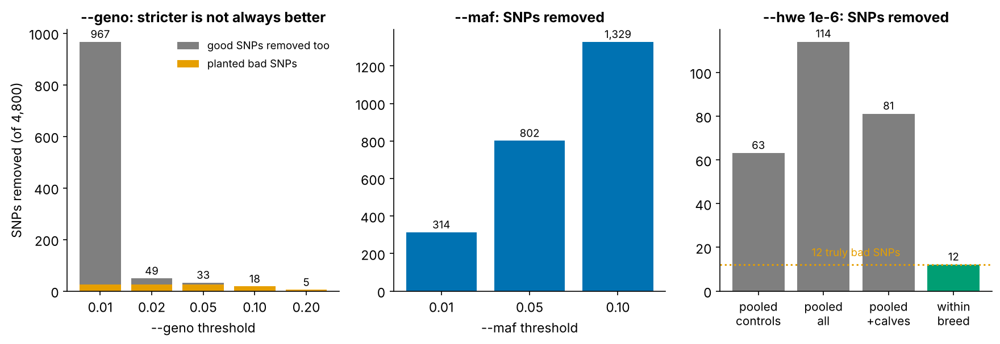
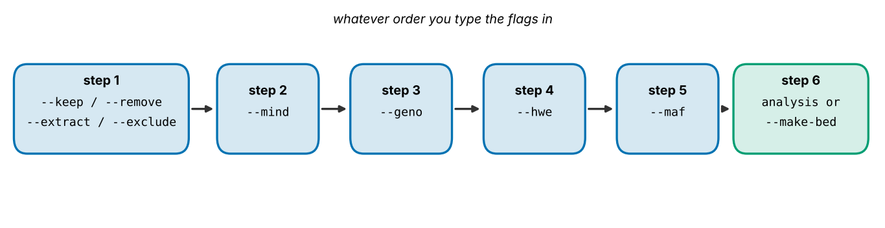

# How each setting changes your results {#sec-params}

::: {.lead}
Every filter is a trade-off. Too strict and you throw away good data; too loose and errors stay in. Each experiment below was run on the raw cattle file (361 animals, 4,800 SNPs), changing one setting at a time, so you can see exactly what each knob does.
:::

{#fig-params}

## The inclusion and exclusion flags

A filter removes SNPs or animals that fail a rule. Filters run **before** the analysis in the same command, and `--make-bed` saves what is left.

| Flag | Removes | PLINK 1.9 default value | Typical livestock choice |
|---|---|---|---|
| `--geno x` | SNPs with missing rate above x | 0.1 | 0.05 (0.02 for high-quality arrays) |
| `--mind x` | Animals with missing rate above x | 0.1 | 0.05 to 0.1 |
| `--maf x` | SNPs with minor allele frequency below x | 0.01 | 0.01 to 0.05 |
| `--mac n` | SNPs with fewer than n copies of the minor allele | | useful for small samples |
| `--hwe p` | SNPs with HWE p below p (controls and founders only) | 0.001 | 10⁻⁶, within each breed |
| `--me f v` | Families with Mendel error rate above f, SNPs above v | | 0.05 0.1 |
| `--chr`, `--autosome`, `--not-chr` | SNPs by chromosome | | `--autosome` for PCA, IBD, ROH, epistasis |
| `--extract` / `--exclude` | Listed SNPs (keep / drop) | | |
| `--keep` / `--remove` | Listed animals (keep / drop) | | |
| `--filter-founders`, `--filter-females`, ... | Animals by status | | |
| `--prune` | Animals with a missing phenotype | | |

"Default value" means the value PLINK uses if you type the flag without a number. **No filter is on unless you ask for it**, so always write the threshold out in full; then your methods section is exact.

## `--geno`: SNP missingness

| Threshold | SNPs removed | Of which truly bad (25 planted) |
|---|---|---|
| 0.01 | 967 | 25 |
| 0.02 | 49 | 25 |
| 0.05 | 33 | 25 |
| 0.10 | 18 | 18 |
| 0.20 | 5 | 5 |

At 0.01, PLINK threw away 967 SNPs but only 25 were truly bad. A single animal with 25% missing data pushes many good SNPs just over 1%. That is why you remove bad animals first.

## `--mind`: animal missingness

| Threshold | Animals removed |
|---|---|
| 0.01, 0.02 or 0.05 | 6 (exactly the 6 poor-DNA samples) |
| 0.10 | 4 |
| 0.20 | 1 |

There was a clear gap between bad animals (6.8% to 24.6% missing) and good ones (below 0.8%), so any threshold from 0.01 to 0.05 gave the same answer. Look for that gap in `.imiss` before you choose.

## The order of filters

| Procedure | Animals removed | SNPs removed |
|---|---|---|
| `--geno 0.01` first, then `--mind 0.03` | 6 | 967 |
| `--mind 0.03` first, then `--geno 0.01` | 6 | 297 |
| One command: `--geno 0.01 --mind 0.03` | 6 | 297 |

Removing bad animals first saved 670 good SNPs. Inside one command, PLINK 1.9 always applies its filters in this order, whatever order you type them in:

{#fig-filter-order}

You can see this order in any log. Here the flags are typed in the reverse order:

```bash
plink --bfile cattle --cow --maf 0.01 --hwe 1e-6 --geno 0.05 --mind 0.05 --make-bed --out order_demo
```

```text
6 cattle removed due to missing genotype data (--mind).
33 variants removed due to missing genotype data (--geno).
--hwe: 59 variants removed due to Hardy-Weinberg exact test.
309 variants removed due to minor allele threshold(s)
4399 variants and 355 cattle pass filters and QC.
```

The log lines come out as `--mind`, `--geno`, `--hwe`, `--maf`, whatever the order on the command line, and each filter sees only what the previous one left. That is why `--hwe` removed 59 SNPs here but 63 when run alone on the raw file: six samples and 33 SNPs were already gone before it ran.

When in doubt, run each filter as a separate step and report the order (Chapter 6 shows the two-round scheme).

## `--maf`: rare variants

| Threshold | SNPs removed |
|---|---|
| 0.01 | 314 |
| 0.05 | 802 |
| 0.10 | 1,329 |
| 0.01 with `--nonfounders` | 330 |

Rare SNPs have little power and give unstable estimates (the OR = inf in Chapter 12). In multi-breed data a SNP rare overall can be common within one breed, so for breed-specific work (selection signatures, F_ROH) filter within each breed. MAF uses founders only unless you add `--nonfounders`.

A missing MAF filter can silently break other analyses: `--pca` on the unfiltered file returned all-zero PCs with a warning to apply a MAF filter. With `--maf 0.01` the eigenvalues were 37.5 and 20.0, and the PCs matched the LD-pruned ones almost exactly (correlation 0.9997).

## `--hwe`: the Hardy-Weinberg filter

| Setting | p < 10⁻³ | p < 10⁻⁶ | p < 10⁻¹⁰ |
|---|---|---|---|
| `--hwe p` (controls and founders only) | 262 | 63 | 19 |
| `--hwe p include-nonctrl` (all animals) | 461 | 114 | 40 |
| `--hwe 1e-6 --nonfounders` | | 81 | |
| `--hwe 1e-6 midp` | | 66 | |
| Within each breed separately (Chapter 7) | | 12 (all 12 planted) | |

Three lessons. PLINK 1.9 tests controls only, so a real disease SNP is not thrown away because it is out of HWE in cases. Adding relatives breaks the independence the test assumes. And in multi-breed data even the controls-only filter removed 63 SNPs when only 12 were bad, because of the Wahlund effect. **Run HWE within breed and remove the failures with `--exclude`.**

## Sex and chromosome options

| Command | Cases / controls used | snp00706 χ², p |
|---|---|---|
| `--assoc` | 142 / 217 (2 phenotypes ignored) | 35.19, 3.0 × 10⁻⁹ |
| `--assoc --allow-no-sex` | 144 / 217 | 32.82, 1.0 × 10⁻⁸ |

In PLINK 1.9, animals with sex code 0 keep their genotypes but their phenotypes are ignored, unless you add `--allow-no-sex`. Here both such animals were cases, so the result changed. Either fix the sexes (`--update-sex` after `--check-sex`) or use `--allow-no-sex` knowingly. `--autosome` keeps chromosomes 1 to 29 (with `--cow`) and drops X, Y and MT.

## `--nonfounders`: who counts in frequencies

| SNP | MAF, founders only (NCHROBS) | MAF, all animals (NCHROBS) |
|---|---|---|
| snp00001 | 0.0249 (602) | 0.0292 (720) |
| snp00002 | 0.0417 (600) | 0.0419 (716) |

The difference is small here. In a nucleus herd where a few sires have hundreds of daughters, counting the daughters would let those sires' alleles dominate. The default (founders only) is right for `--freq`, `--hardy` and the filters; association tests use everyone.

## `--make-bed` and allele order

`--make-bed` writes binary files (0.44 MB for our data) and is what you should save after every QC step. A trap: `--make-bed` with no filters still re-codes A1 as the minor allele (unless `--keep-allele-order`), so a file you "just copied" can have A1 and A2 swapped compared with the original.

## PCA settings

| Setting | First three eigenvalues |
|---|---|
| All SNPs, no MAF filter | 0, 0, 0 (failed) |
| `--maf 0.01` | 37.5, 20.0, 3.0 |
| LD-pruned SNPs | 32.9, 19.1, 2.9 |
| LD-pruned SNPs, founders only | 26.0, 17.5, 2.0 |

## Clustering settings

| Setting | Number of clusters |
|---|---|
| `--cluster` with no limit | 1 (merges until everything is one group) |
| `--cluster --K 3` | 3 (the three breeds) |
| `--cluster --mc 200` / `100` / `50` | 3 / 5 / 9 |
| `--cluster --K 3 --ppc 1e-10` / `1e-6` / `1e-4` / `0.01` | 4 / 4 / 7 / 21 |

`--mc` sets the maximum cluster size. `--ppc` forbids merging two animals that fail the pairwise population concordance test: the higher the p threshold, the more pairs fail and the more clusters you get, even when you ask for 3.

## Relatedness settings

| Setting | Pairs written | Pairs with PI_HAT > 0.2 |
|---|---|---|
| `--genome` on LD-pruned SNPs | 64,980 (all) | 851 |
| `--genome` on all SNPs | 64,980 | 1,138 |
| `--genome --min 0.2` | 851 | |
| `--genome --min 0.9` | 1 (the duplicate) | |

LD inflates IBD estimates: without pruning, 287 more pairs looked related.

## LD settings

| `--r2` setting | Lines written |
|---|---|
| Defaults (window 10 SNPs, 1,000 kb, r² ≥ 0.2) | 1,217 |
| `--ld-window-r2 0` (every pair in the window) | 10,390 |
| `--ld-window 99999 --ld-window-kb 5000` | 1,331 |

| `--indep-pairwise` setting | SNPs kept (of 4,550 autosomal) |
|---|---|
| `50 5 0.1` | 2,409 |
| `50 5 0.2` | 3,581 |
| `50 5 0.5` | 4,405 |
| `50 5 0.8` | 4,471 |
| `10 1 0.2` (small window) | 3,625 |
| `200 20 0.2` (large window) | 3,539 |
| `500kb 1 0.2` (window in kb) | 3,704 |

The r² threshold matters most and the window size much less. For 50K or HD cattle chips, `50 5 0.2` is common for PCA, and `200 10 0.1` or stricter for ADMIXTURE.

## A checklist for choosing thresholds

1. **Look before you cut.** Run `--missing`, `--freq`, `--hardy` (within breed), `--het`, `--check-sex` and `--genome`, and plot the distributions.
2. **Animals before SNPs.** Remove bad animals first, then filter SNPs, then check animals again.
3. **Use the gaps in your own data**, not only textbook numbers.
4. **Work within breed** for HWE, MAF, heterozygosity and sex checks in multi-breed or crossbred data.
5. **Write down the exact commands.** The `.log` file is your record.
