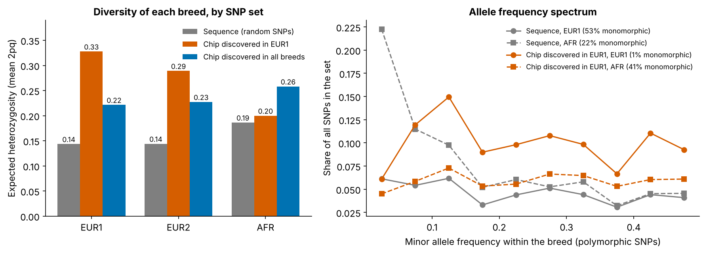

# Real data: cattle and sheep {#sec-real}

::: {.lead}
Simulated data teach the logic because we know the answers. Real data teach judgement, because we don't. This chapter runs the same checks on two public datasets and shows what "normal" looks like in a real livestock population.
:::

## The two datasets

| | Real cattle | Real sheep |
|---|---|---|
| Animals | 500 bulls, plus a pedigree of 1,929 animals | 100: 64 Jacob, 36 Navajo-Churro |
| SNPs | 7,250 on the 29 autosomes | 4,841 on chromosomes 2 and 24 |
| Source | `synbreedData` R package (GPL-2) | Kijas and colleagues (2016), shipped with `detectRUNS` (GPL-3) |
| Species flag | `--cow` | `--sheep` |

Both are in the `data/real/` folder of the repository: the cattle as PLINK binary files (`cattle_real.bed/.bim/.fam`, converted with `scripts/convert_real_data.py`) and the sheep as the original `.ped`/`.map` files from `detectRUNS`.

```bash
plink --file Kijas2016_Sheep_subset --sheep --make-bed --out sheep
```

## Step 1: quality control

```bash
plink --bfile cattle_real --cow --missing --out c_miss
plink --bfile cattle_real --cow --geno 0.05 --mind 0.05 --maf 0.01 --hwe 1e-6 --make-bed --out cattle_real_qc
plink --bfile sheep --sheep --geno 0.05 --mind 0.05 --maf 0.01 --make-bed --out sheep_qc
```

| Check | Real cattle | Real sheep |
|---|---|---|
| Overall genotyping rate | 99.72% | 99.79% |
| Worst animal | 0.5% missing | 2.0% missing |
| SNPs above 5% missing | 0 | 28 (worst 8.0%) |
| SNPs with MAF below 0.01 | 25 | 127 |
| SNPs with HWE p < 10⁻⁶ | 0 | not tested (two breeds) |
| Animals removed | 0 | 0 |
| SNPs left | 7,211 | 4,686 |

These are clean, published datasets, so QC removes little. That is normal. Real chip data from a good lab often look like this, and the hard cases are the few animals and SNPs at the edges. Two habits are worth noticing:

- In the cattle (one population) we could run the HWE filter on everyone and it removed 14 SNPs.
- In the sheep we skipped the pooled HWE filter, because the two breeds differ in allele frequencies (Wahlund effect, Chapter 7). To filter on HWE, run `--hardy` within each breed with `--keep`.

## Step 2: heterozygosity, PCA and ROH in the cattle

```bash
plink --bfile cattle_real_qc --cow --indep-pairwise 50 5 0.2 --out c_prune     # 2,984 of 7,211 SNPs kept
plink --bfile cattle_real_qc --cow --extract c_prune.prune.in --het --out c_het
plink --bfile cattle_real_qc --cow --extract c_prune.prune.in --pca 10 header tabs --out c_pca
plink --bfile cattle_real_qc --cow --homozyg --homozyg-density 1000 --homozyg-gap 3000 \
      --homozyg-snp 30 --homozyg-kb 2000 --homozyg-window-snp 30 --out c_roh
```

{#fig-real-cattle}

What the three panels say:

- **Heterozygosity.** F averages 0.001 (SD 0.049), as expected when F is measured against the population's own allele frequencies. Six bulls lie above +3 SD (F = 0.15 to 0.19). None lies below −3 SD, so there is no sign of contaminated samples. High F in a real herd usually means real inbreeding, not a lab error: these bulls should be checked, not removed.
- **PCA.** PC1 and PC2 explain only 1.7% and 1.4% of the variation (eigenvalue divided by the GRM trace, 501.4; Chapter 11). Compare 8.6% in the simulated three-breed data. There are no separate clouds: this is one breed. The fan shape is typical of a population in which some groups of animals are more closely related than others. With no breed structure, the first PCs often pick up families, so in a GWAS of these bulls a mixed model with the GRM (GCTA, or `plink2 --glm` with PCs plus a relatedness check) would be safer than PCs alone.
- **ROH.** All 500 bulls carry runs of at least 2 Mb, 4,346 runs in total. F_ROH averages 0.079 (maximum 0.258). The SNPs here cover about 1,048 Mb, so F_ROH is the share of that covered length. The three bulls with the most ROH (ID11528, ID11530, ID11593) are also among the six with the highest F, and across all bulls F and total ROH length correlate at 0.83: two different measures tell the same story.

## Step 3: relationships in the cattle

```bash
plink --bfile cattle_real_qc --cow --extract c_prune.prune.in --genome --out c_ibd
plink --bfile cattle_real_qc --cow --make-rel square --out c_grm
```

Of 124,750 pairs, none had PI_HAT above 0.9 (no duplicate samples), 4 had PI_HAT above 0.4 (the highest was 0.49, a pair with Z0 = 0.23, Z1 = 0.56, Z2 = 0.21, the pattern of full sibs) and 917 had PI_HAT above 0.2. A population of bulls from one breed is full of half sibs and cousins, which is why so many pairs pass 0.2.

Chapter 10 compared the GRM with the pedigree for these bulls (@fig-grm-ped): on average they match well (half sibs 0.237 against an expected 0.25), and the spread around each pedigree value is real variation in how much DNA relatives share.

## Step 4: breed differences in the sheep

```bash
plink --bfile sheep_qc --sheep --indep-pairwise 50 5 0.2 --out s_prune         # 843 of 4,686 SNPs kept
plink --bfile sheep_qc --sheep --extract s_prune.prune.in --pca 10 header tabs --out s_pca
plink --bfile sheep_qc --sheep --fst --within sheep_breed.clst --out s_fst
```

{#fig-sheep-pca}

PC1 explains 9.7% of the variation and splits the two breeds cleanly; PC2 (4.8%) and PC3 (4.3%) describe spread within breeds. **F~ST~** measures how much of the genetic variation lies between the breeds rather than within them:

$$
F_{ST} = \frac{\text{variance of allele frequency between breeds}}{\text{total variance}}
$$

PLINK computes the Weir and Cockerham estimator for every SNP. The log reports a mean F~ST~ of 0.142 and a weighted F~ST~ of 0.168: about 15% of the variation separates Jacob from Navajo-Churro. For comparison, F~ST~ between European cattle breeds is often around 0.05 to 0.15. Single SNPs with very high F~ST~ are candidates for selection signatures, which is a whole topic of its own.

ROH tell a breed story too (@fig-froh): Jacob sheep carry on average 52.9 Mb of ROH on the two chromosomes (F_ROH about 0.18 of the 291 Mb covered), against 27.0 Mb (about 0.09) in Navajo-Churro.

## Step 5: LD in real populations

```bash
plink --bfile cattle_real_qc --cow --r2 --ld-window-kb 5000 --ld-window 99999 --ld-window-r2 0 --out c_ld
```

| Distance between SNPs | Real cattle, mean r² | Real sheep, mean r² |
|---|---|---|
| below 100 kb | 0.188 | 0.168 |
| 100 to 500 kb | 0.088 | 0.096 |
| 0.5 to 1 Mb | 0.066 | 0.084 |
| 1 to 2 Mb | 0.054 | 0.074 |
| 2 to 5 Mb | 0.039 | 0.062 |

LD in both species stays above background over several megabases (@fig-ld-decay). That is typical of livestock: breeds were founded from few animals and selected hard, so their effective population size is small and long haplotypes survive. In practice it means a 50K chip tags most of the genome in a single breed, but LD-based results (pruning, clumping, imputation) must be redone for each breed.

## Ascertainment bias: the chip decides part of the answer

Every SNP chip is a selection. Its makers first found SNPs by sequencing a few animals (the *discovery panel*), then kept the SNPs that were common in those animals. That choice, called **SNP ascertainment**, shapes every statistic you compute from the chip. Breeds like the discovery animals look diverse; breeds that were not in the panel carry many chip SNPs that do not vary in them at all, and look less diverse than they are. For cattle this is well documented: the Bovine HapMap study found that African and Indian cattle had higher heterozygosity than European cattle in sequence data, but lower heterozygosity on SNP arrays, whose SNPs had mostly been found in taurine cattle (The Bovine HapMap Consortium, 2009). This matters directly for work on African breeds such as N'Dama, Sanga or zebu.

### A simulation where we know the truth

`scripts/simulate_ascertainment.py` simulates three breeds with msprime: two European-type breeds, EUR1 and EUR2, that split 40 generations ago, and an African-type breed, AFR, with a larger effective population size and therefore **more** diversity. From the same 150 study animals (50 per breed) it builds three SNP sets on five 20 Mb chromosomes:

| SNP set | How the SNPs were chosen | SNPs |
|---|---|---|
| `seq` | A random sample of all SNPs that vary in the 150 animals, as from sequencing | 3,692 |
| `chipEUR` | MAF ≥ 0.05 in a discovery panel of 10 extra EUR1 animals, about one per 25 kb (like a chip designed in one breed) | 3,692 |
| `chipALL` | MAF ≥ 0.05 in a discovery panel with 10 animals of each breed, same density, thinned to the same number | 3,692 |

Then every set went through the same PLINK commands (`scripts/ascertainment_pipeline.sh`):

```bash
plink --bfile chipEUR --cow --freq --within breeds.clst --out f_chipEUR     # allele frequency per breed
plink --bfile chipEUR --cow --het --out h_chipEUR                           # observed heterozygosity per animal
plink --bfile chipEUR --cow --keep EUR1_AFR.txt --fst --within breeds.clst --out fst_chipEUR
plink --bfile chipEUR --cow --homozyg --homozyg-snp 40 --homozyg-kb 1000 --homozyg-density 100 \
      --homozyg-gap 1000 --homozyg-window-snp 40 --out roh_chipEUR
```

{#fig-ascertainment}

### How it shows up in PLINK output

| Statistic (PLINK command) | Breed | Sequence (truth) | Chip found in EUR1 | Chip found in all breeds |
|---|---|---|---|---|
| SNPs monomorphic in the breed (`--freq --within`) | EUR1 | 53.5% | **0.6%** | 31.9% |
| | AFR | 21.9% | **40.9%** | 24.5% |
| Expected heterozygosity, mean 2pq (`--freq --within`) | EUR1 | 0.143 | 0.328 | 0.221 |
| | EUR2 | 0.144 | 0.289 | 0.227 |
| | AFR | **0.186** | **0.200** | **0.258** |
| Observed heterozygosity (`--het`) | EUR1 / AFR | 0.140 / 0.190 | 0.321 / 0.205 | 0.216 / 0.264 |
| F<sub>ST</sub> EUR1 vs AFR (`--fst`) | | 0.313 | 0.285 | 0.321 |
| F<sub>ST</sub> EUR1 vs EUR2 (`--fst`) | | 0.120 | 0.118 | 0.128 |
| F<sub>ROH</sub>, runs ≥ 1 Mb (`--homozyg`) | EUR1 / AFR | 0.257 / 0.055 | 0.174 / 0.049 | 0.196 / 0.027 |
| Variance on PC1 / PC2 (`--pca`) | | 21.5% / 4.8% | 19.0% / 7.8% | 24.7% / 6.0% |

The signs to look for in your own output:

1. **`--freq --within` shows many SNPs with frequency 0 or 1 in one breed only.** On the EUR1-designed chip, 41% of SNPs did not vary at all in AFR, against 0.6% in EUR1. When one breed has far more monomorphic chip SNPs than the others, suspect that it was missing from the discovery panel.
2. **The ranking of breeds by heterozygosity can turn upside down.** The truth is that AFR is the most diverse breed (0.186 against 0.143). On the EUR1 chip, AFR came out the *least* diverse (0.200 against 0.328 for EUR1). The multi-breed chip put the breeds back in the right order.
3. **The allele frequency spectrum is flat instead of falling.** In sequence data most variants are rare (the grey AFR line falls steeply from the left). On the chip, rare variants are almost absent in the discovery breed, because the panel only kept common SNPs. Any statistic that depends on rare variants (Tajima's D, some selection scans, demographic inference) is distorted.
4. **Absolute values cannot be compared across SNP sets.** Every chip gives far higher heterozygosity than sequence (0.33 against 0.14 in EUR1), simply because it selected variable SNPs. Never compare a heterozygosity from a 50K chip with one from sequence, from another chip, or from another study's SNP set.
5. **F<sub>ST</sub> between the discovery breed and an outside breed is underestimated** (0.285 against 0.313), as reported for cattle when SNPs are chosen from some groups only (McTavish and Hillis, 2015). Between two breeds that are both close to the discovery panel, F<sub>ST</sub> was hardly affected.
6. **Runs of homozygosity change with the SNP set.** A SNP that does not vary in a breed always looks homozygous, so it helps a run continue. AFR's F<sub>ROH</sub> was 0.049 on the EUR1 chip but 0.027 on the multi-breed chip, while EUR1's moved the other way (0.174 against 0.196). Compare F<sub>ROH</sub> only between animals typed on the same chip, and be careful comparing breeds that differ in how well the chip suits them.
7. **PCA is the most robust.** The breeds separated in the same way on all three SNP sets, though the split of variance between PC1 and PC2 shifted. Malomane and colleagues (2018) found the same in chickens, comparing arrays with sequence.

### Limiting the damage

| Strategy | What it does | In our simulation |
|---|---|---|
| **Know your chip's discovery panel** | Read the chip paper. For the BovineSNP50 chip, SNPs were found mainly in taurine breeds (Matukumalli and colleagues, 2009); African Sanga breeds were not in the discovery process | |
| **Use a chip discovered in all the breeds you compare, or sequence** | Removes the cause | Correct ranking of breeds, F<sub>ST</sub> 0.321 against 0.313 |
| **LD pruning before diversity statistics** | Removes the dense clusters of SNPs the panel favoured; the best of several filtering strategies tested by Malomane and colleagues (2018) | Narrowed the gap (AFR 0.291, EUR1 0.323) but did not restore the right order, and lowered F<sub>ST</sub> (0.160 against 0.313), as they also reported |
| **Compare within the same SNP set only** | Use chip results for relative comparisons (animals, herds, generations of one breed), not as absolute diversity | |
| **Filter monomorphic SNPs per breed before per-breed analyses** | `--maf` within each breed (Chapter 7), so each breed is described by SNPs that vary in it; report how many were removed per breed | |
| **Model the ascertainment** | Methods that correct the frequency spectrum when the discovery process is known (Nielsen and colleagues, 2004; reviewed by Lachance and Tishkoff, 2013) | |
| **Report it** | Name the chip, its discovery breeds and your SNP filters, so readers can judge how far the comparison is fair | |

The short version: a SNP chip is a good tool for questions *within* the breeds it was designed for, and a biased one for comparing diversity *between* breeds, especially when some of them, like many African breeds, were not in the discovery panel. LD pruning helps a little; sequence data, or a chip discovered across all the breeds you study, help most.

## What real data taught us

| Lesson | Where it showed up |
|---|---|
| Good data still need checking, but QC may remove almost nothing | Step 1 |
| High F in a real herd is usually real inbreeding | Step 2, six bulls; confirmed by ROH |
| Within one breed, PCs explain little and families dominate | Step 2 |
| Many related pairs are normal in a breed | Step 3 |
| Multi-breed data need per-breed HWE, and F~ST~ measures breed separation | Steps 1 and 4 |
| LD extends far in livestock, and differs between breeds | Step 5 |
| A chip designed in other breeds can reverse the diversity ranking of breeds | Ascertainment bias |

## Exercises

Try each question first, then open the answer. The challenge goes a step further than the chapter.

**1.** After QC, how many sheep of each breed remain, and how many SNPs are polymorphic within each breed?

::: {.callout-note collapse="true" title="Answer"}
64 Jacob and 36 Navajo-Churro. Within breeds, 4,336 of the 4,686 SNPs vary in Jacob and 4,612 in Navajo-Churro (`--keep` one breed, then any MAF filter above 0). The Jacob sample is larger yet has fewer polymorphic SNPs, a first sign of lower diversity.
:::

**2.** Compute the mean F from `--het` for each sheep breed.

::: {.callout-note collapse="true" title="Answer"}
Jacob 0.104 and Navajo-Churro −0.021. Jacob sheep are more homozygous, which fits a small, closed breed. Navajo-Churro animals are close to Hardy-Weinberg expectation.
:::

**Challenge.** Compute F_ST between the two sheep breeds with `--fst --within`. How does the weighted F_ST compare with the mean F_ST, and which would you report?

::: {.callout-note collapse="true" title="Answer"}
```bash
awk '{print $1, $2, $1}' sheep_qc.fam > sb.clst
plink --bfile sheep_qc --sheep --within sb.clst --fst --out sfst
```
Mean F_ST = 0.142 and weighted F_ST = 0.168. The weighted estimate (Weir and Cockerham's ratio of averages) gives more weight to informative SNPs and is the one usually reported. Remember the ascertainment section: on this chip, the value is comparable only with values from the same SNP set.
:::
