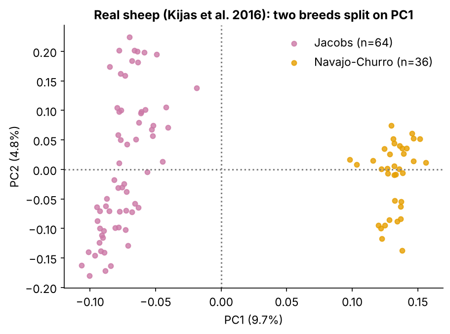

# Real data: cattle and sheep {#sec-real}

::: {.lead}
Simulated data teach the logic because we know the answers. Real data teach judgement, because we don't. This chapter runs the same checks on two public datasets and shows what "normal" looks like in a real livestock population.
:::

## The two datasets

| | Real cattle | Real sheep |
|---|---|---|
| Animals | 500 bulls, plus a pedigree of 1,929 animals | 100: 64 Jacob, 36 Navajo-Churro |
| SNPs | 7,250 on the 29 autosomes | 4,841 on chromosomes 2 and 24 |
| Source | `synbreedData` R package (GPL-2) | Kijas and colleagues (2016), shipped with `detectRUNS` (GPL-3) |
| Species flag | `--cow` | `--sheep` |

Both are in the `data/real/` folder of the repository: the cattle as PLINK binary files (`cattle_real.bed/.bim/.fam`, converted with `scripts/convert_real_data.py`) and the sheep as the original `.ped`/`.map` files from `detectRUNS`.

```bash
plink --file Kijas2016_Sheep_subset --sheep --make-bed --out sheep
```

## Step 1: quality control

```bash
plink --bfile cattle_real --cow --missing --out c_miss
plink --bfile cattle_real --cow --geno 0.05 --mind 0.05 --maf 0.01 --hwe 1e-6 --make-bed --out cattle_real_qc
plink --bfile sheep --sheep --geno 0.05 --mind 0.05 --maf 0.01 --make-bed --out sheep_qc
```

| Check | Real cattle | Real sheep |
|---|---|---|
| Overall genotyping rate | 99.72% | 99.79% |
| Worst animal | 0.5% missing | 2.0% missing |
| SNPs above 5% missing | 0 | 28 (worst 8.0%) |
| SNPs with MAF below 0.01 | 25 | 127 |
| SNPs with HWE p < 10⁻⁶ | 0 | not tested (two breeds) |
| Animals removed | 0 | 0 |
| SNPs left | 7,211 | 4,686 |

These are clean, published datasets, so QC removes little. That is normal. Real chip data from a good lab often look like this, and the hard cases are the few animals and SNPs at the edges. Two habits are worth noticing:

- In the cattle (one population) we could run the HWE filter on everyone and it removed 14 SNPs.
- In the sheep we skipped the pooled HWE filter, because the two breeds differ in allele frequencies (Wahlund effect, Chapter 7). To filter on HWE, run `--hardy` within each breed with `--keep`.

## Step 2: heterozygosity, PCA and ROH in the cattle

```bash
plink --bfile cattle_real_qc --cow --indep-pairwise 50 5 0.2 --out c_prune     # 2,984 of 7,211 SNPs kept
plink --bfile cattle_real_qc --cow --extract c_prune.prune.in --het --out c_het
plink --bfile cattle_real_qc --cow --extract c_prune.prune.in --pca 10 header tabs --out c_pca
plink --bfile cattle_real_qc --cow --homozyg --homozyg-density 1000 --homozyg-gap 3000 \
      --homozyg-snp 30 --homozyg-kb 2000 --homozyg-window-snp 30 --out c_roh
```

{#fig-real-cattle}

What the three panels say:

- **Heterozygosity.** F averages 0.001 (SD 0.049), as expected when F is measured against the population's own allele frequencies. Six bulls lie above +3 SD (F = 0.15 to 0.19). None lies below −3 SD, so there is no sign of contaminated samples. High F in a real herd usually means real inbreeding, not a lab error: these bulls should be checked, not removed.
- **PCA.** PC1 and PC2 explain only 1.7% and 1.4% of the variation (eigenvalue divided by the GRM trace, 501.4; Chapter 11). Compare 8.6% in the simulated three-breed data. There are no separate clouds: this is one breed. The fan shape is typical of a population in which some groups of animals are more closely related than others. With no breed structure, the first PCs often pick up families, so in a GWAS of these bulls a mixed model with the GRM (GCTA, or `plink2 --glm` with PCs plus a relatedness check) would be safer than PCs alone.
- **ROH.** All 500 bulls carry runs of at least 2 Mb, 4,346 runs in total. F_ROH averages 0.079 (maximum 0.258). The SNPs here cover about 1,048 Mb, so F_ROH is the share of that covered length. The three bulls with the most ROH (ID11528, ID11530, ID11593) are also among the six with the highest F, and across all bulls F and total ROH length correlate at 0.83: two different measures tell the same story.

## Step 3: relationships in the cattle

```bash
plink --bfile cattle_real_qc --cow --extract c_prune.prune.in --genome --out c_ibd
plink --bfile cattle_real_qc --cow --make-rel square --out c_grm
```

Of 124,750 pairs, none had PI_HAT above 0.9 (no duplicate samples), 4 had PI_HAT above 0.4 (the highest was 0.49, a pair with Z0 = 0.23, Z1 = 0.56, Z2 = 0.21, the pattern of full sibs) and 917 had PI_HAT above 0.2. A population of bulls from one breed is full of half sibs and cousins, which is why so many pairs pass 0.2.

Chapter 10 compared the GRM with the pedigree for these bulls (@fig-grm-ped): on average they match well (half sibs 0.237 against an expected 0.25), and the spread around each pedigree value is real variation in how much DNA relatives share.

## Step 4: breed differences in the sheep

```bash
plink --bfile sheep_qc --sheep --indep-pairwise 50 5 0.2 --out s_prune         # 843 of 4,686 SNPs kept
plink --bfile sheep_qc --sheep --extract s_prune.prune.in --pca 10 header tabs --out s_pca
plink --bfile sheep_qc --sheep --fst --within sheep_breed.clst --out s_fst
```

{#fig-sheep-pca}

PC1 explains 9.7% of the variation and splits the two breeds cleanly; PC2 (4.8%) and PC3 (4.3%) describe spread within breeds. **F~ST~** measures how much of the genetic variation lies between the breeds rather than within them:

$$
F_{ST} = \frac{\text{variance of allele frequency between breeds}}{\text{total variance}}
$$

PLINK computes the Weir and Cockerham estimator for every SNP. The log reports a mean F~ST~ of 0.142 and a weighted F~ST~ of 0.168: about 15% of the variation separates Jacob from Navajo-Churro. For comparison, F~ST~ between European cattle breeds is often around 0.05 to 0.15. Single SNPs with very high F~ST~ are candidates for selection signatures, which is a whole topic of its own.

ROH tell a breed story too (@fig-froh): Jacob sheep carry on average 52.9 Mb of ROH on the two chromosomes (F_ROH about 0.18 of the 291 Mb covered), against 27.0 Mb (about 0.09) in Navajo-Churro.

## Step 5: LD in real populations

```bash
plink --bfile cattle_real_qc --cow --r2 --ld-window-kb 5000 --ld-window 99999 --ld-window-r2 0 --out c_ld
```

| Distance between SNPs | Real cattle, mean r² | Real sheep, mean r² |
|---|---|---|
| below 100 kb | 0.188 | 0.168 |
| 100 to 500 kb | 0.088 | 0.096 |
| 0.5 to 1 Mb | 0.066 | 0.084 |
| 1 to 2 Mb | 0.054 | 0.074 |
| 2 to 5 Mb | 0.039 | 0.062 |

LD in both species stays above background over several megabases (@fig-ld-decay). That is typical of livestock: breeds were founded from few animals and selected hard, so their effective population size is small and long haplotypes survive. In practice it means a 50K chip tags most of the genome in a single breed, but LD-based results (pruning, clumping, imputation) must be redone for each breed.

## What real data taught us

| Lesson | Where it showed up |
|---|---|
| Good data still need checking, but QC may remove almost nothing | Step 1 |
| High F in a real herd is usually real inbreeding | Step 2, six bulls; confirmed by ROH |
| Within one breed, PCs explain little and families dominate | Step 2 |
| Many related pairs are normal in a breed | Step 3 |
| Multi-breed data need per-breed HWE, and F~ST~ measures breed separation | Steps 1 and 4 |
| LD extends far in livestock, and differs between breeds | Step 5 |
